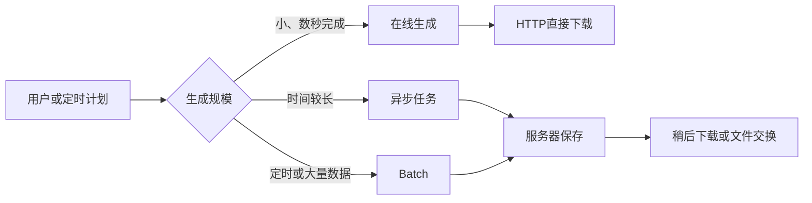

# 第1章 账票基础：认识日本项目中的文件输出

## 本章定位

本章先建立账票处理的全貌。重点是理解“为什么输出、输出什么、怎样交付”，不要求编写 Spring Boot 程序。

| 等级 | 本章要求 |
| --- | --- |
| A：必须理解 | 账票的业务意义；CSV、Excel、PDF；有模板与无模板；在线与 Batch |
| B：能看懂 | 常见技术组合与完整处理流程 |
| C：认识即可 | SVF、JasperReports、COBOL 既存系统等项目形态 |

## 学习目标

学完后，你能够：

- 解释账票（帳票）与画面查询、普通导出的区别；
- 列举日本项目中常见的账票和利用场景；
- 区分 CSV、Excel、PDF，以及有模板和无模板；
- 说明在线、异步任务、Batch、文件保存和下载之间的关系；
- 根据简单业务要求判断适合的生成方式。

## 真实业务背景

日本项目中的“帳票出力”不只表示打印纸张，也包括下载 Excel、夜间生成 CSV、保存 PDF 凭证等处理。账票通常承担确认、审批、对账、归档或系统间交换责任。

| 业务部门 | 日语项目表达 | 使用场景 |
| --- | --- | --- |
| 人事 | 従業員一覧表 | 按部门确认在籍员工 |
| 财务 | 請求書 | 向客户请求付款并留存凭证 |
| 销售 | 売上一覧表、売上日報 | 核对销售记录和合计 |
| 仓库 | 在庫一覧表 | 盘点、补货、确认差异 |
| 系统间联携 | CSV連携ファイル | 定时把数据交给其他系统 |

文件“能打开”不代表账票正确。项目还会检查对象期间、数据截止时点、排序、合计、零件数、权限、文件名、保存期限和打印结果。

## 1. 什么是账票

账票是按照确定的业务规则、版式和交付方式生成的正式业务输出。日语规格中常见：

- **帳票（ちょうひょう）**：账票、报表或业务凭证。
- **出力条件**：申请账票时输入的条件。
- **抽出条件**：从数据库选取记录的规则。
- **帳票レイアウト**：标题、列、明细、合计和打印版式。
- **項目マッピング**：数据库字段与账票位置的对应关系。
- **明細**：逐条输出的业务记录。
- **件数**：明细记录数量；没有记录称为零件数。

### 账票与普通查询的区别

| 比较点 | 画面查询 | 正式账票 |
| --- | --- | --- |
| 数据范围 | 可能只显示当前分页 | 按规格输出完整范围 |
| 排序 | 用户临时选择 | 设计书固定，并要求结果稳定 |
| 版式 | 适合浏览器操作 | 适合交付、打印或再加工 |
| 时间 | 当前查询结果 | 明确基准日、对象期间或截止点 |
| 审计 | 通常记录访问 | 常需记录申请人、版本和结果 |

例如，员工画面每页显示 20 条。従業員一覧表若要求“全部在籍员工”，就不能只把当前页面保存为 Excel。

## 2. 常见文件格式

### CSV

CSV（Comma-Separated Values，逗号分隔值）是文本文件。它适合大量数据和系统间交换，但不能保存字体、边框、合并单元格或打印设置。

### Excel

Excel 的 `.xlsx` 可以保存单元格类型、样式、公式、多个工作表和打印设置。业务人员可以查看和再加工，是日本企业项目中常见的账票格式。

### PDF

PDF 适合固定版式、打印、签章和归档。它需要额外确认字体嵌入、日文字符、分页和打印样张。PDF 不是“更高级的 Excel”，用途不同。

| 需求 | 推荐格式 |
| --- | --- |
| 系统交换、数据量大 | CSV |
| 业务人员查看、筛选、再加工 | Excel |
| 固定打印、对外凭证、归档 | PDF |

## 3. 有模板与无模板

### 无模板账票

程序从空白工作簿开始创建 Sheet、Row 和 Cell。版式简单、列固定的一览表常使用这种方式。

**主案例：従業員一覧表**

```text
従業員一覧表
条件：状态=ACTIVE

| 社员ID | 姓名     | 部门        | 邮箱                | 状态 |
| 1      | 田中太郎 | Sales       | tanaka@example.com  | 在籍 |
| 2      | 佐藤花子 | Development | sato@example.com    | 在籍 |
```

### 有模板账票

设计人员先准备 `.xlsx`，程序读取模板并把数据写入规定单元格。固定抬头、合计和打印版式的文件常使用模板。

**主案例：請求書**

```text
請 求 書
請求番号：INV-2026-0001       発行日：2026/10/01
請求先：株式会社さくら商事

| No. | 摘要       | 数量 | 単価    | 金額    |
| 1   | 系统维护服务 | 1   | 120,000 | 120,000 |
                                      合計 132,000
```

| 比较点 | 无模板 | 有模板 |
| --- | --- | --- |
| 工作簿开始方式 | `new XSSFWorkbook()` | 读取现有 `.xlsx` |
| 行和单元格 | 程序创建 | 主要取得模板已有位置 |
| 适合 | 一览、明细、简单集计 | 請求書、通知书、固定打印格式 |
| 主要风险 | 样式代码变多 | 模板改版后坐标错位 |

## 4. 在线、异步任务与 Batch

- **在线输出（オンライン出力）**：一次 HTTP 请求内完成生成并下载，适合小文件。
- **异步任务**：先申请并取得任务 ID，后台生成，完成后再下载。
- **Batch（バッチ処理）**：按计划或任务批量处理大量数据，强调执行记录和失败恢复。



“Batch”描述执行方式，“CSV/Excel/PDF”描述文件格式，“有模板/无模板”描述生成方式，“下载/服务器保存”描述交付方式。四组概念不能混为一谈。

## 5. 日本项目中的代表性技术组合

| 技术组合 | 常见用途 | 本课程要求 |
| --- | --- | --- |
| Java + Apache POI | 生成或读取 Excel | B：会读核心代码 |
| Spring Boot + MyBatis + MySQL + POI | Web 系统查询并下载账票 | B：看懂调用流程 |
| Shell + SQL + CSV | 夜间抽取、文件交换 | C：认识用途 |
| COBOL 既存系统 | 大型机上的批量账票 | C：能识别既存系统背景 |
| SVF | 日本项目中的专业报表/打印产品 | C：知道是商用账票平台 |
| JasperReports | 通过模板生成 PDF/打印报表 | C：知道适用固定版式 |

这些技术不是互相替代的单一答案。实际项目先看既有系统、交付格式、运维方式和团队标准。

## 6. 从业务请求到文件交付


## 实际项目使用方式

收到“请增加 Excel 导出”时，不要立即查 POI API。先确认：谁使用、输出哪些记录、按什么顺序、零件数怎样处理、是否有模板、立即下载还是夜间生成、保存多久。

本课程后续只使用两个主案例：

1. 无模板「従業員一覧表」。
2. 有模板「請求書」。

## 常见错误与注意事项

- 把画面当前页误当成账票全部数据。
- 没有定义排序，导致相同数据每次顺序不同。
- 把 PDF、Excel 和 CSV 当作只有扩展名不同。
- 把“定时执行”误认为 Batch 的全部含义。
- 有模板时只口头约定坐标，没有字段映射表。
- 没有定义零件数、异常和权限行为。

## 理解练习

1. 人事要下载全部在籍员工并继续筛选，CSV、Excel、PDF 中哪个更适合？说明理由。
2. 客户要求打印版式完全固定的請求書，应优先考虑有模板还是无模板？
3. “每天凌晨生成 30 万行 CSV 并放入交换目录”分别属于什么格式、执行方式和交付方式？
4. 写出在线输出与 Batch 输出各自适合的一种场景。

## 本章总结

账票处理不是单纯写文件，而是从业务规则、数据取得、生成方式到交付方式的一整条流程。下一章将学习如何通过设计书把数据库字段、Java 数据和 Excel 位置连接起来。

## 参考资料

- [Apache POI Spreadsheet Quick Guide](https://poi.apache.org/components/spreadsheet/quick-guide.html)
- [SVF 官方产品说明](https://www.wingarc.com/product/svf/index.html)
- [JasperReports Library Documentation](https://jasperreports.sourceforge.net/README.html)
