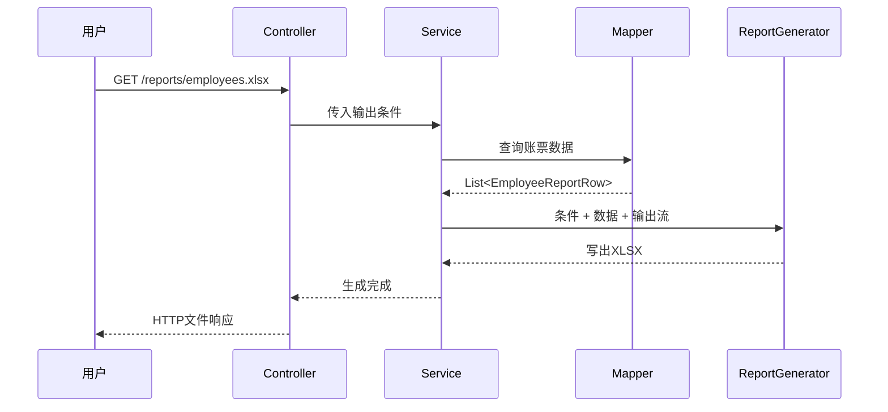

# 第2章 账票设计与架构：从数据库字段到 Excel 单元格

## 本章定位

本章不要求独立编写大型设计书。目标是会阅读账票设计、理解字段映射，并能沿着设计书找到 Mapper、Service、Generator 和 Controller 中对应的处理。

| 等级 | 本章要求 |
| --- | --- |
| A：必须理解 | 抽出条件、字段映射、排序、格式、零件数和分层职责 |
| B：能看懂 | 设计书与 SQL、Java 字段、Excel 位置的对应关系 |
| C：认识即可 | 文件状态管理、恢复和完整生产架构 |

## 学习目标

学完后，你能够：

- 区分基本设计和详细设计关注的内容；
- 说明一条数据库记录如何成为 Excel 的一行；
- 说明一个数据库字段如何映射到 Java 和单元格；
- 解释 Controller、Service、Mapper、Generator 的职责；
- 从设计书中找出代码改修可能影响的位置。

## 真实业务背景

日本项目中，业务方可能提供一张 Excel 样张和一句“按部门输出员工”。开发团队仍需通过设计和质疑票（Q&A）确认：输出哪些状态、怎样排序、空值怎样显示、零件数是否生成文件、谁能下载。

设计书的价值是让业务、开发和测试使用同一组规则，而不是让开发者各自猜测。

## 1. 基本设计与详细设计

### 基本设计（基本設計）

面向外部行为和业务规则：

- 谁使用、为什么使用；
- 输入条件和权限；
- 输出格式和文件名；
- 主要字段、排序、合计和错误行为；
- 在线下载还是 Batch 生成。

### 详细设计（詳細設計）

面向实现和测试：

- 数据表、查询条件和排序 SQL；
- 数据库列与 Java 属性；
- Excel 列或固定单元格；
- 日期、金额、状态等转换；
- 类和方法的职责；
- 零件数、异常和模板变化时的处理。

新人不需要一次写出生产项目的全部章节，但必须会读与当前改修有关的部分。

## 2. 一条记录怎样成为 Excel 的一行

従業員一覧表使用现有员工管理项目的 `employees` 表，不新增另一套员工结构。

```text
employees的一条记录
id=1, name=田中太郎, department=Sales,
email=tanaka@example.com, status=ACTIVE
        │
        ▼ MyBatis映射
EmployeeReportRow
        │
        ▼ Generator逐字段写入
Excel第5行
A5=1, B5=田中太郎, C5=Sales,
D5=tanaka@example.com, E5=在籍
```


这里有两个转换：

1. 数据库列 `created_at` 映射为 Java 的 `createdAt`。
2. 数据库状态 `ACTIVE` 显示为账票文字“在籍”。

## 3. 字段映射表示例

### 従業員一覧表字段映射

| Excel列 | 标题 | 数据库列 | Java字段 | 输出规则 |
| --- | --- | --- | --- | --- |
| A | 社员ID | `employees.id` | `id` | 数字 |
| B | 姓名 | `employees.name` | `name` | 文本 |
| C | 部门 | `employees.department` | `department` | 空值显示空字符串 |
| D | 邮箱 | `employees.email` | `email` | 文本 |
| E | 状态 | `employees.status` | `status` | `ACTIVE→在籍`、`INACTIVE→退职` |
| F | 登记时间 | `employees.created_at` | `createdAt` | `yyyy/MM/dd HH:mm` |

字段映射表不是只写列名。它还要说明数据来源、Java 类型、显示转换和空值规则。

### 請求書固定字段映射

| 模板位置 | 业务项目 | Java字段 | 输出示例 |
| --- | --- | --- | --- |
| B2 | 請求番号 | `invoiceNo` | `INV-2026-0001` |
| B3 | 発行日 | `issueDate` | `2026/10/01` |
| E3 | 支払期限 | `paymentDueDate` | `2026/10/31` |
| B5 | 請求先 | `customerName` | `株式会社さくら商事` |

有模板账票使用固定单元格坐标；无模板一览表通常使用“第几列”。

## 4. 抽出条件、排序和格式

### 抽出条件

従業員一覧表接收 `department` 和 `status`。设计书需要说明：

- `department` 可省略，省略表示全部门；
- `status` 允许 `ACTIVE` 或 `INACTIVE`；
- MyBatis 使用 `#{}` 绑定条件值；
- 零件数仍生成标题、表头和“合计件数 0”。

### 稳定排序

```sql
ORDER BY department ASC, name ASC, id ASC
```

最后使用唯一的 `id`，可以让同部门、同名员工的顺序保持稳定。

### 格式转换

| 原始值 | 账票显示 | 转换位置 |
| --- | --- | --- |
| `ACTIVE` | 在籍 | Generator 或专用转换方法 |
| `2026-10-01T09:30` | `2026/10/01 09:30` | Excel 日期样式 |
| `120000` | `120,000` | Excel 数字格式 |

数据库保存业务值，账票负责显示格式。不要为了 Excel 显示文字而把数据库状态改成“在籍”。

## 5. 四个组件各做什么



| 组件 | 主要职责 | 不应该做的事 |
| --- | --- | --- |
| Controller | 接收参数、调用 Service、设置下载响应 | 写 SQL、直接操作 POI |
| Service | 组织查询与生成流程、处理业务规则 | 决定每个单元格坐标 |
| Mapper | 执行参数化 SQL、返回账票行对象 | 创建 Workbook |
| Generator | 把数据写成 CSV/Excel | 查询数据库、判断当前用户权限 |

## 6. 教学用设计书：従業員一覧表

| 项目 | 设计值 |
| --- | --- |
| 账票名 | 従業員一覧表 |
| 利用者 | 既有员工系统中的 `ROLE_ADMIN` |
| 输入 | `department` 可选；`status` 必填 |
| 数据源 | `employees` |
| 排序 | 部门、姓名、ID 升序 |
| 输出 | 无模板 XLSX，Sheet 名“従業員一覧” |
| 明细开始行 | Excel 第5行 |
| 零件数 | 正常生成，件数为0 |

### 设计书怎样对应代码

| 设计项目 | 代码位置 |
| --- | --- |
| 输入条件 | `EmployeeReportController`、`EmployeeReportCondition` |
| 抽出条件与排序 | `EmployeeReportMapper.xml` |
| 字段与类型 | `EmployeeReportRow` |
| 列、状态文字、日期样式 | `EmployeeListReportGenerator` |
| 权限 | 既有 Spring Security URL/方法授权 |
| 下载文件名和类型 | `EmployeeReportController` |

## 7. 核心示例：读取字段映射

下面是代码片段，不是完整 Mapper 文件。

```xml
SELECT
    id,
    name,
    department,
    email,
    status,
    created_at AS createdAt
FROM employees
WHERE status = #{status}
ORDER BY department, name, id
```

- **所属位置**：`src/main/resources/mapper/EmployeeReportMapper.xml`。
- **调用者**：`EmployeeReportService` 通过 Mapper 接口调用。
- **输入**：`status`，来自经过检查的输出条件。
- **输出**：多条 `EmployeeReportRow`。
- **业务环节**：从数据库抽取账票数据。
- **注意**：若支持可选部门，还要使用 MyBatis 动态条件；不要把请求值直接拼进 SQL。

## 实际项目使用方式

接到“従業員一覧表增加入社日列”的改修时，按设计链检查：

1. `employees` 是否已有数据列；
2. Mapper SELECT 和别名；
3. `EmployeeReportRow` 字段与类型；
4. Generator 的表头、列号和日期格式；
5. 零件数和既有列顺序；
6. 下载接口是否受影响；
7. 设计书与测试期待值是否同步。

## 常见错误与注意事项

- 设计书写“按部门排序”，却没有规定同部门后的顺序。
- SQL 列别名与 Java 字段不一致，结果为 `null`。
- Mapper 返回数据库 Entity，Generator 又自行解释业务含义，责任混乱。
- 在 Controller 中同时查询数据库和创建 Excel，无法单独测试。
- 只改 Excel 标题，没有同步查询和数据对象。

## 理解练习

阅读本章字段映射和调用图，回答：

1. `created_at` 最终写入 Excel F 列，中间经过哪些名称和组件？
2. 业务要求“部门相同按姓名、姓名相同按 ID”时，应改设计书和哪个代码文件？
3. 若状态 `INACTIVE` 在 Excel 中显示为“退职”，数据库是否也应存“退职”？为什么？
4. 請求書的客户名从 B5 改到 C6，主要检查哪个组件？还要检查哪些测试和模板资料？

## 本章总结

账票设计的核心是映射：输入条件映射为查询条件，数据库列映射为 Java 字段，Java 字段再映射为 Excel 的列或单元格。理解这条链，就能阅读代码并判断改修影响。
