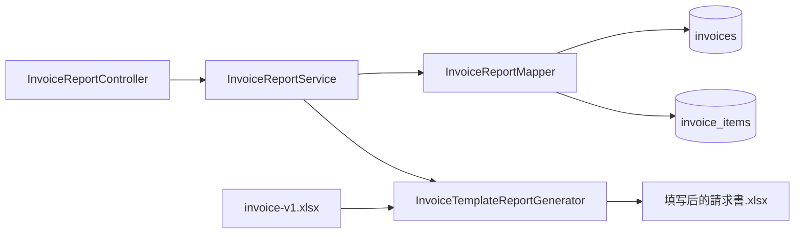

# 第4章 有模板账票：读取并填写請求書

## 本章定位

本章重点是读懂“打开模板、取得已有单元格、写入固定字段和明细、输出文件”的基本流程。复杂插行、公式重算和打印区域调整放入参考实现，不作为必修。

| 等级 | 本章要求 |
| --- | --- |
| A：必须理解 | 模板的作用；固定字段和动态明细；模板坐标映射 |
| B：能看懂和简单修改 | `WorkbookFactory.create`、`getRow/getCell`、`setCellValue`、`write` |
| C：认识即可 | `shiftRows`、公式重算、合并区域、打印范围、模板版本校验 |

## 学习目标

学完后，你能够：

- 区分新建工作簿和读取模板；
- 根据字段映射找到模板单元格；
- 看懂固定字段填充和简单明细循环；
- 解释模板文件、业务数据和输出文件的关系；
- 判断模板坐标变化会影响哪些代码和测试。

## 真实业务背景

财务需要向客户交付统一版式的請求書。标题、客户位置、付款期限、合计和打印布局都已经确定。若全部用 Java 创建，样式代码会很多；因此项目把版式保存在 `invoice-v1.xlsx`，程序只填入数据。

本章主案例使用：

- `invoices`：請求番号、客户、发行日、支付期限、状态；
- `invoice_items`：行号、摘要、数量、单价；
- 模板：`src/main/resources/report-templates/invoice-v1.xlsx`。

## 1. 模板是什么

模板是预先准备好的 Excel 文件，包含固定文字、样式、边框、列宽和打印布局。程序读取模板，而不是从空白工作簿重新创建全部版式。

### 模板与输出结果对比

模板：

```text
請 求 書
請求番号：[B2空白]          発行日：[B3空白]
請求先  ：[B5空白]

| No. | 摘要 | 数量 | 単価 | 金額 |
|      |      |      |      |      |  ← 明细区域
                              小計 [E12]
```

填值后：

```text
請 求 書
請求番号：INV-2026-0001     発行日：2026/10/01
請求先  ：株式会社さくら商事

| No. | 摘要         | 数量 | 単価    | 金額    |
| 1   | 系统维护服务 | 1    | 120,000 | 120,000 |
                              小計 120,000
```

## 2. 新建与读取模板的 API 对比

| 操作 | 无模板 | 有模板 |
| --- | --- | --- |
| 取得 Workbook | `new XSSFWorkbook()` | `WorkbookFactory.create(input)` |
| Sheet | `createSheet()` | `getSheet()` |
| 行 | `createRow()` | 通常 `getRow()`，需要新增时才 `createRow()` |
| 单元格 | `createCell()` | 通常 `getCell()`，需要新增时才 `createCell()` |
| 写值 | `setCellValue()` | `setCellValue()` |
| 输出 | `workbook.write(output)` | `workbook.write(output)` |

关键区别只在“从空白开始”还是“读取已有结构”。最后都需要 `write()`。

## 3. 請求書字段映射

### 固定字段

| 模板位置 | 业务项目 | Java字段 | 示例 |
| --- | --- | --- | --- |
| B2 | 請求番号 | `invoiceNo` | `INV-2026-0001` |
| B3 | 発行日 | `issueDate` | `2026/10/01` |
| E3 | 支払期限 | `paymentDueDate` | `2026/10/31` |
| B5 | 請求先 | `customerName` | `株式会社さくら商事` |

### 动态明细

模板第11行开始是明细区域：

| Excel列 | 项目 | Java字段 |
| --- | --- | --- |
| A | No. | `lineNo` |
| B | 摘要 | `description` |
| C | 数量 | `quantity` |
| D | 単価 | `unitPrice` |
| E | 金額 | `quantity × unitPrice` |

课堂模板预先准备 20 条带样式的空明细行。超过 20 条时的动态插行属于进阶处理。

## 4. 读取模板并填一个值

```java
// 所属类：InvoiceTemplateReportGenerator
try (InputStream input = templateResource.getInputStream();
     Workbook workbook = WorkbookFactory.create(input)) {
    Sheet sheet = workbook.getSheet("請求書");
    Row row = sheet.getRow(1);       // Excel第2行
    Cell cell = row.getCell(1);      // B列
    cell.setCellValue("INV-2026-0001");

    workbook.write(output);
}
```

- **调用者**：`InvoiceReportService` 调用 Generator。
- **输入**：模板输入流、請求書数据和输出流。
- **输出**：填写后的 XLSX。
- **业务环节**：读取模板并写入固定字段。
- **核心方法**：`WorkbookFactory.create`、`getSheet`、`getRow`、`getCell`、`setCellValue`、`write`。
- **注意**：`getRow()` 或 `getCell()` 找不到位置时会返回 `null`。模板必须先按设计准备这些位置。

## 5. 填写固定字段

```java
// 所属类：InvoiceTemplateReportGenerator 的 writeFixedFields 方法
sheet.getRow(1).getCell(1)
        .setCellValue(data.header().invoiceNo());
sheet.getRow(2).getCell(1)
        .setCellValue(data.header().issueDate());
sheet.getRow(2).getCell(4)
        .setCellValue(data.header().paymentDueDate());
sheet.getRow(4).getCell(1)
        .setCellValue(data.header().customerName());
```

- **输入**：`InvoiceReportData` 中的表头数据。
- **输出**：B2、B3、E3、B5 被填充。
- **业务环节**：填入每张請求書只有一个值的固定项目。
- **注意**：Java 使用从 0 开始的行列下标，所以 `getRow(1).getCell(1)` 是 Excel 的 B2。

日期单元格应使用模板已有日期样式；不要先格式化为随意字符串后覆盖模板格式。

## 6. 简单明细循环

下面假设模板已经准备第11～30行的样式。

```java
// 所属类：InvoiceTemplateReportGenerator 的 writeItems 方法
int rowIndex = 10; // Excel第11行
for (InvoiceItemRow item : data.items()) {
    Row row = sheet.getRow(rowIndex++);
    row.getCell(0).setCellValue(item.lineNo());
    row.getCell(1).setCellValue(item.description());
    row.getCell(2).setCellValue(item.quantity().doubleValue());
    row.getCell(3).setCellValue(item.unitPrice().doubleValue());
    row.getCell(4).setCellValue(item.amount().doubleValue());
}
```

- **输入**：按 `line_no, id` 排序的 `InvoiceItemRow` 列表。
- **输出**：每条明细填入一行。
- **业务环节**：输出請求書动态明细。
- **注意**：本例最多 20 行，超过时应按设计拒绝、分页或采用进阶插行，不得默默覆盖合计区。

数据对象中的金额使用 `BigDecimal`：

```java
public record InvoiceItemRow(
        Long itemId,
        int lineNo,
        String description,
        BigDecimal quantity,
        BigDecimal unitPrice) {
    public BigDecimal amount() {
        return quantity.multiply(unitPrice);
    }
}
```

业务金额计算在 Java 中保留 `BigDecimal`。写入 Excel 数值时才转换为 `double`，不要用 `double` 作为财务业务计算依据。

## 7. Mapper、Service 与 Generator



Service 的核心职责：

```java
// 所属类：InvoiceReportService
InvoiceHeader header = mapper.selectHeader(invoiceId);
List<InvoiceItemRow> items = mapper.selectItems(invoiceId);
InvoiceReportData data = new InvoiceReportData(header, items);
generator.write(templateInput, data, output);
```

- **调用者**：Controller。
- **输入**：`invoiceId` 和输出流。
- **输出**：填好的請求書文件。
- **业务环节**：把数据库查询结果和模板生成连接起来。
- **注意**：Controller 不直接访问模板；Generator 不直接调用 Mapper。

## 8. 进阶知识在哪里

以下内容在生产项目很重要，但新人先理解用途即可：

- `shiftRows()`：明细超过模板预留行时移动合计区域；
- 样式复制：新增行保持边框和数字格式；
- 公式重算：移动行后更新小计、税和总额；
- 合并单元格与打印范围；
- 模板标签和版本校验；
- 宏、外部链接和隐藏 Sheet 的安全检查。

完整实现保存在[請求書参考代码](reporting-reference/invoice-reference.md)。课堂不要求逐行记忆。

## 实际项目使用方式

模板改修时要同时检查：

1. Sheet 名是否变化；
2. 固定字段坐标是否变化；
3. 明细起始行和最大行数；
4. 数字、日期和边框样式；
5. 合计公式与打印区域；
6. Generator 常量和自动化测试；
7. 模板文件是否与代码一同发布。

## 常见错误与注意事项

- 用 `new XSSFWorkbook()` 代替读取模板，导致模板内容全部丢失。
- 对模板已有行调用 `createRow()`，覆盖原样式。
- 把 B2 写成 `getRow(2).getCell(2)`，混淆 Excel 坐标与 Java 下标。
- 模板只有 20 行明细，却允许程序写第21条并覆盖合计区。
- 用字符串写金额，Excel 无法正确计算。
- 修改模板后只做人工打开确认，没有回归字段位置和公式。

## 理解练习

1. `new XSSFWorkbook()` 与 `WorkbookFactory.create(input)` 的用途有什么不同？
2. Excel 的 E3 在 Java 中应使用什么行列下标？
3. 固定客户名与动态明细分别适合用哪种写入方式？
4. 模板将客户名从 B5 移到 C6，需要检查哪些设计、代码和测试？
5. 若第21条明细覆盖“小計”，这是数据问题、模板容量问题还是 Controller 问题？

## 本章总结

有模板账票的主线是：读取模板 → 取得 Sheet/Row/Cell → 填固定字段 → 循环填明细 → `workbook.write()`。模板坐标是设计契约，改模板时必须同步检查 Generator 和测试。
