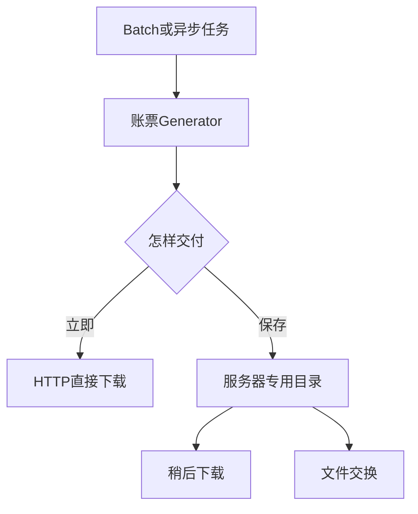
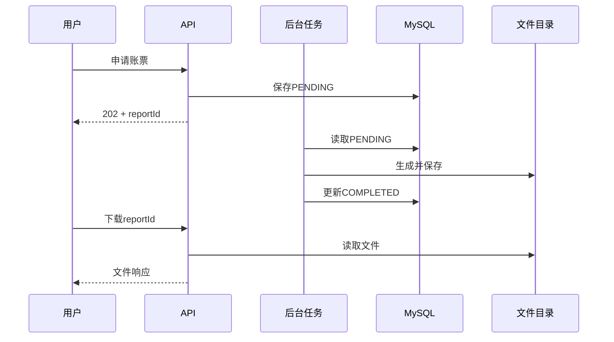

# 第5章 账票交付：下载、保存与 Batch

## 本章定位

本章关注文件生成之后怎样交给使用者。重点是理解直接下载、服务器保存、先生成后下载和 Batch 定时生成；不重复 Spring Batch 的 Job、Step、chunk 等基础内容。

| 等级 | 本章要求 |
| --- | --- |
| A：必须理解 | 四种交付方式、HTTP 响应头、Generator 与 Batch 的职责边界 |
| B：能看懂 | `ResponseEntity<Resource>` 下载和简单服务器保存 |
| C：认识即可 | 完整 FileStore、SHA-256、数据库/文件补偿、复杂恢复与超大文件优化 |

## 学习目标

学完后，你能够：

- 区分直接下载、服务器保存和先生成后下载；
- 解释 `ResponseEntity`、`Resource`、`Content-Type`、`Content-Disposition`；
- 说明 Batch 何时调用账票 Generator；
- 说明大文件、PDF、权限和异常处理的基本注意事项；
- 阅读项目中的账票下载 Controller。

## 真实业务背景

管理员手工下载一张従業員一覧表，通常可以在 HTTP 请求中直接生成。月末几十万行数据或每天凌晨的系统交换文件，则更适合由 Batch 生成并保存。請求書可能先保存为正式文件，再由用户下载或发送给客户。

## 1. 四种交付方式

| 方式 | 处理流程 | 适合场景 |
| --- | --- | --- |
| 直接下载 | 请求 → 查询 → 生成 → HTTP 返回 | 小文件、数秒内完成 |
| 服务器保存 | 任务 → 生成 → 指定目录 | 文件交换、归档 |
| 先生成后下载 | 申请 → 后台生成 → 完成后下载 | 时间较长、需要状态查询 |
| Batch 定时生成 | 调度 → Batch → Generator → 保存 | 夜间、大量、周期性处理 |



Generator 只负责文件内容。是由 Controller 还是 Batch 调用它，属于执行和交付方式。

## 2. HTTP 文件下载的四个关键点

### ResponseEntity

`ResponseEntity` 同时表示 HTTP 状态、响应头和响应体。

### Resource

Spring 的 `Resource` 表示可读取的文件资源，例如服务器上的 `FileSystemResource`。

### Content-Type

告诉客户端文件类型：

| 格式 | Content-Type |
| --- | --- |
| XLSX | `application/vnd.openxmlformats-officedocument.spreadsheetml.sheet` |
| CSV | `text/csv` |
| PDF | `application/pdf` |

### Content-Disposition

`attachment` 表示按附件下载，`filename` 提供下载文件名。

## 3. 核心示例：下载已生成文件

下面代码用于“先生成后下载”。Service 已经确认当前用户有权限、任务完成且文件存在。

```java
// 所属类：ReportDownloadController
@GetMapping("/reports/{reportId}/file")
@PreAuthorize("hasRole('ADMIN')")
public ResponseEntity<Resource> download(@PathVariable Long reportId) {
    ReportDownload download = reportService.findDownload(reportId);
    Resource resource = new FileSystemResource(download.path());

    ContentDisposition disposition = ContentDisposition.attachment()
            .filename(download.filename(), StandardCharsets.UTF_8)
            .build();

    return ResponseEntity.ok()
            .contentType(download.mediaType())
            .contentLength(download.size())
            .header(HttpHeaders.CONTENT_DISPOSITION,
                    disposition.toString())
            .header(HttpHeaders.CACHE_CONTROL, "no-store")
            .body(resource);
}
```

- **调用者**：浏览器或前端通过 HTTP 请求调用。
- **输入**：`reportId` 和既有 JWT 身份。
- **输出**：文件资源及下载响应头。
- **业务环节**：交付已经生成的文件。
- **注意**：Controller 不接收客户端传入的磁盘路径；路径由 Service 根据数据库记录取得。

直接生成并下载时，可使用第3章的 `StreamingResponseBody`。两种方式不要混淆：`Resource` 通常读取已有文件，`StreamingResponseBody` 可以边生成边写响应。

## 4. 简单服务器保存

```java
// 所属类：ReportFileWriter
Path reportRoot = Path.of(configuredReportDirectory)
        .toAbsolutePath().normalize();
Files.createDirectories(reportRoot);

Path output = reportRoot.resolve("employee-list.xlsx").normalize();
if (!output.startsWith(reportRoot)) {
    throw new SecurityException("非法输出路径");
}

try (OutputStream stream = Files.newOutputStream(output)) {
    generator.write(condition, employees, stream);
}
```

- **调用者**：Service、异步任务或 Batch Step。
- **输入**：受控根目录、文件名、账票数据。
- **输出**：服务器上的账票文件。
- **业务环节**：保存而不是立即下载。
- **注意**：目录来自配置，文件名由系统生成。不能把请求中的 `path` 直接拼接为服务器路径。

完整项目通常先写 `.part` 临时文件，生成和检查完成后再改成最终文件名。详细 FileStore 和 SHA-256 参考见[交付参考实现](reporting-reference/delivery-reference.md)。

## 5. 先生成后下载



常见状态：`PENDING`、`RUNNING`、`COMPLETED`、`FAILED`。学员需要会解释状态含义，不要求实现完整状态机和恢复平台。

## 6. Batch 与 Generator 的职责边界

| Spring Batch 负责 | ReportGenerator 负责 |
| --- | --- |
| 任务启动和执行记录 | CSV/Excel/PDF 内容 |
| 大量数据的分块读取 | 标题、列、明细和格式 |
| 失败、重启和运行状态 | 把收到的数据写入文件 |
| 定时任务中的执行步骤 | 模板读取与单元格填值 |

```java
// Batch Step 中的概念性调用
List<EmployeeReportRow> rows = reportRowRepository.loadFor(reportId);
try (OutputStream output = fileWriter.open(reportId)) {
    employeeListReportGenerator.write(condition, rows, output);
}
```

该片段只说明职责连接。Job、Step、chunk、JobRepository 和重启请复习[Spring Batch 专题](spring-batch.md)，本章不重复实现。

## 7. 大文件的基本判断

- `XSSFWorkbook` 在内存中保存整个工作簿，适合普通规模。
- `SXSSFWorkbook` 只保留部分行，适合较大的无模板 Excel。
- CSV 更适合超大量明细和系统交换。
- XLSX 单工作表最多 1,048,576 行，包含表头。
- 超过限制时要拆分 Sheet、拆分文件或改用 CSV，不能截断后报告成功。

这些属于容量设计。新人需要知道何时向资深成员确认，不要求独立完成性能调优。

## 8. 权限和异常处理

本专题复用员工系统既有 JWT 认证，不重新设计登录。

基本检查顺序：

1. 请求是否已认证；
2. 当前角色是否允许下载；
3. 账票是否存在；
4. 是否已经生成完成；
5. 文件是否存在且可读取。

| 情况 | 常见响应 |
| --- | --- |
| 无有效 JWT | 401 |
| 已登录但无权限 | 403 |
| 账票 ID 不存在 | 404 |
| 文件尚未完成 | 409 |
| 生成或读取失败 | 500，并记录受控日志 |

响应和日志不应泄露数据库密码、JWT、文件正文或服务器绝对路径。

## 9. PDF 的基本选择

PDF 适合固定打印、签章和归档。选型时确认：

- 页面大小和分页；
- 日文字体与字体授权；
- 页眉、页脚和打印样张；
- 是否需要搜索、复制文字或电子签章。

Java 项目可能使用 PDFBox、JasperReports 或企业现有产品。没有 PDF 业务要求时，不需要仅为“格式更正式”而增加一套实现。

## 10. 进阶知识在哪里

以下内容保留为参考，不作为必修实现：

- 临时文件到最终文件的原子发布；
- 数据库状态与文件系统的一致性补偿；
- SHA-256 完整性校验；
- 过期清理、孤儿文件恢复；
- `SXSSFWorkbook` 临时文件管理；
- 下载与清理并发控制。

参见[交付参考实现](reporting-reference/delivery-reference.md)和[月度员工变更账票项目](monthly-report-project.md)。

## 实际项目使用方式

调查“账票下载失败”时按层确认：

```text
JWT/权限 → reportId和状态 → 数据库文件记录
→ 服务器文件是否存在 → Content-Type/Content-Disposition
→ 客户端是否收到完整响应
```

先定位失败在哪一层，再决定查看 Security、Service、文件目录还是 Controller。

## 常见错误与注意事项

- 把整个大文件读入 `byte[]` 后再返回，导致内存上升。
- 接收客户端路径，产生路径穿越风险。
- 文件生成失败却把状态更新为 `COMPLETED`。
- 把定时触发器当作 Generator，让职责混在一起。
- 只确认 HTTP 200，没有确认 Content-Type、文件名和文件内容。
- 在日志输出真实个人资料或服务器绝对路径。

## 理解练习

1. `ResponseEntity<Resource>` 中 `Resource`、`Content-Type` 和 `Content-Disposition` 各负责什么？
2. 为什么不能提供 `/reports/download?path=...` 这样的接口？
3. 对 30 万行 CSV，应优先考虑直接在线下载还是 Batch？说明判断依据。
4. Batch 和 Generator 各自负责什么？
5. 用户得到 409 时，最可能检查哪个业务状态？

## 本章总结

账票生成和账票交付是两个环节。小文件可以直接下载；长时间任务通常先生成并保存。Controller 负责 HTTP，Generator 负责文件内容，Batch 负责批量执行和状态管理。
