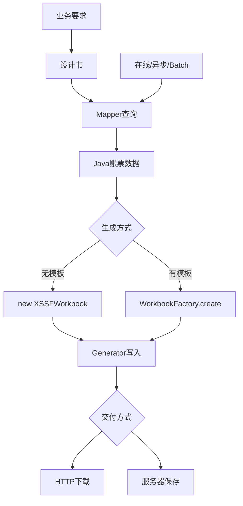

# 第6章 综合理解与代码阅读：账票改修影响分析

## 本章定位

本章通过判断、排序、设计书阅读和代码追踪确认学习成果。不要求独立实现两套完整账票系统。简单 POI 修改作为选做练习。

| 等级 | 本章要求 |
| --- | --- |
| A：必须完成 | 概念判断、处理流程、设计书阅读、职责说明 |
| B：能完成 | 核心代码阅读、字段增加和模板变化影响分析 |
| C：选做 | 在练习工程中修改一列或一个模板单元格 |

## 学习目标

学完后，你能够：

- 正确区分格式、生成方式、执行方式和交付方式；
- 阅读従業員一覧表和請求書的设计映射；
- 追踪 Controller → Service → Mapper → Generator；
- 找到 POI 创建、读取、写值和输出的关键代码；
- 分析增加字段或移动模板位置的影响范围。

## 真实业务背景

新人进入日本项目后，最常见的工作不是从零开发账票平台，而是阅读既有代码、处理小规模改修、修复测试或调查输出不正确的原因。

本章模拟两张改修票：

1. 従業員一覧表增加“更新时间”列。
2. 請求書把“請求先”从 B5 移到 C6。

## 1. 知识地图



## 2. 概念判断

判断下列说法是否正确，并说明理由。

1. CSV 可以保存字体、边框和打印范围。
2. 使用 Excel 模板时，程序仍然需要调用 `workbook.write()`。
3. Batch 是一种文件格式。
4. 无模板账票只能输出固定行数。
5. Generator 应直接从数据库查询数据。
6. PDF 更适合固定打印版式，但不一定适合数据再加工。
7. `getRow(4)` 表示 Excel 第4行。
8. 账票零件数时，必须由设计书决定是生成空文件还是提示无数据。

## 3. 有模板与无模板对比

完成下表中的空白：

| 项目 | 従業員一覧表 | 請求書 |
| --- | --- | --- |
| 生成方式 | （1） | （2） |
| 取得 Workbook | （3） | （4） |
| 主要行操作 | `createRow()` | （5） |
| 适合原因 | （6） | （7） |
| 模板变化影响 | 无模板文件 | （8） |

## 4. 设计书阅读

### 従業員一覧表节选

| Excel列 | 标题 | 数据库列 | Java字段 | 显示规则 |
| --- | --- | --- | --- | --- |
| A | 社员ID | `id` | `id` | 数字 |
| B | 姓名 | `name` | `name` | 文本 |
| C | 部门 | `department` | `department` | 空值为空字符串 |
| D | 邮箱 | `email` | `email` | 文本 |
| E | 状态 | `status` | `status` | `ACTIVE→在籍` |
| F | 登记时间 | `created_at` | `createdAt` | `yyyy/MM/dd HH:mm` |

回答：

1. 数据库 `created_at` 为什么映射为 Java `createdAt`？
2. 状态显示文字应该在哪一层处理？为什么不修改数据库值？
3. 若 SQL 忘记查询 `email`，Excel 会出现什么现象？
4. 若增加 G 列“更新时间”，至少需要修改哪些资料和代码？

### 請求書节选

| 模板位置 | 项目 | Java字段 |
| --- | --- | --- |
| B2 | 請求番号 | `invoiceNo` |
| B3 | 発行日 | `issueDate` |
| E3 | 支払期限 | `paymentDueDate` |
| B5 | 請求先 | `customerName` |

回答：若模板把請求先移动到 C6，但代码仍写 B5，会发生什么？应同步修改哪些内容？

## 5. 处理流程排序

把下列步骤排列为正确顺序：

- A. Generator 调用 `workbook.write(output)`
- B. Controller 接收下载请求
- C. Mapper 查询 MySQL
- D. 浏览器收到 XLSX
- E. Service 把查询结果交给 Generator
- F. MyBatis 映射为 `EmployeeReportRow`

再说明：权限检查应在什么位置发生？为什么不能只在前端隐藏下载按钮？

## 6. 核心代码阅读：无模板

```java
try (XSSFWorkbook workbook = new XSSFWorkbook()) {
    Sheet sheet = workbook.createSheet("従業員一覧");
    int rowIndex = 4;
    for (EmployeeReportRow employee : employees) {
        Row row = sheet.createRow(rowIndex++);
        row.createCell(0).setCellValue(employee.id());
        row.createCell(1).setCellValue(employee.name());
    }
    workbook.write(output);
}
```

回答：

1. 哪一行创建文件中的工作表？
2. 为什么每次循环要执行 `createRow(rowIndex++)`？
3. 第一条员工写到 Excel 第几行？
4. 哪一行真正输出工作簿？
5. `output` 由哪个上层组件提供？

## 7. 核心代码阅读：有模板

```java
try (InputStream input = template.getInputStream();
     Workbook workbook = WorkbookFactory.create(input)) {
    Sheet sheet = workbook.getSheet("請求書");
    sheet.getRow(1).getCell(1)
            .setCellValue(data.header().invoiceNo());
    workbook.write(output);
}
```

回答：

1. 哪一行表示“读取模板”，而不是创建空白工作簿？
2. `getRow(1).getCell(1)` 对应 Excel 哪个位置？
3. 如果模板没有该行或单元格，可能出现什么异常？
4. 为什么修改模板坐标后必须同步修改代码或映射？

## 8. 调用链分析

阅读下面片段：

```java
// Controller
StreamingResponseBody body = output ->
        service.writeExcel(condition, output);

// Service
List<EmployeeReportRow> rows = mapper.selectForReport(
        condition.department(), condition.status());
generator.write(condition, rows, output);
```

填写调用链：

```text
HTTP请求
→ （1）接收条件和输出流
→ （2）组织查询与生成
→ （3）从MySQL取得数据
→ （4）创建并写入Excel
→ HTTP响应
```

再回答：如果 Excel 列值错误，可能调查哪三处？如果请求返回 403，应先调查哪一层？

## 9. 改修影响分析

### 改修票 A：従業員一覧表增加更新时间

要求：在 F 列登记时间后增加 G 列“更新时间”，格式相同。

从下面选出需要检查的项目，并说明理由：

- 数据库 `updated_at`
- Mapper SELECT
- `EmployeeReportRow`
- Generator 表头、列号和日期样式
- Spring Security 的 JWT 签名算法
- 字段映射设计书
- Generator 测试期待值
- 請求書模板

### 改修票 B：請求書模板移动客户名

要求：B5 的請求先值移动到 C6，并更改字体。

说明以下对象是否受影响：

- `invoices.customer_name`
- `InvoiceHeader.customerName`
- 模板文件
- 模板字段映射表
- `InvoiceTemplateReportGenerator`
- Mapper SQL
- 模板回归测试和样张

## 10. 选做练习

在个人练习副本中任选一个：

1. 给无模板従業員一覧表增加 G 列“更新时间”。
2. 在教学模板中把客户名移到 C6，并修改 Generator。

完成后只需提交：修改位置、生成结果截图或单元格检查、一个正常用例和一个零件数/模板缺失用例。不要求实现完整账票系统。

## 11. 参考答案与答案要点

### 概念判断

1. 错。CSV 是文本，不保存 Excel 样式和打印设置。
2. 对。模板只提供输入结构，仍需 `write()` 生成输出。
3. 错。Batch 是执行方式，不是文件格式。
4. 错。循环可以生成动态明细。
5. 错。Mapper 查询数据库，Generator 只处理文件内容。
6. 对。PDF 适合固定显示，CSV/Excel 更适合再加工。
7. 错。Java 下标从 0 开始，`getRow(4)` 是 Excel 第5行。
8. 对。零件数是业务规则，不能由开发者临时猜测。

### 对比表

（1）无模板；（2）有模板；（3）`new XSSFWorkbook()`；（4）`WorkbookFactory.create(input)`；（5）通常 `getRow()`，需要新增时才 `createRow()`；（6）版式简单、动态一览；（7）固定抬头和打印版式；（8）模板坐标、样式、公式和测试可能受影响。

### 设计书阅读

- `created_at` 是数据库蛇形命名，`createdAt` 是 Java 驼峰命名；MyBatis 通过别名或配置映射。
- 状态显示转换属于账票表现规则，可放在 Generator 的专用转换方法；数据库继续保存稳定业务代码。
- 未查询 `email` 时，Java 字段通常为空，Excel D 列会空白；还要检查 MyBatis 映射行为。
- 新增更新时间需要同步数据库字段确认、SELECT、record、字段映射、表头、列号、样式和测试。
- 模板移动而代码未改时，客户名仍写入旧 B5，C6 为空。应修改模板、映射、Generator 坐标、样张和回归测试。

### 流程与代码

- 正确顺序：B → C → F → E → A → D。
- 后端必须执行认证和授权；前端隐藏按钮不能阻止直接发送 HTTP 请求。
- 无模板代码中 `createSheet` 创建工作表，第一条员工写 Excel 第5行，`workbook.write(output)` 输出文件。
- 有模板代码中 `WorkbookFactory.create(input)` 读取模板，`getRow(1).getCell(1)` 是 B2；位置不存在可能发生 `NullPointerException`。
- 调用链答案：（1）Controller；（2）Service；（3）Mapper；（4）Generator。

### 影响分析

- 改修票 A 需要检查除 JWT 签名算法和請求書模板之外的所有列出项目。
- 改修票 B 通常不改变数据库列、Java字段或 Mapper SQL；需要修改模板、字段映射、Generator 坐标、样张和测试。若字体完全由模板控制，代码不必创建新字体样式。

## 实际项目使用方式

Review 账票改修时，按“业务规则 → 设计映射 → Mapper → 数据对象 → Generator → Controller/Batch → 测试与样张”逐项检查。发现问题时写明文件、位置、现象、业务影响和修改建议。

完整参考代码位于[reporting-reference](reporting-reference/README.md)，用于查阅，不是本章必修实现任务。

## 常见错误与注意事项

- 只修改代码，不更新字段映射或模板版本。
- 看到 403 就调查 POI，混淆权限层和文件层。
- 看到 Excel 空值就直接修改 Generator，没有先确认 SQL 和映射。
- 模板位置改变后只手工打开一次，没有固定回归样例。
- 把选做练习误解为必须搭建生产级系统。

## 本章总结

新人应能说清概念、读懂设计、追踪调用链并判断小改修影响。完整生产级文件状态、恢复和性能设计由项目团队共同完成，不是本课程的必修验收目标。
