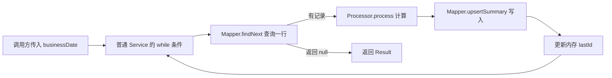

# 01 认识 Batch：从单次请求到项目中的批处理

## 本章学习目标

能解释 Batch 是什么、它与单次请求的主要区别、项目为什么要设置 Batch，并能看懂几种常见的技术组合。最后沿普通 Service 走通一次“读→算→写”，指出它尚未解决的恢复问题。本章只要求**认识** PL/SQL、Linux/Shell 等既有项目形态，不要求用每种技术各做一套程序。

## 前置知识

了解 HTTP 请求、Spring Boot Service、Java 循环和 SQL 查询即可。练习仍使用本专题的独立工程与虚构考勤数据，不连接 Employee Management 主线。Oracle、Linux 和 Shell 的细节分别可在 [PL/SQL 批处理](../../../../../database/plsql/15_batch_and_scheduler.md)、[Linux 定时任务](../../../../../tools/linux/05_crontab_scheduler.md)、[Shell 基础](../../../../../tools/shell/01_shell_basic.md)课程学习。

## 实际业务场景

员工提交当天一条考勤时，需要立即知道“保存成功还是失败”；这是典型的单次请求。每天日本时间 02:00，系统还要汇总**前一天**所有考勤，计算工作与加班分钟数，写入日次汇总表，再交付一份 CSV。后者面对一组数据和一次完整的业务任务，需要记录业务日期、处理件数、执行状态，并在失败后判断能否恢复。

本例的触发时刻是 2026-10-20 02:00，业务日期却是 2026-10-19。业务日期不能简单取机器的“今天”。

## 核心概念

**Batch（批处理）**是把一组数据作为一次业务任务来处理的方式。常见任务有日次/月次汇总、导入外部文件、批量更新、生成账票或导出文件。数据不一定达到百万条才叫 Batch；“本月结束后统一核算 25 条记录”同样可以是 Batch。Spring Batch 是实现这类任务的一种 Java 框架，**不是** Batch 一词的全部含义。

| 观察点 | 单次在线请求：保存一条考勤 | 日次 Batch：汇总前日考勤 |
| --- | --- | --- |
| 谁触发 | 通常由用户操作或其他系统调用 API | 可以定时、人工或由上游作业触发 |
| 处理范围 | 一次请求通常围绕一条或少量业务数据 | 按业务日期处理一组数据，并产出统一结果 |
| 结果如何确认 | 请求方等待 HTTP 响应，检查状态和响应体 | 除启动结果，还要查最终状态、件数、业务表及文件 |
| 失败后的问题 | 按接口契约处理该次请求的失败或重试 | 必须确定已完成部分、恢复位置与重复执行影响 |
| 时间概念 | 请求发生时间通常是主要线索 | 触发时间和要处理的**业务日期**可能不同 |

这不是互斥分类：API 也能接收“启动批处理”的请求，Batch 也能手动同步启动。**异步**描述调用方是否等待结果；**批处理**描述任务怎样组织数据与结果；**定时**描述何时触发，三者不能互相替换。

项目设置 Batch，通常是因为需要在确定的业务时点处理一批数据，并可核对“处理了什么、成功多少、失败在哪里、可否重跑”。普通循环能完成计算，却不会自动提供执行身份、持久化历史、断点或重复控制；这些保障要么自行设计，要么借助框架和调度平台。本例的验收不是“程序启动过”，而是源数据 25 条、汇总 25 条、CSV 26 行，且执行状态与这些业务事实一致。

## 执行流程

先把技术分成四层，再读项目中的具体组合：

```text
何时启动：人工 / Linux cron / Oracle DBMS_SCHEDULER / Spring Scheduling / 企业调度器
    ↓
如何启动：直接调用 / Shell 脚本 / 命令行启动 Java 程序
    ↓
谁处理业务：Oracle PL/SQL / 普通 Java Service / Spring Batch Job
    ↓
结果在哪里：业务表 / CSV / 日志 / 批处理执行记录
```

**Linux 是运行环境，不是业务处理框架；Shell 脚本负责组织命令；cron 负责按时间启动命令。** 它们经常一起出现，却各有职责。Oracle PL/SQL 则是在 Oracle 数据库内编写过程式处理逻辑；MySQL 本身不叫 PL/SQL。本专题用 MySQL 8，因此下面的 Oracle 路线只供识读，不混入可运行的实验工程。

| 常见组合 | 一次前日汇总怎样走 | 新人进入既有项目先找什么 |
| --- | --- | --- |
| Oracle 调度 + PL/SQL | `DBMS_SCHEDULER` 到点调用存储过程；过程按业务日期查、算、写 | Job 定义、过程/包入口、日期参数、异常与提交规则 |
| Linux cron + Shell + PL/SQL | cron 启动 `.sh`；脚本传日期给数据库客户端；PL/SQL 处理业务 | cron 条目、脚本、数据库对象、退出码与各层日志 |
| Linux cron + Shell + Java | cron 启动 `.sh`；脚本设置配置并运行 Jar；Java 访问数据库 | 启动命令、业务日期来源、Jar 入口、数据库和文件结果 |
| Spring Scheduling + 普通 Service | `@Scheduled` 到点调用 Service，Service 自己循环读写 | 定时方法、Service、事务、已处理记录与防重复设计 |
| Spring Scheduling + Spring Batch | `@Scheduled` 触发 Job，Step 负责读写，Repository 记录执行 | 调度入口、Job/Step、参数、执行状态、业务结果 |
| 企业调度器 + Shell/Java/Batch | 平台安排多个作业的时间与依赖，再启动脚本或程序 | 作业链前后置关系、传参、各阶段终态与交接文件 |

表中“+”表示可能的技术组合，不是必须逐项叠加。企业调度器也可以直接启动程序；Linux cron、Spring Scheduling 与数据库调度器是**触发方案**，不能代替业务程序的事务、幂等或结果核对。较复杂项目还可能用专门 ETL/数据集成平台；本专题只要求识别其“调度—转换—交付”位置，不扩展为第二条实操路线。

需要查具体产品配置时，可分别阅读 [Oracle Scheduler 官方说明](https://docs.oracle.com/en/database/oracle/oracle-database/26/admin/scheduling-jobs-with-oracle-scheduler.html)、[Linux crontab 手册](https://man7.org/linux/man-pages/man5/crontab.5.html)和 [Spring Batch 的 JobRepository 说明](https://docs.spring.io/spring-batch/reference/job/configuring-repository.html)。本章只建立职责地图，不要求按这些文档直接配置生产作业。

本课程采用一条稳定主线：**Spring Scheduling → Spring Batch → MyBatis/MySQL → CSV**。手动执行与定时执行共用同一 Job。Spring Batch 的持久执行记录及恢复能力将在[第 02 章](02_batch_architecture_and_tasklet.md)开始学习；[第 05 章](05_scheduling_and_batch_integration.md)再详细讲定时触发。

## 关键类与接口

先认识三个名字即可：`Job` 是 Spring Batch 对完整任务的定义，`Step` 是其中的阶段，`JobRepository` 保存执行元数据。它们不是所有 Batch 项目都会有的对象：纯 PL/SQL 或普通 Shell 项目可以没有 Spring Batch。当前工程中的 [BatchConfig.java](../examples/attendance-batch/src/main/java/com/example/attendance/BatchConfig.java) 定义了 `validateStep → summarizeStep → csvStep → resultStep`；此处先看职责，不要求立即掌握配置 API。

## 代码示例

先用下面 **3 行纸面演示数据**理解循环；它不是 `sample_data.sql` 的 25 条基线（基线中 ID 2、3 的下班时间也为 18:00），不要把此表直接当作测试结果：

| ID | 员工 ID | 上班 | 下班 | 休息 | 计算后工作分钟 |
| ---: | ---: | --- | --- | ---: | ---: |
| 1 | 1001 | 09:00 | 18:00 | 60 | 480 |
| 2 | 1002 | 09:00 | 19:00 | 60 | 540 |
| 3 | 1003 | 09:00 | 17:00 | 60 | 420 |

下面是[普通 Service 对照实验](../examples/attendance-batch/src/main/java/com/example/attendance/PlainAttendanceSummaryService.java)的**方法片段**；该类由 Spring 创建，调用方显式传入 `businessDate`，测试只验证一次普通循环。完整类的构造器注入 Mapper 与 Processor：

```java
public Result summarize(LocalDate businessDate) {
    Instant started = Instant.now();
    long lastId = 0;
    int processed = 0;
    AttendanceRecord record;
    while ((record = mapper.findNext(businessDate, lastId)) != null) {
        mapper.upsertSummary(processor.process(record));
        lastId = record.id();
        processed++;
    }
    return new Result(processed, started, Instant.now());
}
```

逐行看这段方法（行号从代码块第一行算，空行与单独的右括号只表示代码范围）：

| 行 | 功能与首次出现的对象/方法 |
| --- | --- |
| 1 | 声明 `summarize`：调用方传入 `LocalDate businessDate`（只含日期、不含时刻），方法结束返回 `Result`；普通 Service 不会自动运行它。 |
| 2 | `Instant.now()` 取当前时间点作为开始时间；`Instant` 表示时间线上的瞬间，**不是**业务日期。 |
| 3～5 | `lastId=0` 表示从最小 ID 前开始；`processed` 计本次处理件数；`AttendanceRecord record` 保存本轮从表中读出的考勤对象。 |
| 6 | `mapper.findNext(date, lastId)` 经 MyBatis 查询下一行并赋给 `record`；返回 `null` 才退出 `while`，否则进入循环体。`mapper` 是注入的数据库访问对象。 |
| 7 | `processor.process(record)` 校验并生成 `DailySummary`；其返回值交给 `mapper.upsertSummary(...)` 写入或更新汇总表。两个调用按内到外执行。 |
| 8～9 | 用本条记录的 `id()` 推进读取位置，再把处理计数加一；这两个变量都只在当前方法内存中。 |
| 11 | 新建 `Result`，携带处理件数、开始时间与 `Instant.now()` 取得的结束时间并返回调用方。 |

`Result` 是该普通 Service 定义的返回记录，不是 Spring Batch 的 `JobExecution`；`record.id()` 是 Java record 生成的读取属性方法。方法体里的 `mapper`、`processor` 由构造器注入，创建和调用时机见[第 02 章](02_batch_architecture_and_tasklet.md)。

## 代码执行说明



`businessDate` 由调用方指定；`findNext` 按稳定的 `id` 找下一条，返回 `null` 时结束；Processor 计算，Mapper 写入；`Result` 记录成功走过循环的件数和起止时刻。此方法只用于比较，**不参与最终 Spring Batch Job**。它不会持久保存 `lastId`；进程退出后，仅凭返回值也无法判断实际已提交多少行。为整个方法加长事务可以改变数据库回滚行为，却不能让外部 CSV 跟着回滚，也不能自动补上执行历史。

`mapper.findNext(businessDate, lastId)` 每次由 while 条件调用，MyBatis 对日期和 ID 进行参数绑定，执行下面的 **MySQL 8 查询逻辑片段**（`#{...}` 是 MyBatis 占位符，不可直接粘贴到 MySQL 客户端）：

```sql
SELECT id, employee_id, business_date, start_at, end_at, break_minutes
FROM attendance_records
WHERE business_date = #{businessDate} AND id > #{afterId}
ORDER BY id
LIMIT 1
```

SQL 逐行看：第 1 行只取 Reader 需要的六列；第 2 行指定考勤源表；第 3 行限定业务日期且只取上次 ID 之后的记录，`#{...}` 由 MyBatis 绑定参数；第 4 行按唯一 ID 升序保证顺序稳定；第 5 行的 MySQL `LIMIT 1` 每次只返回下一行。`findNext` 返回 `AttendanceRecord` 或 `null`，**不是**一次把 25 行读入内存。

Processor 的 `process(record)` 检查上、下班与休息时间，计算 `worked = 结束与开始相差分钟 - breakMinutes`，再计算 `overtime = max(0, worked - 480)`，返回 `DailySummary`。Mapper 的 `upsertSummary(summary)` 把员工、日期、工作和加班分钟写入 `attendance_daily_summary`；同一员工同日期已有行则更新。这是普通 MyBatis 数据操作，**不是 Spring Batch 专有方法**。正式源码分别见 [AttendanceProcessor.java](../examples/attendance-batch/src/main/java/com/example/attendance/AttendanceProcessor.java) 和 [AttendanceMapper.java](../examples/attendance-batch/src/main/java/com/example/attendance/AttendanceMapper.java)。

假设只处理上表 3 行，while 条件里的查询和循环体的计算/写入顺序如下：

| 循环 | 进入条件前 lastId | findNext 返回 ID | 写入员工/工作分钟 | 更新后的 lastId |
| ---: | ---: | ---: | --- | ---: |
| 1 | 0 | 1 | 1001 / 480 | 1 |
| 2 | 1 | 2 | 1002 / 540 | 2 |
| 3 | 2 | 3 | 1003 / 420 | 3 |
| 4 | 3 | `null` | 不进入循环体 | 结束 |

如果第 3 条的休息时间不合法，`processor.process` 抛异常，本次方法在写 ID 3 之前停止。ID 1、2 是否已提交，取决于该普通 Service 的事务配置和 Mapper 所用连接；当前方法没有声明统一事务，也没有持久化检查点。进程重启后 `lastId` 又从 0 开始，必须另查业务表、事务结果和 UPSERT 行为，不能只凭 `processed` 推定提交件数。这正是后续用 Batch 执行记录和恢复设计解决的问题。

| 入口 | 谁确定业务日期 | 传给处理代码的形式 | 本课程示例 |
| --- | --- | --- | --- |
| 手动执行正式 Job | 操作者按补跑/日次规格指定 | `ManualBatchRunner` 解析命令行日期，`BatchTrigger` 写入标识性 `businessDate` | 明确指定 `2026-10-19` |
| 定时执行正式 Job | `AttendanceScheduler` 在触发时按东京时区取前一日 | `BatchTrigger` 写入同名标识参数 | 10 月 20 日凌晨处理 10 月 19 日 |
| 普通 Service 对照测试 | 测试代码直接指定 | 调用 `summarize(LocalDate businessDate)` 的方法参数；**没有** JobParameters | 测试给定固定日期 |

业务处理层只使用收到的日期，不各自调用 `LocalDate.now()`：否则手动补跑、跨午夜执行、时区差异或失败恢复时，不同 Step 可能读写不同业务日。日期规则集中在入口，记录在参数中，排查时才能重现同一次输入范围。

## 逐步操作

1. 在纸上分别画“用户保存一条考勤”和“前日考勤汇总”的输入、触发、处理、输出与失败检查点。
2. 在独立练习库按 [README](../README.md)准备数据，用下方 **MySQL 8 只读查询**确认业务日期 `2026-10-19` 的源记录数：

   ```sql
   SELECT business_date, COUNT(*) AS source_count
   FROM attendance_records
   WHERE business_date = '2026-10-19'
   GROUP BY business_date;
   ```

3. 在 `examples/attendance-batch` 工程目录执行 `mvn -q -Dtest=PlainAttendanceSummaryServiceTest test`。该 Mockito 测试只验证普通循环的一条记录和结束条件，不连接真实 MySQL，也不证明失败恢复。然后阅读方法，假设第 13 条出错，列出需要调查的事实。
4. 从上表任选五种组合中的两种，指出“谁定时、谁启动、谁处理、去哪里看最终结果”。不要在共享服务器上创建 cron 或数据库 Job。

## 运行结果与验证

样例日期的只读查询预期得到 `source_count=25`；没有数据的日期不会返回一行，不能误读为已返回 0。普通 Service 单元测试通过时，只能说明方法的调用顺序和件数统计；本章**尚未运行最终 Batch Job**。最终 Job 的预期结果是汇总 25 行、CSV 26 行，需在后续章节实际运行与核对。

## 常见错误

- 把 2026-10-20 02:00 当成业务日期 2026-10-20：应显式传入前一日 `businessDate=2026-10-19`。
- 看见 `@Scheduled` 或 cron 日志就报告“批处理成功”：调度只证明尝试触发，还须查程序终态和业务输出。
- 把 Shell 脚本中的 `java -jar` 当成全部业务逻辑：继续追查 Jar 的入口、Service/Job、数据库与 CSV。
- 把普通循环的 `processed=12` 当成“数据库恰好提交了 12 行”：需要结合事务与数据库状态核实。
- 把 Oracle PL/SQL 直接套到本课程 MySQL 工程：数据库方言、存储过程语法与调度方式不同。

## 日本项目中的注意事项

调查既有任务时，先画出**触发器 → 启动入口 → 业务处理 → 输出/日志**，再确定故障属于哪一层。脚本的退出码、Java 进程状态、Spring Batch Job 状态和下游文件交付状态可能并不一致。长期任务还要确认重跑规则、输入是否变化、是否已交付下游，以及作业是否由多个节点重复触发。

常见日本项目词汇：日次バッチ（日批）、月次バッチ（月批）、集計処理（汇总）、ファイル連携（文件联携）、異常終了（异常结束）、再実行（重跑）、リカバリ（恢复）、処理件数（处理件数）。报告时要写具体业务日期、执行 ID 和件数，不只写“批处理失败”。

## 学员练习

1. 判断三项任务更适合单次请求还是 Batch，并分别写出输入、输出及失败后检查点：① 保存一条考勤；② 凌晨汇总前日 10 万条考勤；③ 每月生成一次全员 CSV。对第②项，说明为什么“它很慢”不是唯一理由。
2. 给出一张既有项目线索卡：`0 0 2 * * *`、`run_attendance.sh`、`java -jar attendance.jar`、`BATCH_JOB_EXECUTION`。画出调度、启动、业务处理、执行记录四层，并写出“CSV 缺失”时先查的三处证据。
3. 查看普通 Service：若第 13 条在 Processor 抛异常，写出必须进一步确认的三件事——此前哪些行已提交、下次从哪里读、重复执行会否写重。只读代码不能直接断言真实提交件数。

## 本章验收标准

能够用考勤案例解释 Batch 与单次请求、异步、定时的区别；正确识别至少两种项目技术组合中各层职责；说明本课程为什么选择 Spring Batch 主线，并指出普通循环在失败恢复与执行记录方面的缺口。

## 本章总结

Batch 是一类业务任务，不是某个框架的别名。项目可用数据库过程、脚本、Java 或 Spring Batch 处理，用 cron、数据库调度器、Spring Scheduling 或企业平台触发；真正交付时还要核对业务结果、执行状态与恢复策略。
