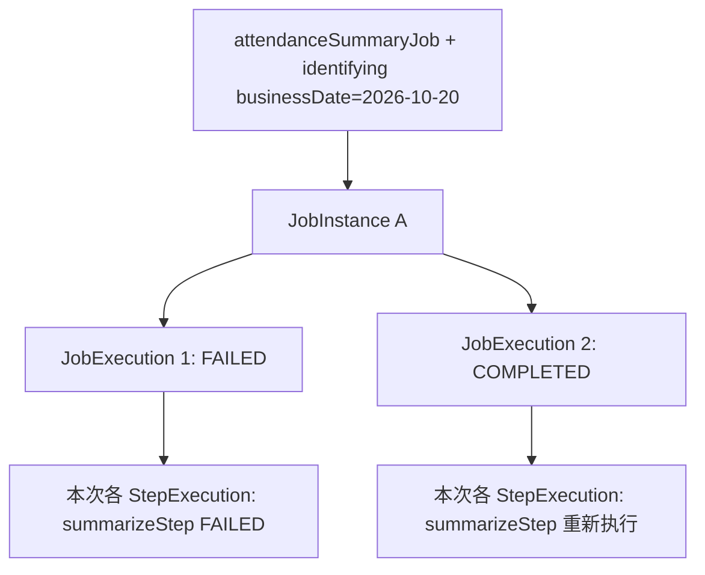
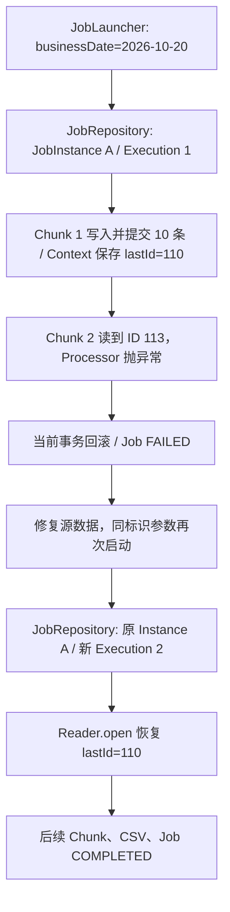

# 04 事务、恢复与执行管理：第 13 条失败后怎么办

## 本章学习目标

能用 `businessDate` 确认 JobInstance，解释 25 条考勤在第 13 条失败时哪些数据已提交；修复后以相同标识参数 Restart，分别验证 Skip 和 Retry，并用元数据、业务表、CSV 判断可否人工再执行。

## 前置知识

完成[第 03 章](03_chunk_processing.md)的 10/10/5 正常处理。三个故障实验只在隔离的 H2 测试库或可重建的个人 MySQL 副本进行；**不要**在共享库改第 13 条。进入实验前确认正式配置 `app.batch.skip-invalid=false`，输出目录是个人测试路径。

## 实际业务场景

运营报告“业务日期 2026-10-20 的考勤汇总失败”。当晚 25 条源记录中，第 13 条休息时间被改成 600 分钟，而 09:00～18:00 只有 540 分钟。处理者必须回答：这一天是哪一个 JobInstance？第一组 10 条是否已入库？第二组是否回滚？修好数据后传原日期还是新参数？CSV 是否存在？不先回答这些问题就“再跑一次”可能造成重复或误交付。

## 核心概念

### 阶段一：确认执行身份——JobParameters、JobInstance、JobExecution、StepExecution

`JobParameters` 是运行输入。`businessDate=2026-10-20` 被设置为 **identifying（标识性）** 参数；Job 名加标识参数确定一个 `JobInstance`。`non-identifying` 参数不改变 Instance 身份，适合记录说明等不改变业务范围的信息；不能借此偷偷改变输入数据。每次启动尝试产生 `JobExecution`，其中每个实际执行的 Step 有 `StepExecution`。`COMPLETED` 的 Instance 不能原样再启动；`FAILED` 可否恢复还要核对处理设计和现场状态。不同业务日期是新 Instance；随机 `run.id` 不是修复同日失败的方法。

例如 Job 名为 `attendanceSummaryJob`、标识参数为 `businessDate=2026-10-20`：首次 `JobExecution 1` 失败，修正数据后原参数启动得到**同一个 JobInstance A** 的 `JobExecution 2`；只有执行尝试 ID 改变。换 `2026-10-21` 才是新 Instance。即使另加 non-identifying 备注，只要标识参数没变，仍属于 A；备注不能改变实际读写范围。



一个 Instance 可有多次执行尝试；每次尝试有自己的 StepExecution。重启时已完成且未配置重做的 Step 不会再产生新的业务执行，不能把两个 Execution 合并成一条记录。

### 阶段二：Chunk 事务、Rollback、ExecutionContext 与 Restart

| 概念 | 解决什么 | 本例中的边界 |
| --- | --- | --- |
| Rollback | 撤销**当前未提交**事务内的数据库修改 | 第 13 条所在第二组失败，不会撤销已提交的 1～10 |
| Restart | 给失败的同一 JobInstance 新建一次 Execution | 保持相同标识日期，从上次提交的检查点继续 |
| Skip | 按业务批准的规则跳过指定错误记录 | 仅教学开关允许 `InvalidAttendanceException` 最多跳 2 条 |
| Retry | 对有机会恢复的暂时性错误有限重试 | 仅对 `TransientDataAccessException` 配置，坏考勤不能靠重试变好 |
| 幂等性 | 限制重复执行的业务副作用 | 员工+日期唯一键与 UPSERT；文件和外部交付另查 |

`AttendanceReader` 实现 `ItemStreamReader`：`open(ExecutionContext)` 取回 `attendanceReader.lastId`，`update` 在提交检查点保存它；`JobRepository` 保存 Step 状态与 Context。第一组完成后，其位置和业务写入才能成为恢复依据。JobRepository 有历史**不等于**业务写入天然幂等，也不能保证源数据在两次执行间没变。

`Reader.lastId` 是**当前 Java 对象的内存值**。框架在检查点调用 `update(context)`，把值放进该 StepExecution 的 `ExecutionContext`；JDBC JobRepository 将上下文持久化到 `BATCH_STEP_EXECUTION_CONTEXT` 等元数据。恢复时，新的 Reader 对象先经 `open(context)` 取得**已持久化的最后位置**，不是接着使用上次进程的内存对象。检查点随成功提交的 Chunk 推进；失败组里 Reader 可能已读到 113，但不能把未提交组的内存 113 当作恢复起点。本例测试验证最终恢复点 110。此过程依赖 JDBC 仓库和当前 Step 配置，不能推广为任意 Reader 都自动可恢复。

数据库事务不能撤销已发出的外部 API 请求或已写好的 CSV。CSV Step 使用同目录临时文件再原子替换，但“文件替换成功、元数据尚未更新”仍有故障窗口；重跑前要核对下游是否已取走旧文件。

### 阶段三：Skip、Retry、幂等性与业务验收

先判断错误是否会自行消失：坏休息时间是确定性业务错误，默认失败；只有业务批准时才考虑限定类型和数量的 Skip。暂时性数据库错误可有限 Retry，但 Retry 仍在同一次 Step 中。即使框架报告完成，也要核对汇总表、CSV 和下游接收状态。下文三个隔离实验分别验证这些边界，不把 Skip 与 Retry 混成 Restart。

## 执行流程



```text
Job 名 attendanceSummaryJob + identifying businessDate=2026-10-20
  → JobInstance A / JobExecution 1
  → Chunk 1：源 ID 101～110（第 1～10 条）提交，Context.lastId=110
  → Chunk 2：读到 ID 113（第 13 条）抛 InvalidAttendanceException
  → 当前 Chunk 回滚，summarizeStep 与 Job 为 FAILED，业务汇总留 10 行
修正源 ID 113 的休息时间，仍用 businessDate=2026-10-20
  → JobInstance A / JobExecution 2
  → 已完成的 validateStep 不重做；从保存位置继续 summarizeStep
  → 汇总 25 行、CSV 26 行、Job COMPLETED
```

测试把原始日期的 `id=1～25` 复制到第二天，ID 加 100，因此检查点是 **110** 而不是 10。第 13 条的逻辑序号和数据库 ID 要分开说，避免现场报告误指记录。

| 时间点 | Reader 已接触的位置 | 已提交的检查点 | 汇总表与后续动作 |
| --- | --- | --- | --- |
| 第 1 组提交后 | ID 101～110 | `lastId=110` | 10 行保留 |
| 第 2 组读到第 13 条并失败 | 内存可到 ID 113 | 仍是 `lastId=110` | 当前组回滚；CSV Step 未开始 |
| 修复 ID 113 后同参数重启 | 新 Reader `open` 从 110 后继续 | 后续成功 Chunk 再推进 | 最终 25 行，CSV 含表头 26 行 |

| 首次失败后的检查对象 | 此隔离实验的结果 | 不能误判为 |
| --- | --- | --- |
| 汇总表 | 已提交的 10 行保留 | 全部 25 行回滚 |
| 第 2 个 Chunk | 第 13 条出错，未提交组回滚 | 11～12 已永久写入 |
| Step / Job | `summarizeStep=FAILED`、Job `FAILED` | 应用进程退出就一定失败 |
| Reader 检查点 | 持久化 `lastId=110` | 内存已读到 113 就从 113 恢复 |
| CSV | `csvStep` 尚未执行 | 文件已交付 |

| 顺序 | 执行者 | 执行内容 | 结果 |
| --- | --- | --- | --- |
| 1 | 手动入口 / `BatchTrigger` | 构造同一标识参数并调用 Launcher | 启动失败后的重试执行 |
| 2 | JobRepository | 找到原 JobInstance，新建 JobExecution | Instance 不变、Execution ID 改变 |
| 3 | Spring Batch | 根据元数据跳过已完成的 `validateStep`，启动失败 Step | 不重复校验 Step |
| 4 | Spring Batch / Reader | `open` 读取上次 Context 的 110 | 从 ID 110 后继续 |
| 5 | Spring Batch | 成功提交后续 Chunk，运行 CSV、结果 Step | 汇总 25、CSV 26 行、Job `COMPLETED` |

## 关键类与接口

`JobParametersBuilder.addString("businessDate", value, true)` 指明标识参数；`JobLauncher.run` 发起执行。`AttendanceBatchIntegrationTest` 验证失败与 Restart 属于同一 Instance。`StepExecution.getExecutionContext()` 能读保存的 `lastId`；`getReadCount/getWriteCount/getCommitCount/getProcessSkipCount` 提供调查线索，但“读过多少”不等于“业务表最终留下多少”。

`BatchConfig.summarizeStep` 的 `faultTolerant()` 分支仅在 `app.batch.skip-invalid=true` 的教学模式启用；`skip(InvalidAttendanceException.class).skipLimit(2)` 和 `retry(TransientDataAccessException.class).retryLimit(3)` 限定异常类型与上限。`Retry` 是同一次 Step 处理中的再次尝试；`Restart` 是 Job 失败后再次启动新的 JobExecution。两者不混用。`skipLimit` 是整个 Step 的跳过上限，不是“每行重试两次”。

## 代码示例

以下代码均为**现有工程的关键片段**，不是可单独复制编译的类。完整类分别在段落后的链接中。

```java
// BatchTrigger.java：手动与定时共用的标识参数
JobParameters parameters = new JobParametersBuilder()
        .addString("businessDate", businessDate.toString(), true)
        .toJobParameters();
JobExecution execution = launcher.run(job, parameters);
if (execution.getStatus() != BatchStatus.COMPLETED) {
    throw new IllegalStateException("batch failed: jobExecutionId=" + execution.getId());
}
```

```java
// AttendanceReader.java：从提交检查点恢复
public void open(ExecutionContext context) {
    lastId = context.getLong("attendanceReader.lastId", 0);
}
public void update(ExecutionContext context) {
    context.putLong("attendanceReader.lastId", lastId);
}
```

```java
// BatchConfig.java：仅在教学容错开关开启时应用
if (skipInvalid) {
    builder.faultTolerant()
            .skip(InvalidAttendanceException.class).skipLimit(2)
            .retry(TransientDataAccessException.class).retryLimit(3);
}
```

完整位置分别是 [BatchTrigger.java](../examples/attendance-batch/src/main/java/com/example/attendance/BatchTrigger.java)、[AttendanceReader.java](../examples/attendance-batch/src/main/java/com/example/attendance/AttendanceReader.java)、[BatchConfig.java](../examples/attendance-batch/src/main/java/com/example/attendance/BatchConfig.java)。故障注入不是改生产代码： [AttendanceBatchIntegrationTest.java](../examples/attendance-batch/src/test/java/com/example/attendance/AttendanceBatchIntegrationTest.java) 把第二天 `id=113` 的 `break_minutes` 改为 600 后启动；[SkipIntegrationTest.java](../examples/attendance-batch/src/test/java/com/example/attendance/SkipIntegrationTest.java) 用独立 H2 库只观察跳过；[RetryIntegrationTest.java](../examples/attendance-batch/src/test/java/com/example/attendance/RetryIntegrationTest.java) 用另一个 H2 库让 Writer 第一次抛暂时性异常。测试隔离避免一个场景的已完成 Instance 污染另一个场景。

三个关键片段逐行对照：

| 片段与行 | 作用 |
| --- | --- |
| Trigger 1～4 | 注释说明所属文件；`new JobParametersBuilder()` 建参数，`addString("businessDate", ..., true)` 把日期设为标识性值，`toJobParameters()` 生成启动参数集合。 |
| Trigger 5 | `launcher.run(job, parameters)` 执行 Job 并返回本次 `JobExecution`；它不是创建 Job Bean 的方法。 |
| Trigger 6～8 | `getStatus()` 取框架状态；非 `COMPLETED` 时抛异常并附执行 ID，阻止调用方误报成功。 |
| Reader 1～4 | 注释定位源码；`open(context)` 在读前用 `getLong(key,0)` 取上次持久化位置，首次没有值用 0。 |
| Reader 5～7 | `update(context)` 把当前 `lastId` 放入 Step 的 `ExecutionContext`，供提交检查点保存。`ExecutionContext` 是键值状态容器，不是业务汇总表。 |
| BatchConfig 1～6 | 注释定位源码；只有 `skipInvalid` 为真才调用 `faultTolerant()`；`skip(...).skipLimit(2)` 限定可跳过的业务异常与总数；`retry(...).retryLimit(3)` 限定暂时性数据异常的重试上限。 |

### Skip：已获准“带异常清单继续”时

测试在独立 H2 库把 `id=13` 的休息时间置为 600。默认模式会失败；只有开启 `app.batch.skip-invalid=true` 后，[BatchConfig.summarizeStep](../examples/attendance-batch/src/main/java/com/example/attendance/BatchConfig.java) 才使用下面这段**配置片段**。完整源代码还紧接着配置 Retry：

```java
builder.faultTolerant()
        .skip(InvalidAttendanceException.class).skipLimit(2)
        .retry(TransientDataAccessException.class).retryLimit(3);
```

片段第 1 行进入容错 Builder；第 2 行只允许 `InvalidAttendanceException` 最多跳 2 条；第 3 行只对 `TransientDataAccessException` 设置有限重试，不能把任意异常忽略。`skip` 只匹配指定业务异常；`skipLimit(2)` 是 Step 最多可跳过的件数。Processor 抛错后，框架按允许规则跳过该输入，继续其它考勤；不会为这条生成 `DailySummary`。测试实际断言 `readCount=25`、`writeCount=24`、`processSkipCount=1`、检查点 `lastId=25`、业务汇总 24 行，Step 与 Job 都是 `COMPLETED`。这代表“按教学配置完成”，不是正式人事账票可以默认丢一条。必须把异常行数交给业务方确认。

### Retry：暂时性错误有机会消失时

同一容错开关下，`retry(TransientDataAccessException.class).retryLimit(3)` 只针对 Spring 的暂时性数据访问异常，不会重试 `InvalidAttendanceException`。测试 [RetryIntegrationTest.java](../examples/attendance-batch/src/test/java/com/example/attendance/RetryIntegrationTest.java) 用 `@Primary` 测试 Writer 替换正常 Writer；下面是**故障注入方法片段**，不修改正式工程的 Writer：

```java
@Override
public void write(Chunk<? extends DailySummary> chunk) {
    if (writerAttempts.incrementAndGet() == 1) {
        throw new TransientDataAccessResourceException("simulated one-time outage");
    }
    super.write(chunk);
}
```

故障注入方法逐行看：第 1 行 `@Override` 表示覆盖父类 Writer 方法；第 2 行接收本次 `Chunk`；第 3 行原子计数并判断是否首次调用；第 4 行仅首次抛暂时性异常；第 6 行后续调用委托 `super.write(chunk)` 执行正常写入。第一次 Writer 调用抛暂时异常，当前尝试不会被误记为成功；框架在同一次 Step 内有限重试，后续调用成功。测试实际断言尝试次数至少 2、`processSkipCount=0`、`writeCount=25`、检查点 `lastId=25`、业务汇总 25 行，Step 与 Job 均 `COMPLETED`。若错误持续超过上限则失败；Retry **不是**新 JobExecution，和失败后重新启动的 Restart 不同。

| 三个隔离实验 | 注入位置/异常 | 最终元数据与业务结果 | Context 核对 |
| --- | --- | --- | --- |
| A：Rollback → Restart | 第二天 ID 113 的 `break_minutes=600`，Processor 抛 `InvalidAttendanceException` | 首次 `summarizeStep/Job=FAILED`、汇总 10；修复后同 Instance、新 Execution、汇总 25、CSV 26 行 | 首次失败后 `lastId=110`；重启从其后读取 |
| B：Skip | 首日 ID 13 的休息时间无效 | `summarizeStep/Job=COMPLETED`，读 25、写 24、跳 1、业务 24 | 最终 `lastId=25` |
| C：Retry | 测试 Writer 首次抛 `TransientDataAccessResourceException` | `summarizeStep/Job=COMPLETED`，写 25、跳 0、业务 25 | 最终 `lastId=25` |

## 代码执行说明

1. 手动入口或 Scheduler 先给 `BatchTrigger` 一个 `LocalDate`；它构造 identifying 参数，Launcher 向 Repository 请求执行记录。若返回的 JobExecution 不是最终 `COMPLETED`，触发服务抛异常，不能只打印“已启动”。
2. `summarizeStep` 的每组 Reader/Processor/Writer 在事务边界内工作；第一组写入和 Context 位置提交后，第二组才开始。`id=113` 在 Processor 校验时抛异常，未提交的第二组回滚。
3. 修正测试数据后，Launcher 仍传相同日期；Repository 找到原 JobInstance，新建 JobExecution。Batch 跳过已完成 Step，Reader 的 `open` 取上一次提交位置 110，从后续输入继续。
4. 教学容错模式下，特定坏记录可 Skip，Step 继续处理其余输入；暂时性 Writer 故障可有限 Retry。若重试超过配置上限，仍应失败并保留调查证据；不能无差别捕获所有异常返回成功。
5. 即使 Job 最终 `COMPLETED`，仍需查业务表唯一键、汇总数与 CSV；若曾向外部交付文件，还要确认下游状态。`COMPLETED` 是框架执行结论，不是业务验收书。

## 逐步操作

以下命令均在 `examples/attendance-batch` 目录运行，使用各自独立的 H2 数据库；**不要**通过清除 `BATCH_*` 表来制造重跑。

1. **实验 A：Rollback 与 Restart。**运行 `mvn -q -Dtest=AttendanceBatchIntegrationTest test`。该测试先验证正常日 25 条，再复制到新日期并使 `id=113` 无效；断言首跑 `FAILED`、汇总留 10 行、Context.lastId=110；修复后同参数 Restart，断言同一 Instance、新 Execution、汇总 25 行，且已完成 `validateStep` 不重做。
2. **实验 B：Skip。**运行 `mvn -q -Dtest=SkipIntegrationTest test`。测试仅把 `id=13` 改坏，教学开关允许跳过该特定异常；确认 Job `COMPLETED`、`processSkipCount=1`、汇总 24 行。记录 read/write/skip 计数，不能把“完成”解释为“25 行全部处理成功”。
3. **实验 C：Retry。**运行 `mvn -q -Dtest=RetryIntegrationTest test`。测试数据全部合法，但测试 Writer 第一次抛 `TransientDataAccessResourceException`；确认 Writer 至少调用两次、`processSkipCount=0`、汇总 25 行。若错误一直不消失，超过有限上限后应失败，不应继续无限重试。
4. 在个人 MySQL 8 环境调查时，先用 [运行手册](../runbook.md)的 SQL 按业务日期找 JobInstance/Execution/Step，再比对业务表和 CSV。H2 自动化测试通过不能代替 MySQL 方言、权限与文件系统验证。

## 运行结果与验证

本机 JDK 21/H2 自动测试可检查：A 首跑 `FAILED`、汇总 10、检查点 110，Restart 后同 Instance/汇总 25；B `COMPLETED`、Skip 1、汇总 24；C 暂时性写入失败后恢复，汇总 25。实验 A 的实际失败日志是预期注入，不代表 JUnit 失败；最终以测试退出码和 Surefire 报告为准。Java 17/MySQL 8 实测仍列在[验证报告](../verification_report.md)的未验证项。

## 常见错误

- **改随机参数求“再执行”**：会创建新 Instance，掩盖同日重复。应先查原 Instance 状态，再判断是否可 Restart。
- **认为 Rollback 撤销了全部 25 条**：只回滚当前未提交 Chunk；第一组 10 条已经保留。
- **对无效休息时间无限 Retry**：确定性业务错误不会自行变好。Skip 也须得到业务规格允许并记录异常件数。
- **看到 Repository 有记录就认为幂等**：DB 唯一键、UPSERT、稳定输入与外部文件策略才共同决定重复执行结果。
- **只看 Step 的 readCount**：回滚、Skip、重试时读写次数与最终业务行数可能不同。
- **忽略 CSV 已外发**：数据库事务不能撤销文件或下游导入；覆盖前须核对外部消费状态。

## 日本项目中的注意事项

补跑或障害调查记录至少包括：対象ジョブ、業務日付、原/新実行ID、失败 Step、已提交件数、异常摘要、CSV/下游状态、再実行可否、確認者。输入源可能在两次执行间被修改；`lastId` 只表示位置，不保证相同输入快照。若需要同日“订正版”，应由规格定义业务版本、覆盖与下游再交付，而非随意换 Job 名。

## 学员练习

1. 基础理解：对同一业务日期的 `FAILED→COMPLETED` 历史，画出 1 个 JobInstance、2 个 JobExecution 与对应 StepExecution；解释 identifying 与 non-identifying 参数。
2. 代码阅读：指出参数在哪里构造、Reader 在哪里保存 `lastId`、哪种异常允许 Skip/Retry；说明 `Retry` 与 `Restart` 的调用时机。
3. 实际操作：独立运行 A/B/C 三个测试，提交状态、Execution ID、检查点、read/write/skip 件数与业务表件数；再验证同日 `COMPLETED` 后重启被拒绝。
4. 故障分析：假设汇总表有 25 行但 CSV 缺失，判断应查哪个 Step、哪个输出路径、下游是否取走文件，以及同参数恢复是否安全。
5. 执行身份检查题：同一 Job 名、同一标识日期，仅修改 non-identifying 备注后再次启动，Instance 是否变化？若原 Instance 已 `COMPLETED`，会发生什么？
6. 恢复检查题：第 13 条失败时内存已看到 ID 113，为何新 Reader 不应从 113 后开始？指出应查的 Context 与业务表证据。
7. 容错判断题：坏休息时间和一次性数据库故障各适合默认失败、Skip、Retry 中哪种？若 CSV 已被下游取走，仅看 Job `COMPLETED` 足够吗？

## 本章验收标准

能证明第 13 条故障时首组已提交、失败组回滚；区分同实例 Restart、新日期 Instance、Skip 与 Retry；用元数据、业务表和 CSV 三方证据给出再执行决定，不通过随机参数绕过保护。

## 本章总结

处理一批数据必须同时管理“这是哪项业务、执行到哪里、已经交付什么”。下一章让定时器触发同一个 Job，并验证“到点启动”与“业务完成”仍是两件事。
