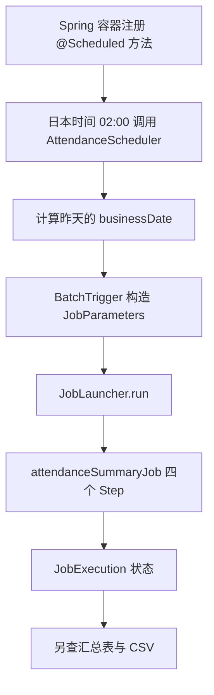

# 05 Spring Scheduling 与 Batch 定时整合

## 本章学习目标

先独立观察定时规则，再将日本时间前一日的考勤 Job 接入调度；能够区分“到点触发”“Job 启动”“最终完成”，并说明异常、停机及多实例风险。

## 前置知识

完成[第 04 章](04_transaction_restart_and_job_management.md)，会看 JobExecution 状态。本章继续使用同一 `attendanceSummaryJob`，不把汇总循环复制进定时方法。

## 实际业务场景

项目每天日本时间 02:00 汇总前一日考勤，也允许人工指定业务日期补跑。调度器只决定何时发起调用；数据库事务、执行历史和重启仍由 Batch 负责。

## 核心概念

`@EnableScheduling` 启用调度基础设施，`@Scheduled` 指定触发规则。`fixedRate` 按计划开始时刻计算间隔，`fixedDelay` 从上一次方法结束后计算，`initialDelay` 控制首次等待。Spring cron 有“秒 分 时 日 月 周”六段，Linux cron 通常是五段；`0 0 2 * * *` 配合 `zone="Asia/Tokyo"` 表示日本时间每天 02:00。应用停止时不会自动补跑错过的时刻。

任务方法抛出异常不等于 JobRepository 已记录一次失败：只有实际启动的 Job 才有 JobExecution。反过来，调度方法被调用也不等于 Job `COMPLETED`。

## 执行流程



独立 rate/delay 实验停在“调用实验方法、记录起止日志”，不经过 `BatchTrigger`。

```text
固定间隔实验：Spring 调度器 → rate/delay 实验方法 → 起止/异常日志
正式路径：日本时间 02:00 → AttendanceScheduler → BatchTrigger
          → JobLauncher → attendanceSummaryJob → JobRepository / 汇总表 / CSV
          → 检查最终状态并记录结果
```

## 关键类与接口

| 文件 | 职责 | 默认状态 |
| --- | --- | --- |
| [SchedulingConfig.java](../examples/attendance-batch/src/main/java/com/example/attendance/SchedulingConfig.java) | 通过 `@EnableScheduling` 开启调度基础设施 | 启用，但无任务自动执行 |
| [FixedRateLab.java](../examples/attendance-batch/src/main/java/com/example/attendance/FixedRateLab.java) / [FixedDelayLab.java](../examples/attendance-batch/src/main/java/com/example/attendance/FixedDelayLab.java) | 各自运行 3 秒任务，观察 2 秒间隔和异常 | 仅指定 `app.schedule.lab-mode` 后创建 |
| [AttendanceScheduler.java](../examples/attendance-batch/src/main/java/com/example/attendance/AttendanceScheduler.java) | 按东京时区取前一日并记录触发异常 | `app.schedule.enabled=false` |
| [BatchTrigger.java](../examples/attendance-batch/src/main/java/com/example/attendance/BatchTrigger.java) | 构造标识性日期参数、调用 `JobLauncher`、检查返回状态 | 手动/定时共用 |

## 代码示例

### 先运行独立 Scheduling 实验

以下是**完整教学类** [FixedDelayLab.java](../examples/attendance-batch/src/main/java/com/example/attendance/FixedDelayLab.java) 及启用基础设施的 [SchedulingConfig.java](../examples/attendance-batch/src/main/java/com/example/attendance/SchedulingConfig.java)。它们是两个独立 Java 文件，按文件名保存。Spring 容器发现 `@Scheduled` 后注册任务，由调度器到时调用 `tick()`；不需要 Controller，也不需要开发者手动调用。

```java
// SchedulingConfig.java
package com.example.attendance;

import org.springframework.context.annotation.Configuration;
import org.springframework.scheduling.annotation.EnableScheduling;

@Configuration
@EnableScheduling
public class SchedulingConfig {
}
```

```java
// FixedDelayLab.java
package com.example.attendance;

import java.util.concurrent.atomic.AtomicBoolean;
import org.slf4j.Logger;
import org.slf4j.LoggerFactory;
import org.springframework.beans.factory.annotation.Value;
import org.springframework.boot.autoconfigure.condition.ConditionalOnProperty;
import org.springframework.context.annotation.Configuration;
import org.springframework.scheduling.annotation.Scheduled;

@Configuration
@ConditionalOnProperty(prefix = "app.schedule", name = "lab-mode", havingValue = "delay")
public class FixedDelayLab {
    private static final Logger log = LoggerFactory.getLogger(FixedDelayLab.class);
    private final boolean failOnce;
    private final AtomicBoolean first = new AtomicBoolean(true);

    public FixedDelayLab(@Value("${app.schedule.lab-fail-once:false}") boolean failOnce) {
        this.failOnce = failOnce;
    }

    @Scheduled(fixedDelay = 2000, initialDelay = 1000)
    public void tick() {
        log.info("fixedDelay start thread={}", Thread.currentThread().getName());
        if (failOnce && first.getAndSet(false)) {
            throw new IllegalStateException("simulated scheduling error");
        }
        try {
            Thread.sleep(3000);
        } catch (InterruptedException ex) {
            Thread.currentThread().interrupt();
            return;
        }
        log.info("fixedDelay end");
    }
}
```

`SchedulingConfig` 逐行看：第 1 行标明源文件，第 2 行是包名，第 4～5 行导入配置与调度注解，第 7 行让 Spring 读取配置类，第 8 行 `@EnableScheduling` 开启定时方法扫描，第 9～10 行是空配置类。**开启扫描不等于启动任何 Job**。

`FixedDelayLab` 逐行阅读（行号从该代码块第 1 行起）：

| 行 | 功能与首次出现的对象/方法 |
| --- | --- |
| 1～10 | 文件标记、包名和导入；`AtomicBoolean` 安全记录“首次触发”，`Logger` 记观察日志，`@Scheduled` 声明定时方法。 |
| 12～17 | `@Configuration` 注册类；条件注解仅在 `lab-mode=delay` 时创建；`log` 记录信息，`failOnce` 保存开关，`first` 初值为真。 |
| 19～21 | 构造器由容器调用；`@Value` 从配置读取 `lab-fail-once`，未配置时为 `false`，保存到字段。 |
| 23～25 | `@Scheduled(fixedDelay=2000,initialDelay=1000)` 注册触发规则，单位毫秒；调度器到时调用无参 `tick()`，首先记录开始时间和线程。 |
| 26～28 | 若开启故障且 `first.getAndSet(false)` 返回首次的真值，就仅在第一次抛异常；异常由调度层记录，不进入后面的休眠。 |
| 29～35 | 正常触发休眠 3000 毫秒模拟工作；中断时恢复线程中断标志并结束；未中断才记录结束日志。 |

`lab-mode=delay` 才创建此 Bean；`lab-fail-once` 默认为 `false`。`initialDelay=1000` 表示首次约 1 秒触发；方法正常耗时约 3 秒，结束后再等约 2 秒。一次异常会由调度层记录，后续触发以实际日志确认。对照**完整教学类** [FixedRateLab.java](../examples/attendance-batch/src/main/java/com/example/attendance/FixedRateLab.java)：

```java
package com.example.attendance;

import org.slf4j.Logger;
import org.slf4j.LoggerFactory;
import org.springframework.boot.autoconfigure.condition.ConditionalOnProperty;
import org.springframework.context.annotation.Configuration;
import org.springframework.scheduling.annotation.Scheduled;

@Configuration
@ConditionalOnProperty(prefix = "app.schedule", name = "lab-mode", havingValue = "rate")
public class FixedRateLab {
    private static final Logger log = LoggerFactory.getLogger(FixedRateLab.class);

    @Scheduled(fixedRate = 2000, initialDelay = 1000)
    public void tick() {
        log.info("fixedRate start thread={}", Thread.currentThread().getName());
        try {
            Thread.sleep(3000);
        } catch (InterruptedException ex) {
            Thread.currentThread().interrupt();
            return;
        }
        log.info("fixedRate end");
    }
}
```

`FixedRateLab` 逐行看：1、3～7 行是包名和导入；9～12 行定义只在 `lab-mode=rate` 时创建的配置对象及日志器；14～16 行声明首次等 1 秒、之后按 2 秒固定速率排程，并在 `tick()` 开始时记日志；17～22 行休眠 3 秒模拟工作，若中断则恢复中断标志并返回；23 行只在正常结束时记 `end`。`fixedRate` 与上面的 `fixedDelay` 只改变调度基准，不会调用 Batch Job。

两个类均由 Spring 容器按同一个 `app.schedule.lab-mode` 属性择一创建：`rate` 与 `delay` 互斥。两者首次延迟 1 秒、间隔参数 2 秒、正常工作 3 秒，比较时只改变 `lab-mode`；务必保持 `app.schedule.enabled=false`，避免正式考勤调度同时启动。定时器调用 `tick()`，无业务日期或 JobParameters，仅输出起止、线程和异常日志。`fixedRate` 按计划开始时刻排程，但执行器忙时实际触发会延迟，不保证并发。下表是**示意时间线，不是本机实测日志**：

| 规则 | 第一次开始 | 第一次结束 | 第二次实际开始的典型观察 |
| --- | --- | --- | --- |
| fixedDelay 2 秒，任务 3 秒 | 00:00:01 | 00:00:04 | 约 00:00:06 |
| fixedRate 2 秒，任务 3 秒 | 00:00:01 | 00:00:04 | 计划 00:00:03，可能延迟到约 00:00:04 |

| 实验日志相对时间（示意） | 第一次 | 第二次 | 判断依据 |
| --- | --- | --- | --- |
| `fixedDelay start/end` | 01s / 04s | start 约 06s | 上次结束后再等约 2s |
| `fixedRate start/end` | 01s / 04s | start 约 04s | 计划点 03s 已错过，执行器空闲后运行 |
| `fixedDelay` 首次抛异常 | 01s start 后抛错、无 end | 约 03s 再 start，约 06s end | 以实际后续日志确认任务仍继续 |

### 再让 Scheduling 启动 Batch

以下是**完整工程类** [AttendanceScheduler.java](../examples/attendance-batch/src/main/java/com/example/attendance/AttendanceScheduler.java)。`app.schedule.enabled=true` 才创建它；它只负责东京日期与调度日志，不把汇总计算写在定时方法里。

```java
package com.example.attendance;

import java.time.LocalDate;
import java.time.ZoneId;
import org.slf4j.Logger;
import org.slf4j.LoggerFactory;
import org.springframework.batch.core.launch.JobInstanceAlreadyCompleteException;
import org.springframework.boot.autoconfigure.condition.ConditionalOnProperty;
import org.springframework.context.annotation.Configuration;
import org.springframework.scheduling.annotation.Scheduled;

@Configuration
@ConditionalOnProperty(prefix = "app.schedule", name = "enabled", havingValue = "true")
public class AttendanceScheduler {
    private static final Logger log = LoggerFactory.getLogger(AttendanceScheduler.class);
    private final BatchTrigger trigger;

    public AttendanceScheduler(BatchTrigger trigger) {
        this.trigger = trigger;
    }

    @Scheduled(cron = "${app.schedule.cron:0 0 2 * * *}", zone = "Asia/Tokyo")
    public void launchYesterday() {
        LocalDate businessDate = LocalDate.now(ZoneId.of("Asia/Tokyo")).minusDays(1);
        try {
            trigger.launch(businessDate);
        } catch (JobInstanceAlreadyCompleteException ex) {
            log.info("scheduled batch already completed for businessDate={}", businessDate);
        } catch (Exception ex) {
            log.error("scheduled batch failed for businessDate={}", businessDate, ex);
        }
    }
}
```

`AttendanceScheduler` 逐行看：1、3～10 行声明包和日期、日志、异常、调度类型；12～16 行规定仅 `enabled=true` 才创建 Bean，并保存日志器与 `BatchTrigger`；18～20 行由容器注入 Trigger；22～24 行注册东京时区 cron，`LocalDate.now(ZoneId.of("Asia/Tokyo")).minusDays(1)` 算业务日前一日；25～26 行调用 Trigger；27～28 行专门把已完成实例记为跳过；29～30 行记录其他异常。`@Scheduled` 的 cron 缺省值是东京时间 02:00；测试可覆盖 `app.schedule.cron`，正式环境不要用每秒表达式。`launchYesterday` 由 Spring 调度器调用，参数是内部计算的“昨天”，不是 HTTP 请求。

实际构造参数、调用 `JobLauncher` 的是**完整工程类** [BatchTrigger.java](../examples/attendance-batch/src/main/java/com/example/attendance/BatchTrigger.java)：

```java
package com.example.attendance;

import java.time.LocalDate;
import org.slf4j.Logger;
import org.slf4j.LoggerFactory;
import org.springframework.batch.core.BatchStatus;
import org.springframework.batch.core.job.Job;
import org.springframework.batch.core.job.JobExecution;
import org.springframework.batch.core.job.parameters.JobParameters;
import org.springframework.batch.core.job.parameters.JobParametersBuilder;
import org.springframework.batch.core.launch.JobLauncher;
import org.springframework.beans.factory.annotation.Qualifier;
import org.springframework.stereotype.Service;

@Service
public class BatchTrigger {
    private static final Logger log = LoggerFactory.getLogger(BatchTrigger.class);
    private final JobLauncher launcher;
    private final Job job;

    public BatchTrigger(JobLauncher launcher, @Qualifier("attendanceSummaryJob") Job attendanceSummaryJob) {
        this.launcher = launcher;
        this.job = attendanceSummaryJob;
    }

    public JobExecution launch(LocalDate businessDate) throws Exception {
        JobParameters parameters = new JobParametersBuilder()
                .addString("businessDate", businessDate.toString(), true)
                .toJobParameters();
        JobExecution execution = launcher.run(job, parameters);
        log.info("jobExecutionId={} businessDate={} status={}",
                execution.getId(), businessDate, execution.getStatus());
        if (execution.getStatus() != BatchStatus.COMPLETED) {
            throw new IllegalStateException("batch failed: jobExecutionId=" + execution.getId());
        }
        return execution;
    }
}
```

`BatchTrigger` 逐行看：1、3～13 行导入日期、状态、Job、参数、Launcher 与 Spring 类型；15～19 行 `@Service` 注册可被注入的入口对象并保存 Launcher/Job 字段；21～24 行构造器用 `@Qualifier` 只接正式 Job；26～29 行的 `launch(date)` 把传入日期写为标识性 `JobParameters`；30 行 `launcher.run` 启动并取得 `JobExecution`；31～32 行记执行 ID、日期和状态；33～35 行非完成时抛异常；36 行成功时返回执行对象。`run` 抛“实例已完成”异常时交给 Scheduler 的专用 catch；返回 `FAILED` 时 Trigger 抛带执行 ID 的异常。当前项目使用同步 Launcher，返回时可以检查终态；若改成异步，返回时可能仍是 `STARTING/STARTED`，应通过 JobRepository 后续查询或完成通知判断，不可沿用“返回即完成”。最后还须查业务表和 CSV。

## 代码执行说明

| 顺序 | 执行者 | 执行内容 | 可观察结果 |
| --- | --- | --- | --- |
| 1 | Spring 容器 | 解析 `@EnableScheduling` 与条件 Bean，注册 `@Scheduled` | 默认不开任何考勤/实验定时任务 |
| 2 | Spring 调度器 | 到东京时间 02:00 调用无参方法 | Scheduler 日志与业务日期 |
| 3 | `AttendanceScheduler` / `BatchTrigger` | 计算昨天，构造 identifying 参数 | `businessDate=YYYY-MM-DD` |
| 4 | `JobLauncher` / Spring Batch | 启动 Job、四个 Step、更新 Repository | JobExecution ID、Step 状态 |
| 5 | Trigger / 运维检查 | 同步检查框架状态，再查业务表与 CSV | 区分触发、完成、业务正确 |

配置类启动调度功能，但 `lab-mode` 与 `enabled` 的条件使实验任务和真实任务默认均不执行。实验中的 `2000`/`1000` 默认按毫秒解释；方法运行 3 秒时，不应把 fixedRate 理解为“保证两个实例并发”。实际线程资源可能使开始时间延后，应以日志为准。`lab-fail-once` 用于观察一次异常及后续触发。

正式路径中，Scheduler 按东京时区计算业务日期，`BatchTrigger` 将其交给唯一的 `attendanceSummaryJob`。本项目使用同步启动器，`BatchTrigger` 在 `run` 返回后检查最终状态；若项目改成异步 JobLauncher，返回时可能仍是 `STARTING/STARTED`，必须改为通过 JobRepository 查询最终状态或接入完成通知，不能沿用“返回即完成”的假设。同日期已经完成会被 Batch 拒绝，Scheduler 记为已完成跳过；其他异常应保留日志与执行 ID 供调查。

## 逐步操作

1. 在个人 MySQL 实验库准备好元数据后，构建 JAR。分别执行以下三条命令，每条观察至少三轮并按 Ctrl+C 结束；不要同时运行多个实例：

   ```powershell
   java -jar target/attendance-batch-1.0.0.jar --app.schedule.enabled=false --app.schedule.lab-mode=rate
   java -jar target/attendance-batch-1.0.0.jar --app.schedule.enabled=false --app.schedule.lab-mode=delay
   java -jar target/attendance-batch-1.0.0.jar --app.schedule.enabled=false --app.schedule.lab-mode=delay --app.schedule.lab-fail-once=true
   ```

2. 记录每次开始、结束、线程名和异常；对比“计划间隔”与“实际间隔”。第三次实验应观察首次 `fixedDelay start` 后有一次异常、没有对应 `end`，随后再次出现 `start` 与 `end`；若后续没有触发，保留日志调查，不能凭示意表宣布通过。这些实验不会启动考勤 Job，但应用启动仍需可连接的实验数据库。三条命令应逐条结束进程后再运行下一条。
3. 运行 `mvn -q '-Dtest=AttendanceSchedulerTest,ScheduledLaunchIntegrationTest' test`。集成测试在独立 H2 中临时使用短周期 cron，检查实际 JobExecution；此配置只属于测试。
4. 在受控测试环境临时启用 `--app.schedule.enabled=true`，核对触发日志、JobExecution、汇总行数与 CSV，再关闭它；不要把每秒 cron 留在正式配置。

## 运行结果与验证

delay 下一次开始应晚于上次结束约 2 秒；rate 按开始时刻规划，但 3 秒任务和线程限制会推迟实际开始。故障实验应记录一次失败与之后的触发。自动化测试验证东京时区“昨天”的参数和单进程定时创建 JobExecution；不能据此声称多实例下唯一触发。核对调度成功必须分别看日志、Batch 元数据和业务输出。

## 常见错误

五段 Linux cron 写进 Spring 注解会解析失败；不指定 `zone` 会受部署机默认时区影响；在 Scheduler 中直接写批量循环会失去 Batch 执行历史；只看“调用成功”日志而不看 Job 最终状态会误报。若应用停机，没有调度补跑，应按[第 04 章](04_transaction_restart_and_job_management.md)的规则人工调查和补跑。

| 现象 | 首先确认 | 处理方向 |
| --- | --- | --- |
| 启动时报 cron 解析错误 | 是否误用了 Linux 五段式 | 使用 Spring 六段式，检查测试覆盖值 |
| 东京凌晨处理了错误日期 | `zone` 与 `LocalDate.now(ZoneId.of("Asia/Tokyo"))` 是否一致 | 统一按业务时区算前一日 |
| 调度已触发但没有 JobExecution | 数据库连接、Repository 初始化、Launcher 调用异常 | 从 Scheduler 错误日志追到连接和元数据表 |
| 显示“已完成跳过” | 同业务日期 JobInstance 是否已 `COMPLETED` | 核对原执行和输出，不加随机参数 |
| 已有 JobExecution 但 `FAILED` | 失败 Step、异常、已提交件数和 CSV | 按第 04 章调查并决定同参数恢复 |
| 停机后缺某日记录 | 该时段进程是否运行 | 确认遗漏日期，人工受控补跑 |
| 两个实例都触发 | 是否多实例部署 | 明确单一调度责任并核对共享 Repository/业务唯一键 |

## 日本项目中的注意事项

多实例会在各实例触发；共享 JDBC JobRepository 和业务唯一键能降低同一日期重复写入风险，但不是完整的集群调度方案。需明确单一调度责任、部署策略、长任务重叠、停机补跑与告警。Linux cron、Shell、应用内 Scheduling 可作为不同入口，不应各自复制业务逻辑。日志避免姓名、密码等敏感内容。参见 [Spring Scheduling 官方文档](https://docs.spring.io/spring-framework/reference/integration/scheduling.html)。

## 学员练习

1. 理解：说明六段 cron、东京时区和 `businessDate` 的关系，以及定时触发不等于完成的原因。
2. 读代码：从 `AttendanceScheduler` 追到 `BatchTrigger` 和 `BatchConfig`，标出每层负责的状态判断。
3. 操作：分别运行 rate/delay/一次失败实验，提交三轮起止时间；再运行两项自动化测试，截图或记录 JobExecution 状态。
4. 故障调查：假设凌晨实例停机，写出确认遗漏日期、检查既有实例、按同参数人工补跑与验收的手顺。

## 本章验收标准

能用实际日志比较 rate/delay，写出正确的东京时间 cron，并分别证明调度调用、JobExecution 和业务结果；能指出多实例与停机漏跑的处置边界。

## 本章总结

Scheduling 管“何时发起”，Batch 管“如何执行与恢复”，业务表/CSV 管“结果是什么”。下一章把三类证据合成一份可交付的业务票。
