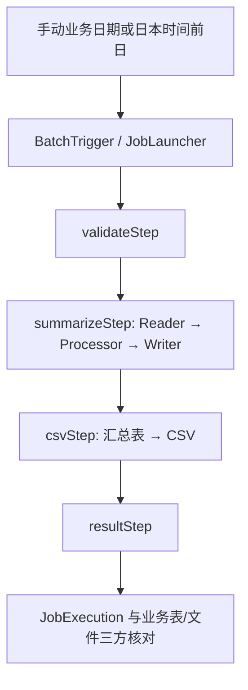

# 06 综合实战：勤怠日次集計・CSV連携バッチ

## 本章学习目标

按照业务票独立完成一次考勤日次汇总与 CSV 联携，提交可复核的运行、测试、故障恢复和障害調査证据。概念和单点操作已在[第 01～05 章](../README.md)完成，本章重在改修和交付。

## 前置知识

会运行独立[实验工程](../examples/attendance-batch/pom.xml)，理解 Job/Step、Chunk、同参数重启和调度入口。先核对[运行手册](../runbook.md)；使用个人 MySQL 8 数据库和专用输出目录，不改 Spring Boot Employee Management 主线。

## 实际业务场景

业务票：每天日本时间 02:00 汇总前一日虚构员工考勤，向下游交付 `attendance-YYYY-MM-DD.csv`；运维可以指定日期人工执行。员工与业务日期构成汇总唯一键；完成日期不得无意重生成，失败后应能调查并恢复。

| 项目 | 验收规格 |
| --- | --- |
| 输入参数 | 必填 `businessDate`，ISO `YYYY-MM-DD`；定时入口取日本时间前一日 |
| 输入表 | `employees`、`attendance_records`；本实验每人每天至多一条考勤 |
| 计算 | `worked = end - start - break` 分钟；`overtime = max(0, worked - 480)` |
| 输出表 | `attendance_daily_summary`，主键 `(employee_id, business_date)` |
| CSV | UTF-8、表头 `employee_id,business_date,worked_minutes,overtime_minutes`、按员工 ID 升序 |
| 证据 | Job/Step 状态、源/汇总件数、CSV 行数、脱敏日志与异常记录 |

这只是培训规格，不涵盖跨日班、复杂休假或法律上的加班认定；现场必须按真实设计书确认。

## 核心概念

`validateStep` 校验参数与源件数，`summarizeStep` 分块计算并提交，`csvStep` 在数据库事务外导出文件，`resultStep` 记录完成件数。`businessDate` 是标识性 Job 参数。默认遇到非法考勤即失败；Skip/Retry 是第 04 章的独立实验，不应未经业务批准带入正式 Job。CSV 用同目录临时文件和原子替换；文件步骤失败后修复路径，按同参数恢复，而非删除已经提交的汇总。

## 执行流程



```text
人工日期 / 日本时间前日
  → validateStep：参数与源记录
  → summarizeStep：Reader → Processor → Writer（25 条分 10/10/5）
  → csvStep：读取汇总 → 临时 CSV → 原子替换
  → resultStep：记录件数
  → 核对 JobExecution、汇总表、CSV
```

以 `businessDate=2026-10-19` 为例：PowerShell 命令行把参数交给 [ManualBatchRunner.java](../examples/attendance-batch/src/main/java/com/example/attendance/ManualBatchRunner.java)，它解析 `LocalDate` 并调用 `BatchTrigger`；Trigger 用日期创建标识性 JobParameters，`JobLauncher` 通过 Repository 创建 JobExecution。`validateStep` 先检查日期和源件数，`summarizeStep` 的 Reader 查询 `attendance_records`，Processor 计算，Writer 经 Mapper 在每个 Chunk 事务中写汇总。全部 25 条按 10/10/5 提交后，`csvStep` 读取已提交汇总生成文件，`resultStep` 记件数，框架最终更新 Job 状态。之后仍要独立查询 25 行汇总与 26 行 CSV。

| 顺序 | 执行者 | 输入与处理 | 可检查结果 |
| --- | --- | --- | --- |
| 1 | 命令行 / ManualBatchRunner | 接收业务日期，调用 Trigger | 参数值与入口日志 |
| 2 | JobLauncher / JobRepository | 创建 JobExecution | 执行 ID 与 `BATCH_*` 行 |
| 3 | Spring Batch 四个 Step | 校验 → Chunk 汇总 → CSV → 结果日志 | 各 Step 状态、读写计数 |
| 4 | 学员/运维 | 查汇总表、CSV 与元数据 | 三方一致才通过 |

## 关键类与接口

### 从入口按调用顺序读工程

真实目录的核心文件如下；`target/` 是本地构建产物，不属于源码。下列 `src` 文件均在 [独立 Maven 工程](../examples/attendance-batch/pom.xml)，SQL 在课程 `sql/` 目录：

```text
examples/attendance-batch/
  pom.xml
  src/main/java/com/example/attendance/
    AttendanceBatchApplication.java   # Spring Boot 入口
    ManualBatchRunner.java             # 手动入口
    AttendanceScheduler.java           # 定时入口
    BatchTrigger.java                  # 日期参数与 JobLauncher
    BatchConfig.java                   # Job 与四个 Step
    AttendanceReader.java              # 按日期/ID 读
    AttendanceProcessor.java           # 计算工作与加班分钟
    AttendanceWriter.java              # 写一组汇总
    AttendanceMapper.java              # MyBatis SQL
    CsvExportTasklet.java              # CSV 文件输出
  src/test/java/com/example/attendance/
    AttendanceBatchIntegrationTest.java
    CsvFailureIntegrationTest.java
    ScheduledLaunchIntegrationTest.java
sql/
  schema.sql
  sample_data.sql
```

阅读时先找 `AttendanceBatchApplication.main`，再按“手动或定时入口 → BatchTrigger → BatchConfig 的 Job/Step 顺序 → Reader → Processor → Writer/Mapper SQL → CsvExportTasklet → 异常处理 → 测试”的方向追踪。每读一个文件回答：谁创建对象、谁调用方法、参数从哪来、失败交给谁、留下什么证据。`TaskletLessonConfig` 和 `NumberChunkLessonConfig` 是仅由教学开关启用的独立实验，**不在正式四 Step 执行链内**。

| Step | 输入 | 处理与输出 | 事务边界 / 失败后 |
| --- | --- | --- | --- |
| `validateStep` | `businessDate`、源表件数 | 校验并记日志 | Tasklet Step 的 JDBC 事务；完成后默认不在重启时重做 |
| `summarizeStep` | 当日考勤记录 | 计算后写 `attendance_daily_summary` | 每 10 条一组提交；失败组回滚，按保存的 Reader 位置恢复 |
| `csvStep` | 已提交的汇总表 | 临时文件原子替换为 CSV | 文件不参加 JDBC 回滚；失败后核对路径与下游，再按同参数恢复 |
| `resultStep` | 业务日期与汇总表 | 统计件数并记日志 | Tasklet Step；Job 状态之外仍须业务验收 |

| 源文件 | 本票职责 | 主要检查点 |
| --- | --- | --- |
| [BatchConfig.java](../examples/attendance-batch/src/main/java/com/example/attendance/BatchConfig.java) | 定义唯一正式 Job 和四个 Step | 顺序、参数、事务 |
| [AttendanceReader.java](../examples/attendance-batch/src/main/java/com/example/attendance/AttendanceReader.java) | 按日期及唯一 ID 读取，保存检查点 | 排序和重启位置 |
| [AttendanceProcessor.java](../examples/attendance-batch/src/main/java/com/example/attendance/AttendanceProcessor.java) | 校验并计算工时 | 错误必须显式失败 |
| [AttendanceWriter.java](../examples/attendance-batch/src/main/java/com/example/attendance/AttendanceWriter.java) / [AttendanceMapper.java](../examples/attendance-batch/src/main/java/com/example/attendance/AttendanceMapper.java) | MyBatis UPSERT | 主键和事务参与 |
| [CsvExportTasklet.java](../examples/attendance-batch/src/main/java/com/example/attendance/CsvExportTasklet.java) | 导出和原子替换 | 路径、临时文件和失败清理 |
| [BatchTrigger.java](../examples/attendance-batch/src/main/java/com/example/attendance/BatchTrigger.java) / [AttendanceScheduler.java](../examples/attendance-batch/src/main/java/com/example/attendance/AttendanceScheduler.java) | 手动/定时入口 | 日期、状态、重复执行 |

表结构与虚构数据见 [schema.sql](../sql/schema.sql)、[sample_data.sql](../sql/sample_data.sql)。`idx_attendance_day_id` 支持按日期、ID 读取；汇总唯一键是最后一道重复写入防护。

## 代码示例

以下是 [CsvExportTasklet.java](../examples/attendance-batch/src/main/java/com/example/attendance/CsvExportTasklet.java) 的文件替换核心片段；完整类还包含 `lines` 的生成和清理：

```java
Path target = outputDirectory.resolve("attendance-" + date + ".csv");
Path temporary = Files.createTempFile(outputDirectory, "attendance-" + date + "-", ".tmp");
try {
    Files.write(temporary, lines, StandardCharsets.UTF_8);
    Files.move(temporary, target, StandardCopyOption.ATOMIC_MOVE,
            StandardCopyOption.REPLACE_EXISTING);
} finally {
    Files.deleteIfExists(temporary);
}
```

文件替换片段逐行看：第 1 行 `Path target` 用输出目录和业务日期构成最终 CSV 路径；第 2 行 `Files.createTempFile` 在**同一目录**创建临时文件；第 3 行进入 `try/finally` 清理范围；第 4 行以 UTF-8 写入已准备好的 `lines`；第 5～6 行用 `Files.move` 尝试原子替换目标文件；第 7～8 行无论成功或异常都尝试删除剩余临时文件。`Path` 表示文件路径，`Files` 提供文件操作方法；`ATOMIC_MOVE` 不保证所有文件系统都支持，失败须调查，不可把异常吞掉。`lines` 在完整 `CsvExportTasklet` 中生成，此片段不是独立可运行程序。

## 代码执行说明

汇总 Chunk 在数据库事务中提交；CSV 文件不参与该事务，因此需要单独的 `csvStep` 和重启策略。临时文件与目标位于同一目录；若目标文件系统不支持原子移动，本例选择失败并调查，而非静默暴露半成品。当前 CSV 仅有整数与日期；若加姓名或自由文本，必须使用经过验证的 CSV 转义工具。文件替换成功但元数据更新失败仍有故障窗口，需同时对照文件和 JobExecution。

## 逐步操作

1. 在个人数据库确认业务表、25 条样例记录和 Batch 元数据；`sample_data.sql` 仅首次导入。运行 `mvn test`、`mvn package`。H2 测试不能替代 MySQL 验证。
2. 配置本机数据库凭据和输出目录，在工程目录运行 `java -jar target/attendance-batch-1.0.0.jar --app.batch.business-date=2026-10-19`。首次空元数据需按[运行手册](../runbook.md)初始化，后续关闭初始化。
3. 查 JobExecution 为 `COMPLETED`，四个 Step 完成；源 25、汇总 25，CSV 26 行。抽查员工 1001 的 `worked_minutes=480`、`overtime_minutes=0`。
4. 同参数再运行，记录已完成实例拒绝；换空日期运行，CSV 应只有表头。
5. 在可重建副本中破坏第 13 条：确认第一 Chunk 的 10 行已提交、Job `FAILED`；修复后同参数重启，确认最终 25 行且没有重复。另制造一次 CSV 路径故障，修复后同参数恢复，不删除汇总。
6. 实施[学员任务书](../exercises/assignments.md)中的加班改修，更新预期并测试。受控启用调度后，分别保存触发、JobExecution、业务表/文件证据，然后关闭。

## 运行结果与验证

自动化测试验证 H2 下正常 25、空日 0、错误参数、已完成实例拒绝、第 13 条失败/同参数恢复、Skip/Retry、CSV 路径恢复和定时创建执行记录；具体本次运行结果见[验证报告](../verification_report.md)。Java 17 与 MySQL 必须在对应环境实际执行后才能签收，不能把 H2 结果写成 MySQL 实测。

## 常见错误

| 现象 | 先查 | 处置 |
| --- | --- | --- |
| 缺少 `BATCH_*` 表 | 元数据库和 JDBC 配置 | 仅在专用空库按当前版本初始化 |
| 第 13 条失败，已有 10 行 | Step 记录与 Reader 检查点 | 修正源数据，同参数重启 |
| 汇总 25 行但无 CSV | `csvStep`、目录权限、临时文件 | 修复路径，同参数恢复，不清空汇总 |
| 同日期再次被拒绝 | JobInstance 是否 `COMPLETED` | 按订正规格处理，不加随机参数绕过 |
| 文件已有但 Job 失败 | 文件替换与元数据的故障窗口 | 对照文件、执行 ID 和下游接收状态 |

## 日本项目中的注意事项

改修前记录设计书的対象日、対象件数、异常处理和再実行条件；改修后提供 SQL、文件和执行元数据的交叉证据。源数据若执行中变化，需要冻结快照或截止点规格，UPSERT 不会自动解决。CSV 路径限定专用测试目录；日志只留日期、执行 ID、件数和异常摘要，不写个人信息或凭据。交接材料应包含対象ジョブ、業務日付、実行 ID、処理件数、影響範囲、再実行可否和确认结果。

## 学员练习

1. 理解：解释“数据库 25 行但 Job 失败”为何可能发生。
2. 读代码：标注四个 Step 的输入、输出、事务边界及失败后会否重跑。
3. 改修与验证：新增合法加班数据，更新测试预期，交付数据库与 CSV 对照；故意制造第 13 条错误并完成同参数恢复。
4. 故障调查：按[学员任务书](../exercises/assignments.md)提交脱敏的日文风格障害調査报告；教师核对要点在独立的[教师参考](../exercises/instructor_answers.md)。

每次实验按同一份证据模板提交，避免只给“运行成功”截图：

| 字段 | 填写内容 |
| --- | --- |
| 执行命令与环境 | 完整命令、JDK、数据库种类；凭据脱敏 |
| 业务日期与执行身份 | `businessDate`、JobInstance ID、JobExecution ID |
| Step 证据 | 四个 Step 的状态、读/写/跳过数、失败 Step 与异常摘要 |
| 业务证据 | 源表与汇总表件数、员工 1001 抽查值 |
| 文件证据 | CSV 路径、行数、是否已交给下游 |
| 结果判断 | 正常/失败/已完成拒绝/同参数恢复；说明是否可再执行 |

正式交付时逐项勾选并附证据位置，不用单张“成功”截图替代：

| 检查项 | 可提交证据 | 状态 |
| --- | --- | --- |
| 工程可构建 | Maven 命令、退出码、依赖版本及 JDK 版本 | 待填写 |
| 自动测试 | Surefire 用例总数、失败数、报告路径 | 待填写 |
| MySQL 8 实际运行 | 独立库连接、建表/导入记录、Job 与四 Step 状态 | 待填写 |
| 业务结果 | 源 25、汇总 25、员工 1001 工时及改修后的预期 | 待填写 |
| CSV 交付 | 文件路径、表头与数据行数、下游接收确认 | 待填写 |
| 失败恢复 | 首次失败与恢复 Execution ID、检查点、最终无重复 | 待填写 |
| 安全与交接 | 凭据脱敏、个人数据脱敏、补跑可否与确认者 | 待填写 |

| 判定层次 | 达成条件 | 不可越过的边界 |
| --- | --- | --- |
| 实现完成 | 代码、配置、说明和改修内容齐备，能构建 | 不能推断测试已通过 |
| 测试通过 | 自动测试退出码为 0，断言及报告已核对 | H2 只证明测试环境行为，**不能替代 MySQL 8 的 SQL 方言、权限、事务与文件路径实测** |
| 业务验收通过 | 业务方按规格核对件数、工时、CSV、异常与下游交付并签认 | Job `COMPLETED` 或 Maven 绿色均不能代替业务确认 |

## 本章验收标准

工程可重建；基线和改修后的件数/工时均可核对；同参数重复不产生新业务行，失败重启无重复；调度触发与 Job 完成有分别证据；另一位开发者能据报告复核故障原因和再执行结果。只答对理论、不完成实操不能通过。

## 本章总结

交付一份可靠 Batch 的标准是：输入和日期说得清、结果可核对、失败可恢复、重复可控制、调度可调查，并把这些证据交给下一位维护者。
