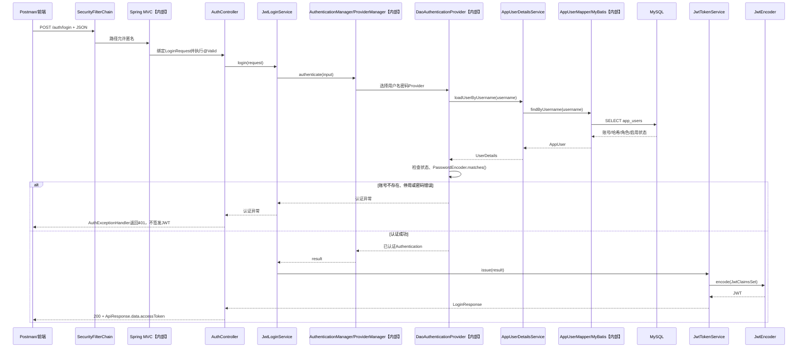
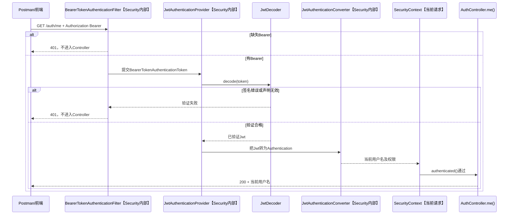

# 第15章 Spring Security：数据库注册与JWT Bearer认证

第14章的Employee Management已能查询、修改员工，但任何请求都没有身份检查。本章沿用同一工程和数据库，完成“公开注册USER账号→用户名密码登录→签发短期JWT→后续请求带Bearer证明身份”。第16章再决定角色能做什么、能读哪一名员工。环境为Java 17、Spring Boot 4.1.1、MyBatis Starter 4.1.0、MySQL 8；Eclipse启动、Postman观察响应、数据库客户端核对记录。最终源码在[R15](../reference/R15_session_login_complete_source.md)，正文可以独立完成，不需要先阅读参考文件。

先在第14章工程的`pom.xml`现有`<dependencies>`中增加下面两项，保留原有依赖：

```xml
<!-- 功能：加入请求过滤、密码编码等Spring Security基础能力。 -->
<dependency>
    <groupId>org.springframework.boot</groupId>
    <artifactId>spring-boot-starter-security</artifactId>
</dependency>
<!-- 功能：加入Bearer JWT验证能力，并传递引入JOSE与OAuth2 Core模块。 -->
<dependency>
    <groupId>org.springframework.boot</groupId>
    <artifactId>spring-boot-starter-security-oauth2-resource-server</artifactId>
</dependency>
```

- `dependency`：放在原有`<dependencies>`内部，`groupId`和`artifactId`共同确定要加入的库；这里是新增项，不替换第14章依赖。
- `spring-boot-starter-security`：提供Spring Security的请求过滤、认证与密码编码基础能力。
- `spring-boot-starter-security-oauth2-resource-server`：提供Bearer JWT认证所需的资源服务器，并间接引入`spring-security-oauth2-jose`和`spring-security-oauth2-core`；`JwtDecoder`与`OAuth2TokenValidator`分别来自后两个模块。

本章使用Spring Boot 4.1.1父工程管理这些依赖的版本，不要自行给两项Starter指定版本。保存后在Eclipse中右键项目，选择**Maven → Update Project**，等待下载完成，再重新启动项目。如果`JwtDecoder`无法导入，或启动时报找不到`OAuth2TokenValidator`，先确认当前启动工程的Maven Dependencies中包含上述模块。完整`pom.xml`可对照[R15](../reference/R15_session_login_complete_source.md)。

## 15-01 Security是什么，为什么要放在Controller之前

没有后端保护时，即使前端隐藏了员工列表按钮，任何人仍可直接发送`GET /employees`。Spring Security把检查放在Controller之前：**认证（Authentication）**确认“请求是谁”，**授权（Authorization）**判断“这个身份能否做当前操作”。本章先建立身份，第16章再按角色和员工归属限制操作。

```text
客户端HTTP请求
    ↓
Spring Security FilterChain【框架内部】
    ├─ 缺身份或权限不足 → 401或403，不进入Controller
    ↓
DispatcherServlet【Spring MVC内部】
    ↓
Controller【项目代码】→ Service【项目代码】→ Mapper【MyBatis代理】→ MySQL
```

这是简化的请求路径，不表示每个请求都会访问数据库。尚未登录访问受保护接口是401；第16章中已登录USER访问仅ADMIN可用的接口是403；已登录ADMIN且业务查询成功才可能得到200。401表示需要有效身份，403表示已有身份但当前操作被拒绝。`HttpSecurity`、`SecurityFilterChain`、`@Bean`此时先认识名称：前者在启动时配置规则，`http.build()`建立过滤链，`@Bean`交给Spring管理；15-02结合代码说明。它们都不是一次登录请求的账号密码。

学习路线：匿名请求被挡住 → 账号来自MySQL → 注册时哈希密码 → 用数据库资料验证登录 → 签发JWT → 新请求验证Bearer → 过期与退出。JWT只是带签名的声明，不是加密保险箱；不要存密码或敏感员工资料。

## 15-02 先让匿名员工请求返回401

先立三条规则：`/health`与`/error`可访问；`/auth/register`与`/auth/login`稍后允许匿名；其余请求暂时必须有身份。确认已在本章开头为原第14章工程加入两项Security依赖，其他依赖不删。下列阶段配置在JWT编解码器尚未建立时也能启动；到15-08**整体替换**为最终配置，不能并存两条`SecurityFilterChain`。

`src/main/java/com/example/employee/config/SecurityConfig.java`：

```java
package com.example.employee.config;

import jakarta.servlet.http.HttpServletResponse;
import org.springframework.context.annotation.Bean;
import org.springframework.context.annotation.Configuration;
import org.springframework.http.MediaType;
import org.springframework.security.config.annotation.web.builders.HttpSecurity;
import org.springframework.security.config.annotation.web.configurers.AbstractHttpConfigurer;
import org.springframework.security.config.http.SessionCreationPolicy;
import org.springframework.security.crypto.bcrypt.BCryptPasswordEncoder;
import org.springframework.security.crypto.password.PasswordEncoder;
import org.springframework.security.web.SecurityFilterChain;

// 功能：标记安全配置类，供Spring在启动时读取其中的Bean定义。
@Configuration
public class SecurityConfig {
    // 功能：建立密码编码器；注册时生成BCrypt哈希，认证时核对密码。
    @Bean
    public PasswordEncoder passwordEncoder() {
        return new BCryptPasswordEncoder();
    }

    // 功能：把下方HTTP访问规则构建成应用实际使用的过滤链。
    @Bean
    public SecurityFilterChain securityFilterChain(HttpSecurity http)
            throws Exception {
        // 功能：本项目使用显式Bearer头而非认证Cookie，故不使用CSRF令牌。
        http.csrf(AbstractHttpConfigurer::disable)
            // 功能：不在服务器Session中保存每次请求的认证身份。
            .sessionManagement(s -> s.sessionCreationPolicy(SessionCreationPolicy.STATELESS))
            // 功能：关闭框架自动提供的表单登录和HTTP Basic入口。
            .formLogin(AbstractHttpConfigurer::disable)
            .httpBasic(AbstractHttpConfigurer::disable)
            // 功能：按顺序声明匿名、需认证和兜底拒绝的路径。
            .authorizeHttpRequests(a -> a
                .requestMatchers("/health", "/error",
                        "/auth/register", "/auth/login").permitAll()
                .requestMatchers("/auth/me", "/employees", "/employees/**")
                    .authenticated()
                .anyRequest().denyAll())
            // 功能：匿名访问受保护路径时返回401 JSON，而不是跳转登录页。
            .exceptionHandling(e -> e.authenticationEntryPoint((request, response, ex) -> {
                response.setStatus(HttpServletResponse.SC_UNAUTHORIZED);
                response.setContentType(MediaType.APPLICATION_JSON_VALUE);
                response.setCharacterEncoding("UTF-8");
                response.getWriter().write("{\"success\":false,\"message\":\"请先登录\",\"data\":null}");
            }));
        // 功能：完成配置并将过滤链交给Spring。
        return http.build();
    }
}
```

- `@Configuration`、`@Bean`：前者标记启动时读取的配置类；后者把方法返回值注册为Spring Bean。`passwordEncoder()`产生一个`PasswordEncoder`，`securityFilterChain(...)`产生一个`SecurityFilterChain`，不是每次HTTP请求都执行这两个Bean方法。
- `HttpSecurity http`、`SecurityFilterChain`：前者是Spring传入的规则配置对象；`http.build()`把规则建成后者，供后续HTTP请求通过。`throws Exception`使配置失败直接表现为启动失败。
- `PasswordEncoder`、`BCryptPasswordEncoder`：前者是密码编码接口，后者是本例的BCrypt实现；注册服务会调用`encode(...)`，认证组件会调用`matches(...)`。
- `csrf(AbstractHttpConfigurer::disable)`、`sessionManagement(...)`：前者关闭CSRF过滤，理由仅限本项目不使用自动附加的认证Cookie；后者用`SessionCreationPolicy.STATELESS`要求不把认证身份存入Session。`AbstractHttpConfigurer::disable`是调用该配置器`disable()`的简写。
- `formLogin(...)`、`httpBasic(...)`：关闭两种不属于本项目规格的内置登录入口；本章后面只提供JSON登录，并让后续请求带Bearer。
- `authorizeHttpRequests(...)`、`requestMatchers(...)`：按书写顺序选择路径；`permitAll()`允许匿名，`authenticated()`要求已认证，`denyAll()`拒绝其余未列出的路径。这些规则不负责读取登录JSON或验证密码。
- `exceptionHandling(...)`、`authenticationEntryPoint(...)`：指定“尚未认证却访问受保护接口”的HTTP出口；回调中的`response`是本次响应，`SC_UNAUTHORIZED`是401，`MediaType.APPLICATION_JSON_VALUE`表示JSON内容类型。它不处理业务Controller内部异常。
- 当前状态：现在还没有登录接口，匿名员工请求必为401。`STATELESS`表示不把身份存Session；最终请求将使用Bearer头。关闭CSRF只适用于本项目不使用认证Cookie的最终方案，不是“所有REST接口都无需CSRF”的通则。
- 验证：Eclipse运行启动类。Postman请求`GET http://localhost:8080/health`（无参数/请求体）预期200和原健康响应；`GET http://localhost:8080/employees/1001`（无参数/请求体）预期401 JSON。在`EmployeeController`详情方法首行设断点，匿名请求不应命中；若命中，先检查是否启动了更新依赖后的工程和当前`SecurityConfig`。

## 15-03 登录账号与员工资料分开

`employees`是业务员工，`app_users`是系统账号；一个账号可暂时没有员工关联。注册不能自选ADMIN，密码只保存BCrypt哈希。按下列顺序准备MySQL账号表、实体和Mapper；这些代码沿用前面MyBatis知识，重点看`role`、`enabled`、`employee_id`的业务意义。

| `app_users`字段 | 本项目用途 |
| --- | --- |
| `id` | 登录账号主键，不等于员工ID |
| `username` | 唯一登录名；认证时按它查询 |
| `password_hash` | BCrypt哈希；不保存明文密码 |
| `employee_id` | 关联的业务员工ID，可为空，供第16章本人判断 |
| `role` | 服务端指定的`USER`或`ADMIN`，登录时进入身份权限 |
| `enabled` | 能否通过新的密码认证 |

### 在MySQL 8.0创建账号表

只在个人练习数据库执行。`password_hash` 保存单向哈希，不保存原始密码：

```sql
USE employee_db;

-- 功能：独立保存登录账号，不把密码和角色塞进业务员工表。
CREATE TABLE app_users (
    -- 功能：用数据库生成账号主键，并保证用户名和员工关联不重复。
    id BIGINT NOT NULL AUTO_INCREMENT,
    username VARCHAR(50) NOT NULL,
    password_hash VARCHAR(100) NOT NULL,
    employee_id BIGINT NULL,
    role VARCHAR(30) NOT NULL,
    enabled BOOLEAN NOT NULL DEFAULT TRUE,
    CONSTRAINT pk_app_users PRIMARY KEY (id),
    CONSTRAINT uk_app_users_username UNIQUE (username),
    CONSTRAINT uk_app_users_employee_id UNIQUE (employee_id)
);
```

- `app_users`、`employees`：前者保存登录资料，后者保存业务员工资料；两者分开才能允许“有员工但无账号”或“账号暂未绑定员工”。
- `password_hash`：保存BCrypt哈希而非原始密码；`VARCHAR(100)`为编码结果留出空间。
- `employee_id BIGINT NULL`：账号可以暂时不关联员工；唯一约束防止两名账号同时绑定同一员工。
- `role`、`enabled`：分别保存服务端指定的角色和是否允许新登录；公开注册不可由客户端设置这两列。
- `UNIQUE`、`PRIMARY KEY`：由MySQL检查重复；即使应用层先查询用户名，也必须保留数据库唯一约束来挡住并发重复注册。

当前员工采用物理删除，因此本章不虚构外键删除规则。只在个人练习库建表；已有表不要重复执行`CREATE TABLE`。

先在本机临时工具中用课程项目的 `PasswordEncoder` 生成哈希，再把输出写入练习库。不要把命令中的练习密码替换成真实密码：

```java
// 功能：将练习密码编码一次，得到可写入password_hash列的BCrypt字符串。
String hash = passwordEncoder.encode("TrainingPass123!");
System.out.println(hash);
```

- `passwordEncoder`、`encode(...)`：使用15-02创建的编码器；`encode`接收原始密码，返回带随机盐的哈希字符串。它不把原密码写入数据库。
- `System.out.println(...)`：仅用于本地练习时观察生成值；真实密码和哈希都不应输出到项目日志。

```sql
-- 功能：准备一名可登录账号和一名停用账号，供本章及第16章验证。
INSERT INTO app_users (
    id, username, password_hash, employee_id, role, enabled
) VALUES (
    1, 'tanaka',
    '$2a$10$nljJFXRpHlZ2gPsH7lM12eIan96c0Y03Y/YCucFA/SA6z.1Lv7UTC',
    1001,
    'USER',
    TRUE
),
(
    4,
    'disabled-user',
    '$2a$10$nljJFXRpHlZ2gPsH7lM12eIan96c0Y03Y/YCucFA/SA6z.1Lv7UTC',
    NULL,
    'USER',
    FALSE
);
```

- `INSERT INTO app_users`：只写入练习库；示例哈希对应练习密码，不要替换为真实密码。
- `id=1`、`id=4`：分别保留给tanaka与停用账号，使第16章可使用`id=2`、`id=3`新增sato、admin。若个人练习库已存在tanaka，不要再次执行整段`INSERT`，只补尚不存在的停用账号。
- `TRUE`、`FALSE`：分别表示允许和禁止该账号进行新的认证；它们不删除账号记录。

BCrypt每次使用随机salt，同一密码产生不同哈希是正常现象；验证应调用 `matches()`，不能重新encode后比较两个字符串。

### 新建AppUser.java

```java
package com.example.employee.entity;

// 功能：承载app_users中的一行账号资料，不直接作为HTTP响应返回。
public class AppUser {
    private Long id;
    private String username;
    private String passwordHash;
    private Long employeeId;
    private String role;
    private boolean enabled;

    public Long getId() { return id; }
    public void setId(Long id) { this.id = id; }
    public String getUsername() { return username; }
    public void setUsername(String username) { this.username = username; }
    public String getPasswordHash() { return passwordHash; }
    public void setPasswordHash(String passwordHash) { this.passwordHash = passwordHash; }
    public Long getEmployeeId() { return employeeId; }
    public void setEmployeeId(Long employeeId) { this.employeeId = employeeId; }
    public String getRole() { return role; }
    public void setRole(String role) { this.role = role; }
    public boolean isEnabled() { return enabled; }
    public void setEnabled(boolean enabled) { this.enabled = enabled; }
}
```

- `AppUser`：与`app_users`表对应的持久化对象；`passwordHash`只供认证使用，不能作为注册或查询接口的响应字段。
- `Long employeeId`：可为`null`，表示尚未绑定业务员工；`boolean enabled`对应数据库启用标志。
- getter/setter：沿用前面章节的Java Bean写法，供MyBatis读取、写入属性；这里不再次把它们当作新的Spring Security机制。

### 新建AppUserMapper.java和XML

```java
package com.example.employee.mapper;

import com.example.employee.entity.AppUser;
import org.apache.ibatis.annotations.Mapper;
import org.apache.ibatis.annotations.Param;

// 功能：让MyBatis为接口生成访问app_users的实现。
@Mapper
public interface AppUserMapper {
    // 功能：按唯一用户名查询账号，供认证组件加载资料。
    AppUser findByUsername(@Param("username") String username);
    // 功能：注册成功时插入一行并把生成的主键写回account.id。
    int insert(AppUser account);
}
```

- `@Mapper`：沿用MyBatis章节的注解，使该接口成为可注入的Mapper代理，不需要手写实现类。
- `@Param("username")`、`findByUsername(...)`：把方法参数命名为XML中的`username`，查询成功返回`AppUser`，未找到时返回`null`；方法本身不验证密码。
- `insert(AppUser account)`：接收注册服务创建的账号，返回受影响行数；数据库唯一约束可能使重复用户名插入失败。

```xml
<?xml version="1.0" encoding="UTF-8" ?>
<!DOCTYPE mapper PUBLIC "-//mybatis.org//DTD Mapper 3.0//EN"
        "https://mybatis.org/dtd/mybatis-3-mapper.dtd">
<mapper namespace="com.example.employee.mapper.AppUserMapper">
    <!-- 功能：按用户名读取认证所需字段，#{username}作为绑定参数。 -->
    <select id="findByUsername" resultType="AppUser">
        SELECT id, username, password_hash, employee_id, role, enabled
        FROM app_users
        WHERE username = #{username}
    </select>
    <!-- 功能：插入账号并把数据库生成的id回填到AppUser.id。 -->
    <insert id="insert" parameterType="AppUser"
            useGeneratedKeys="true" keyProperty="id">
        INSERT INTO app_users
            (username, password_hash, employee_id, role, enabled)
        VALUES
            (#{username}, #{passwordHash}, #{employeeId}, #{role}, #{enabled})
    </insert>
</mapper>
```

- `namespace`、`id`：把XML语句绑定到`AppUserMapper`及其同名方法；这些是MyBatis映射关系，不是Security配置。
- `resultType="AppUser"`、`parameterType="AppUser"`：分别指定查询结果与插入参数的类型别名，沿用前面工程的MyBatis类型别名配置。
- `#{username}`等占位写法：让MyBatis绑定参数，不把用户输入直接拼进SQL；查询在唯一约束下最多返回一行。
- `useGeneratedKeys="true"`、`keyProperty="id"`：让`insert`执行后把MySQL生成的主键写回`AppUser.id`，注册响应才能返回新ID。

登录时不是Controller直接查这张表：15-05的`DaoAuthenticationProvider`调用`AppUserDetailsService.loadUserByUsername()`，该方法再调用`AppUserMapper.findByUsername()`。公开注册请求也不能任意指定`role`、`enabled`和`employee_id`，否则可自行创建ADMIN或冒用其他员工。`enabled=false`能阻止**下一次账号密码认证**，但本项目已签发的JWT在到期前不会因为这一列变化而自动撤销。


## 15-04 注册：把JSON安全地写进账号表

规格：`POST /auth/register`接收`username`与`password`；成功201且仅返回ID/用户名；重名409；校验失败400。服务器固定`role=USER`、`employee_id=null`、`enabled=true`，不信任客户端给出的角色。处理顺序：请求绑定与校验 → `PasswordEncoder.encode`生成带盐BCrypt哈希 → Mapper写入；数据库唯一约束负责并发重名的最后防线。

```text
POST /auth/register
  → SecurityFilterChain允许匿名【Spring Security内部】
  → JSON绑定RegisterRequest、@Valid校验【Spring MVC内部】
      ├─ 输入不合法 → 第8章异常处理返回400
      ↓
  → AuthController.register()【项目代码】
  → AccountRegistrationService.register()【项目代码】
  → PasswordEncoder.encode(原始密码)【Security库调用】
  → AppUserMapper.insert()【项目接口／MyBatis代理】
  → MySQL INSERT；唯一键冲突 → 409
  → 回填账号ID；Controller返回201
```

从网络上看请求先通过过滤链，再由Spring MVC绑定JSON并执行校验，最后才进入Controller方法；图中把绑定和方法调用展开，是为了指出失败出口，不代表Controller手动调用JSON解析器。注册完成只产生数据库账号，不产生已认证`Authentication`或JWT。

| 操作 | 输入 | 输出 | 发生时机 |
| --- | --- | --- | --- |
| `encoder.encode(raw)` | 注册时的原始密码 | 带随机盐的BCrypt哈希 | 写入`password_hash`之前 |
| `encoder.matches(raw, hash)` | 登录原始密码和数据库已有哈希 | `true`或`false` | `DaoAuthenticationProvider`验证密码时 |

`matches()`不是“解密哈希”；BCrypt根据已存哈希中的参数核对输入。同一密码多次`encode()`结果可能不同，因此不能再次`encode()`后用字符串`equals()`比较。

注册代码及异常类如下；其中`PasswordEncoder`由15-02的Bean构造并注入，不是注册时新建。`encode`返回可保存的哈希，登录时用`matches`验证而不是再次`encode`做字符串比较。

### 新建注册请求和响应类

```java
package com.example.employee.dto.request;

import jakarta.validation.constraints.NotBlank;
import jakarta.validation.constraints.Pattern;
import jakarta.validation.constraints.Size;

public class RegisterRequest {
    // 功能：先拒绝空用户名，再限制长度与允许字符。
    @NotBlank(message = "用户名不能为空")
    @Size(max = 50, message = "用户名不能超过50个字符")
    @Pattern(regexp = "[A-Za-z0-9._-]+", message = "用户名格式错误")
    private String username;

    // 功能：拒绝空密码，并限制本注册接口接受的长度。
    @NotBlank(message = "密码不能为空")
    @Size(min = 12, max = 64, message = "密码长度应为12到64个字符")
    private String password;

    public String getUsername() { return username; }
    public void setUsername(String username) { this.username = username; }
    public String getPassword() { return password; }
    public void setPassword(String password) { this.password = password; }
}
```

- `RegisterRequest`：Spring MVC把本次注册JSON绑定到这个请求对象；它没有`role`、`employeeId`或`enabled`字段，客户端不能通过请求对象决定权限。
- `@NotBlank`、`@Size`、`@Pattern`：沿用第8章校验；分别检查非空白、长度和用户名字符格式。`message`是校验失败时的提示，`min`/`max`是长度边界，`regexp`是允许字符的正则表达式；这些检查在Controller的`@Valid`触发后运行。

```java
package com.example.employee.dto.response;

// 功能：成功注册只返回账号ID与用户名，不泄露密码哈希和角色配置。
public record RegisteredUserResponse(Long id, String username) {
}
```

- `record`：Java 17的数据载体写法；`id`、`username`是组件，构造器接收同名参数并自动生成访问方法。这里用它表达只读响应，而不是数据库实体。
- `RegisteredUserResponse`：Controller成功时放入`ApiResponse.data`；不包含`passwordHash`。请求对象仍保留普通类和setter供JSON绑定。

### 新建注册服务和用户名冲突异常

`src/main/java/com/example/employee/exception/DuplicateUsernameException.java`：

```java
package com.example.employee.exception;

// 功能：把数据库用户名冲突转换为明确的注册业务错误。
public class DuplicateUsernameException extends RuntimeException {
    public DuplicateUsernameException() {
        super("用户名已存在");
    }
}
```

- `DuplicateUsernameException`：注册服务抛出的非受检业务异常；构造器调用`super(...)`设置异常消息，后面的异常处理器将其转换为HTTP 409。

`src/main/java/com/example/employee/security/AccountRegistrationService.java`：

```java
package com.example.employee.security;

import com.example.employee.dto.request.RegisterRequest;
import com.example.employee.dto.response.RegisteredUserResponse;
import com.example.employee.entity.AppUser;
import com.example.employee.exception.DuplicateUsernameException;
import com.example.employee.mapper.AppUserMapper;
import org.springframework.dao.DuplicateKeyException;
import org.springframework.security.crypto.password.PasswordEncoder;
import org.springframework.stereotype.Service;

// 功能：把注册流程封装为业务服务，由Controller调用。
@Service
public class AccountRegistrationService {
    private final AppUserMapper mapper;
    private final PasswordEncoder encoder;

    // 功能：取得Spring已创建的Mapper和密码编码器，不在每次注册时重新创建。
    public AccountRegistrationService(AppUserMapper mapper, PasswordEncoder encoder) {
        this.mapper = mapper;
        this.encoder = encoder;
    }

    // 功能：固定账号初始角色和状态，编码密码后写入MySQL。
    public RegisteredUserResponse register(RegisterRequest request) {
        AppUser account = new AppUser();
        account.setUsername(request.getUsername());
        // 功能：只保存BCrypt哈希，绝不保存请求中的原始密码。
        account.setPasswordHash(encoder.encode(request.getPassword()));
        account.setRole("USER");
        account.setEmployeeId(null);
        account.setEnabled(true);
        // 功能：把唯一键冲突转换为对外可理解的重名异常。
        try {
            if (mapper.insert(account) != 1) {
                throw new IllegalStateException("account insert affected no row");
            }
        } catch (DuplicateKeyException exception) {
            throw new DuplicateUsernameException();
        }
        return new RegisteredUserResponse(account.getId(), account.getUsername());
    }
}
```

- `@Service`、构造器参数：Spring创建注册服务并注入`AppUserMapper`与`PasswordEncoder`；前者写库，后者编码密码，职责不同。
- `encoder.encode(request.getPassword())`：接收请求中的原始密码，返回BCrypt哈希；本方法不调用`matches(...)`，因为此时还未登录。
- `setRole("USER")`、`setEmployeeId(null)`、`setEnabled(true)`：服务端指定初始角色、未绑定员工和启用状态；不能改为从注册JSON读取ADMIN等值。
- `mapper.insert(account)`：写入一行并回填账号ID；返回值为影响行数，`!= 1`说明写入结果不符合预期。
- `DuplicateKeyException`：Spring数据库异常，表示唯一键等约束冲突；此处转换成`DuplicateUsernameException`供HTTP层返回409，不向客户端暴露SQL细节。MySQL唯一约束是并发注册的最终防线。
- `RegisteredUserResponse`：只携带回填的ID和用户名；成功注册**不会**自动签发JWT。


先创建仅注册的Controller；15-07会一次性替换为含登录和`/auth/me`的最终文件。

```java
package com.example.employee.controller;

import com.example.employee.common.ApiResponse;
import com.example.employee.dto.request.RegisterRequest;
import com.example.employee.dto.response.RegisteredUserResponse;
import com.example.employee.security.AccountRegistrationService;
import jakarta.validation.Valid;
import org.springframework.http.HttpStatus;
import org.springframework.http.ResponseEntity;
import org.springframework.web.bind.annotation.PostMapping;
import org.springframework.web.bind.annotation.RequestBody;
import org.springframework.web.bind.annotation.RequestMapping;
import org.springframework.web.bind.annotation.RestController;

// 功能：提供/auth下的JSON接口；本阶段只开放注册。
@RestController
@RequestMapping("/auth")
public class AuthController {
    private final AccountRegistrationService registration;

    public AuthController(AccountRegistrationService registration) {
        this.registration = registration;
    }

    // 功能：校验注册JSON，调用服务，成功时返回201与安全的响应字段。
    @PostMapping("/register")
    public ResponseEntity<ApiResponse<RegisteredUserResponse>> register(
            @Valid @RequestBody RegisterRequest request) {
        return ResponseEntity.status(HttpStatus.CREATED)
                .body(ApiResponse.success(registration.register(request)));
    }
}
```

- `@RestController`、`@RequestMapping("/auth")`：沿用Spring MVC章节的JSON Controller和类级路径；这里不创建HTML登录页。
- `@PostMapping("/register")`：把HTTP POST `/auth/register`交给该方法，方法名`register`不决定URL。
- `@RequestBody`、`@Valid`：前者把JSON绑定成`RegisterRequest`，后者触发对象上的校验注解；不合法时由第8章已有异常处理返回400，服务方法不会执行。
- `AccountRegistrationService registration`：构造器注入业务服务；Controller不直接计算BCrypt或操作Mapper。
- `ResponseEntity.status(HttpStatus.CREATED).body(...)`：明确返回201及JSON响应；`ApiResponse.success(...)`沿用第7章统一包装，不是新的认证对象。

先建立注册重名的409处理；参数400继续沿用第8章的校验异常处理。登录失败的401方法等到15-07再加入。

### 注册重名的错误处理

`src/main/java/com/example/employee/exception/AuthExceptionHandler.java`：

```java
package com.example.employee.exception;

import com.example.employee.common.ApiResponse;
import org.springframework.http.HttpStatus;
import org.springframework.http.ResponseEntity;
import org.springframework.web.bind.annotation.ExceptionHandler;
import org.springframework.web.bind.annotation.RestControllerAdvice;

// 功能：把注册业务异常统一映射为JSON HTTP响应。
@RestControllerAdvice
public class AuthExceptionHandler {
    // 功能：用户名唯一约束导致的注册冲突返回409。
    @ExceptionHandler(DuplicateUsernameException.class)
    public ResponseEntity<ApiResponse<Void>> duplicate() {
        return ResponseEntity.status(HttpStatus.CONFLICT)
                .body(ApiResponse.failure("用户名已存在"));
    }
}
```

- `@RestControllerAdvice`：由Spring MVC处理进入Controller后的异常；可与第8章已有的校验异常处理并存。
- `@ExceptionHandler(DuplicateUsernameException.class)`：只匹配此类型的注册冲突；`HttpStatus.CONFLICT`对应409，`ApiResponse.failure(...)`生成统一失败响应。
- 异常边界：参数校验400仍由原处理器负责；请求在Security过滤链里被拒绝的匿名401不会进入这个MVC异常处理器。


Postman调用`POST /auth/register`，Body为`{"username":"learner15","password":"TrainingPass123!"}`，无查询参数，预期201、`data.username=learner15`；MySQL检查`password_hash`不是明文且`role=USER`。注册未签发Token。当前工程不使用认证Cookie，POST无需先请求CSRF令牌。注册成功后，不带Token直接调用`GET /auth/me`仍应401。请求JSON即使附加`role=ADMIN`也不能创建管理员：若多余字段被忽略，数据库仍应是USER；若JSON绑定拒绝多余字段，则预期400。

## 15-05 谁验证数据库账号密码

**当前阶段完成状态：**15-04的注册接口可以运行并验证BCrypt入库；本节的调用位置代码只是示意，`AuthenticationManager` Bean是向现有配置类添加的方法片段。此时尚未建立`JwtLoginService`、JWT签发及完整登录接口，不能直接按本节片段请求`POST /auth/login`。到15-07完成登录签发后再执行该请求。

| 完成阶段 | 当前能够验证的功能 | 尚未完成 |
| --- | --- | --- |
| 15-04 | 注册账号、BCrypt入库、重复注册检查 | JWT登录 |
| 15-05 | 认证组件组装与代码调用链学习 | 完整JWT签发 |
| 15-07 | `POST /auth/login`取得JWT | 后续Bearer验证尚未完成 |
| 15-08 | Bearer访问`/auth/me`、员工接口身份验证 | USER/ADMIN权限 |
| 第16章 | 角色与本人数据权限 | 本基础课程以外的高级安全功能 |

### 15-05-1 从一次登录请求找认证入口

前端将`POST http://localhost:8080/auth/login`的`Content-Type`设为`application/json`，Body为`{"username":"tanaka","password":"TrainingPass123!"}`。接收JSON不等于密码已通过验证；必须查到账号、确认启用、核对BCrypt哈希，才可签发JWT。

下面是**调用位置示意片段，暂不可单独复制运行**；15-07会给出完整`LoginRequest`、`JwtLoginService`和`AuthController`，此处先找清谁调用谁：

```java
// 【项目代码：AuthController.login】Spring MVC已把JSON绑定为请求对象并触发字段校验。
public ResponseEntity<ApiResponse<LoginResponse>> login(
        @Valid @RequestBody LoginRequest request) {
    return ResponseEntity.ok(ApiResponse.success(login.login(request)));
}

// 【项目代码：JwtLoginService.login】创建本次待认证输入，不意味着登录成功。
Authentication input = UsernamePasswordAuthenticationToken.unauthenticated(
        request.getUsername(), request.getPassword());
// 【项目代码】这一行才真正调用认证组件；失败会抛异常，不会继续签发JWT。
Authentication result = authenticationManager.authenticate(input);
```

- `@RequestBody`由Spring MVC处理，接收JSON并形成`LoginRequest`；`@Valid`只检查该对象上的非空、长度等格式规则，不查MySQL、不比较数据库密码。
- `request.getUsername()`、`request.getPassword()`读取本次输入；`unauthenticated(...)`包装成尚未认证的`Authentication input`，`isAuthenticated()`此时为`false`。
- `authenticationManager.authenticate(input)`才开始用户名密码认证；成功返回`isAuthenticated()==true`的`Authentication result`，其中可读取可信用户名和权限，但**不会自动签发JWT**。认证失败时不会得到可用的`result`。

### 15-05-2 认证组件怎样向数据库走

```text
AuthController.login()【项目代码】
  → JwtLoginService.login()【项目代码】
  → AuthenticationManager.authenticate(input)【项目调用入口】
  → ProviderManager选择支持UsernamePasswordAuthenticationToken的Provider【Security内部】
  → DaoAuthenticationProvider【Security内部】
      ├─ AppUserDetailsService.loadUserByUsername()【项目代码】
      │    → AppUserMapper.findByUsername()【项目接口】
      │    → MyBatis参数绑定与SELECT【MyBatis内部】→ MySQL
      └─ PasswordEncoder.matches(原始密码, 数据库哈希)【Security内部调用】
  → 返回已认证Authentication，或抛认证异常
```

`AuthenticationManager`是统一入口接口；本项目Bean返回的`ProviderManager`是它的实现。`ProviderManager`按输入的认证类型选择`DaoAuthenticationProvider`；该Provider把“取账号资料”“检查停用状态”“核对密码”组合起来。**启动时创建Bean**只是在准备这些协作对象，不会查询tanaka；只有HTTP登录调用`authenticate(input)`时才沿此链执行。

| 登录结果 | 内部发生什么 | 对外结果 |
| --- | --- | --- |
| 用户名不存在 | Mapper查不到记录，`UserDetailsService`抛`UsernameNotFoundException` | 统一401，不告知账号是否存在 |
| 密码错误 | 找到账号，但`matches(raw, hash)`为`false` | 统一401，不签发Token |
| `enabled=false` | 找到停用账号，Provider拒绝认证 | 统一401，不签发Token |
| 账号启用且密码正确 | 返回已认证`Authentication`，含用户名和权限 | 下一步才能交给签发服务 |

**密码验证不是SQL中的字符串比较。** 查询只按用户名取回密码哈希；Provider使用BCrypt编码器根据已存哈希核对原始输入，不把数据库哈希“解密”。

```text
AuthenticationManager → DaoAuthenticationProvider
                         ├─ AppUserDetailsService → AppUserMapper → MySQL
                         └─ PasswordEncoder.matches()
```

| 对象 | 创建或取得时机 | 作用与输入/输出 |
| --- | --- | --- |
| `AppUserMapper` | Spring启动时创建Mapper代理 | 按用户名查MySQL，返回`AppUser` |
| `UserDetailsService`、`DaoAuthenticationProvider`、`PasswordEncoder` | 启动时作为Bean建立/注入 | 前者转换账号资料；Provider用编码器核验密码 |
| 待认证`Authentication` | 每次登录请求由登录服务创建 | 输入用户名和原始密码，不能代表已登录 |
| 已认证`Authentication` | `authenticate`成功时返回 | 输出可信用户名与数据库加载的角色；供JWT签发 |

### 15-05-3 在哪一行触发MyBatis查询

```java
package com.example.employee.security;

import com.example.employee.entity.AppUser;
import com.example.employee.mapper.AppUserMapper;
import org.springframework.security.core.userdetails.User;
import org.springframework.security.core.userdetails.UserDetails;
import org.springframework.security.core.userdetails.UserDetailsService;
import org.springframework.security.core.userdetails.UsernameNotFoundException;
import org.springframework.stereotype.Service;

// 功能：把数据库账号转换成Spring Security认证组件需要的资料。
@Service
public class AppUserDetailsService implements UserDetailsService {
    private final AppUserMapper mapper;

    public AppUserDetailsService(AppUserMapper mapper) {
        this.mapper = mapper;
    }

    // 功能：按用户名加载账号；找不到时通知认证组件登录失败。
    @Override
    public UserDetails loadUserByUsername(String username) {
        // 功能：此处触发MyBatis代理执行按用户名查询的SELECT。
        AppUser account = mapper.findByUsername(username);
        if (account == null) {
            throw new UsernameNotFoundException("login failed");
        }
        // 功能：转换用户名、已有密码哈希、角色和停用状态，不在这里比较密码。
        return User.withUsername(account.getUsername())
                .password(account.getPasswordHash())
                .roles(account.getRole())
                .disabled(!account.isEnabled())
                .build();
    }
}
```

- `@Service`、`AppUserDetailsService`：Spring创建此服务，供后面的`DaoAuthenticationProvider`使用；构造器注入`AppUserMapper`，不会自己创建Mapper。
- `UserDetailsService`、`loadUserByUsername(String username)`：Security规定的账号加载接口与方法；输入登录名，输出`UserDetails`账号资料，**不等于已经登录**，也不直接比较原始密码。
- `@Override`：说明该方法实现接口定义；名称和参数签名必须符合`UserDetailsService`要求。
- `UsernameNotFoundException`：Mapper未查到账号时通知认证组件失败；对客户端仍使用统一401消息，不暴露“账号是否存在”。
- `User.withUsername(...).password(...).roles(...).disabled(...).build()`：把数据库字段转换为Security的`UserDetails`。`password(...)`放已存哈希；`roles("USER")`建立`ROLE_USER`权限；`disabled(true)`使停用账号不能通过认证。此处只准备资料，密码核验由Provider完成。

对应的**MyBatis Mapper SQL片段**由15-03的XML提供；其中`#{username}`需由MyBatis绑定，不能把下列文本原样粘贴到MySQL客户端执行：

```sql
-- 功能：只按用户名查询账号及认证需要的字段，不在SQL中比较原始密码。
SELECT id, username, password_hash, employee_id, role, enabled
FROM app_users
WHERE username = #{username};
```

- `#{username}`是MyBatis参数绑定占位符，不是让SQL比较原始密码。MyBatis把结果映射为`AppUser`；查不到时Mapper返回`null`，随后由项目代码抛认证用异常。
- 查询有数据库唯一约束，最多取得一个账号。`UserDetails`返回Provider后，Provider才核对启用状态与密码；`loadUserByUsername()`返回不等于登录成功。


### 15-05-4 启动时建立认证入口，请求时才执行认证

在15-02的`src/main/java/com/example/employee/config/SecurityConfig.java`里增加以下Bean方法（15-08最终配置已包含它）。先在原文件导入`org.springframework.context.annotation.Bean`、`org.springframework.security.authentication.AuthenticationManager`、`org.springframework.security.authentication.ProviderManager`、`org.springframework.security.authentication.dao.DaoAuthenticationProvider`、`org.springframework.security.crypto.password.PasswordEncoder`和`com.example.employee.security.AppUserDetailsService`；已有的导入不要重复写。将方法放在`SecurityConfig`类的两个大括号**内部**，例如放在`passwordEncoder()`之后、`securityFilterChain()`之前，不要放到`securityFilterChain()`方法内部。这是**增量方法片段**，不是第二个完整配置类；仅添加Bean还没有可请求的登录接口。登录失败时对外统一返回401，不区分账号不存在和密码错误：

```java
// 功能：建立统一认证入口，供登录服务调用。
@Bean
public AuthenticationManager authenticationManager(
        AppUserDetailsService users, PasswordEncoder encoder) {
    // 功能：让Provider从数据库加载账号，并使用相同编码器核对原始密码。
    DaoAuthenticationProvider provider = new DaoAuthenticationProvider(users);
    provider.setPasswordEncoder(encoder);
    // 功能：把当前Provider交给Manager统一调度。
    return new ProviderManager(provider);
}
```

- `@Bean`、`AuthenticationManager`：启动时由Spring保存的统一认证入口；它不是某一次登录的身份对象。后面的`JwtLoginService`通过构造器取得它。
- `AppUserDetailsService users`、`PasswordEncoder encoder`：两个参数由Spring按类型注入；前者供Provider加载账号资料，后者供Provider调用`matches(原始密码, 数据库哈希)`。
- `DaoAuthenticationProvider`：用户名密码认证的具体执行者；`new DaoAuthenticationProvider(users)`指定账号资料来源，`setPasswordEncoder(encoder)`指定密码核验器。
- `ProviderManager`：`AuthenticationManager`的一种实现；本例只持有上述一个Provider。之后的`authenticate(input)`每次请求执行，成功返回含用户名和角色的已认证`Authentication`，失败或停用则抛认证异常。

### 15-05-5 用Eclipse跟踪一次认证

先在Postman准备上述tanaka登录请求，Eclipse以Debug方式启动项目。**不要在调试截图、Console或交接材料中公开原始密码**；只观察是否有输入、长度和认证状态。

| 断点位置 | 要观察的内容 |
| --- | --- |
| 15-07完整`AuthController.login()`方法首行 | `LoginRequest.username`已由JSON绑定；`@Valid`通过后才进入方法 |
| `JwtLoginService.login()`中创建`input`之后 | `input.isAuthenticated()==false`，仅是待认证请求 |
| `authenticationManager.authenticate(input)`调用行 | 从这里进入认证链；此时没有JWT |
| `AppUserDetailsService.loadUserByUsername()`入口 | 收到查询用的`username`，不是密码哈希 |
| `mapper.findByUsername(username)`调用行 | Step Over后看到`AppUser`字段；SQL由MyBatis代理执行 |
| `UserDetails`的`build()`返回行 | 可看到角色、启用状态和哈希已转为Security资料 |
| `authenticate(input)`返回后的下一行 | `result.isAuthenticated()==true`、`getName()`和`getAuthorities()`；密码错误时不会到此行 |

若要Step Into `ProviderManager`或`DaoAuthenticationProvider`的框架源码，Eclipse可能需要下载Maven Sources；即使看不到第三方源码，以上项目代码断点也足以证实调用顺序。完成本节时，应能从Controller输入一路指出SQL触发、BCrypt核对和认证结果各在何处，而不是把Bean创建误认成一次登录。

## 15-06 认识JWT，不先写签名代码

HTTP请求彼此独立：登录请求认证成功，不会让下一条请求天然带有身份。Session方案通常靠浏览器自动携带Cookie连接请求；本课程选择客户端**显式**携带Access Token，并用JWT（JSON Web Token）作为格式。后续请求使用`Authorization: Bearer <token>`头。JWT是令牌格式，OAuth2是授权框架；虽然资源服务器组件可验证Bearer JWT，本项目并未实现OAuth2授权码流程。

一个JWT由`Header.Payload.Signature`三段构成。Header声明签名算法（本课HS256）；Payload包含`iss`签发者、`aud`目标API、`sub`用户名、`iat`签发时间、`nbf`生效时间、`exp`过期时间及`roles`。两段编码文本不是加密，任何拿到Token的人都可能读到内容，因此不放密码、哈希或个人敏感信息。Signature让服务器发现内容被篡改；只解码Payload而不验证签名，绝不能据此信任角色。

| Claim | 在本项目中的含义与来源 |
| --- | --- |
| `sub` | 用户名，来自认证成功的`Authentication.getName()` |
| `roles` | 角色列表，来自数据库账号经认证后形成的权限，不来自登录JSON |
| `exp` | 过期时间，签发时的当前时间加900秒 |
| `iss` | 签发者，与本项目配置的`issuer`一致 |
| `aud` | 目标API，与本项目配置的`audience`一致 |
| `iat`、`nbf` | 签发时间、生效时间；15-07签发代码会设置 |

```text
登录成功 → 服务器签发JWT → 响应体交给客户端 → 客户端在当前使用场景中保存
         → 下一次请求显式加Bearer头 → 服务器验签与校验声明
         → 合格才建立本次Authentication；过期或篡改则401
```

客户端改`roles`或`exp`会破坏签名；过期后必须重新登录。本课不引入Refresh Token或撤销表。HS256密钥是至少32字节的安全随机值，以Base64通过环境变量注入；Token泄露在有效期内仍有风险。

## 15-07 一次完成JSON登录与JWT签发

15-05已经找到`authenticate(input)`这一行：现在的问题是“账号密码正确后，怎样把已认证身份交给前端，并让下一条请求能证明身份？”登录输入对象和当前身份响应对象现在进入工程；请求对象由Spring MVC每次绑定JSON创建，响应对象由Controller按已验证用户名创建。

一次登录可按以下五步观察输入、处理和结果：

1. **阶段A：认证成功。** 输入是`LoginRequest`的用户名和密码；`JwtLoginService.login()`调用`AuthenticationManager.authenticate(input)`，得到已认证的`Authentication`，再交给签发服务。认证失败则直接进入401出口。
2. **阶段B：准备JWT内容。** 输入是已认证身份；`JwtTokenService.issue()`读取`getName()`和`getAuthorities()`，生成`sub`与`roles`，并设置`iss`、`aud`、`iat`、`nbf`、`exp`，得到待签名的`JwtClaimsSet`。
3. **阶段C：签名生成JWT。** 输入是`JwtClaimsSet`；`JwtEncoder.encode(...)`用服务端密钥签名，得到JWT文本，交给`LoginResponse`。
4. **阶段D：返回登录响应。** 输入是JWT文本和900秒有效期；`AuthController.login()`返回`ApiResponse<LoginResponse>`，客户端取得`data.accessToken`。
5. **阶段E：验证错误情况。** 再输入错误密码；`authenticate(...)`抛认证异常，不调用`issue()`，`AuthExceptionHandler`返回401且没有Token。

下方`JwtConfig`、DTO、服务、Controller和异常处理器的Java代码块分别是**完整文件**；`application.yml`展示的是向原配置**增量添加**的字段，生成密钥的临时`main`代码是**示意片段**，不能当作业务类直接复制。

```text
启动时：JwtConfig → SecretKey → JwtEncoder（注入JwtTokenService）
                        └→ JwtDecoder（留给15-08后续Bearer验签）
        AuthenticationManager → JwtLoginService ← JwtTokenService
请求时：AuthController.login() → JwtLoginService.login()
        → authenticate(input)得到已认证Authentication
        → JwtTokenService.issue(result) → JwtEncoder签名 → LoginResponse
        → AuthController返回ApiResponse<LoginResponse>
```

`SecretKey`是HS256签名及验签共用的密钥对象。启动时建立Encoder/Decoder Bean；每次登录请求才新建`Authentication input`、`JwtClaimsSet`、JWT文本和`LoginResponse`。仅仅创建`JwtEncoder`不等于已经签发Token。

### 新建LoginRequest.java与CurrentUserResponse.java

```java
package com.example.employee.dto.request;

import jakarta.validation.constraints.NotBlank;
import jakarta.validation.constraints.Size;

public class LoginRequest {
    // 功能：拒绝空用户名，并避免超长输入进入认证流程。
    @NotBlank(message = "用户名不能为空")
    @Size(max = 50, message = "用户名不能超过50个字符")
    private String username;

    // 功能：只校验登录输入是否存在及长度；正确性由认证组件判断。
    @NotBlank(message = "密码不能为空")
    @Size(max = 200, message = "密码不能超过200个字符")
    private String password;

    public String getUsername() { return username; }
    public void setUsername(String username) { this.username = username; }
    public String getPassword() { return password; }
    public void setPassword(String password) { this.password = password; }
}
```

- `LoginRequest`：每次`POST /auth/login`由Spring MVC从JSON创建的输入对象；只含用户名和原始密码，不接收角色或令牌。
- `@NotBlank`、`@Size(max = ...)`：分别拒绝空白和超长输入；`message`指定校验提示。注册时的最小密码长度是创建规则，登录时不以长度判断密码是否正确，最终仍由认证组件核对。

```java
package com.example.employee.dto.response;

// 功能：/auth/me只返回从当前已认证身份取得的用户名。
public record CurrentUserResponse(String username) {
}
```

- `CurrentUserResponse`：只读响应对象，构造参数`username`来自已验证的`Authentication`，不能直接信任请求参数。

`POST /auth/login`的业务顺序为JSON输入 → `authenticate`查库验密码 → `issue`签发JWT → 返回Token类型与秒数。如下完整代码先配置密钥和编解码器，再写登录服务与Controller；到15-08替换过滤链后整体验证。

### 配置签名密钥与JWT编解码

`application.yml`保留第14章的数据库、MyBatis等配置，只新增以下字段。运行前先在本机的临时代码中生成随机值，再在Eclipse的Run Configuration中设置`EMPLOYEE_JWT_SECRET_BASE64`。下面是**生成值的代码片段**，可放在本机临时`main`方法内执行，不应留在业务代码中：

```java
// 功能：生成32字节随机密钥，并输出供本机环境变量使用的Base64文本。
byte[] bytes = new byte[32];
new java.security.SecureRandom().nextBytes(bytes);
System.out.println(java.util.Base64.getEncoder().encodeToString(bytes));
```

- `byte[32]`、`SecureRandom.nextBytes(bytes)`：创建32字节数组并填入密码学随机值，不使用固定示例密钥。
- `Base64.getEncoder().encodeToString(bytes)`：把随机字节转成便于设置环境变量的文本；Base64不增加密钥强度，也不是加密。
- `System.out.println(...)`：只在本机临时运行以复制环境变量值；不要将真实密钥提交仓库或写进项目日志。更换密钥会令旧Token无法验证。

```yaml
app:
  security:
    jwt:
      # 功能：运行时从环境变量取得Base64编码的签名密钥，不写死在仓库中。
      secret-base64: ${EMPLOYEE_JWT_SECRET_BASE64}
      # 功能：标识本项目签发者及令牌预期使用的API。
      issuer: employee-management
      audience: employee-api
```

- `app.security.jwt.secret-base64`：由`@Value`读取的配置项；`${EMPLOYEE_JWT_SECRET_BASE64}`要求启动环境提供该变量，缺失时应停止启动，而不是使用教材中的固定密钥。
- `issuer`、`audience`：签发时分别写入JWT的`iss`、`aud`，后续验签时也必须检查相同值；本地示例分别为`employee-management`和`employee-api`，正式项目应按系统规格配置。

`src/main/java/com/example/employee/config/JwtConfig.java`：

```java
package com.example.employee.config;

import java.util.Base64;
import java.util.List;
import javax.crypto.SecretKey;
import javax.crypto.spec.SecretKeySpec;
import org.springframework.beans.factory.annotation.Value;
import org.springframework.context.annotation.Bean;
import org.springframework.context.annotation.Configuration;
import org.springframework.security.oauth2.jose.jws.MacAlgorithm;
import org.springframework.security.oauth2.jwt.JwtClaimNames;
import org.springframework.security.oauth2.jwt.JwtClaimValidator;
import org.springframework.security.oauth2.jwt.JwtDecoder;
import org.springframework.security.oauth2.jwt.JwtEncoder;
import org.springframework.security.oauth2.jwt.JwtValidators;
import org.springframework.security.oauth2.jwt.NimbusJwtDecoder;
import org.springframework.security.oauth2.jwt.NimbusJwtEncoder;
import org.springframework.security.oauth2.core.DelegatingOAuth2TokenValidator;

// 功能：集中建立本项目使用的JWT签名密钥、签发器和验证器。
@Configuration
public class JwtConfig {
    // 功能：从配置读取Base64文本，解码并检查HS256密钥长度。
    @Bean
    public SecretKey jwtSecretKey(
            @Value("${app.security.jwt.secret-base64}") String encoded) {
        byte[] bytes;
        try {
            bytes = Base64.getDecoder().decode(encoded);
        } catch (IllegalArgumentException ex) {
            throw new IllegalStateException("JWT secret must be Base64", ex);
        }
        if (bytes.length < 32) {
            throw new IllegalStateException("JWT HS256 secret must be at least 32 bytes");
        }
        // 功能：把合格的原始字节包装为供签名和验签共用的密钥对象。
        return new SecretKeySpec(bytes, "HmacSHA256");
    }

    // 功能：建立签发JWT的编码器，供JwtTokenService使用。
    @Bean
    public JwtEncoder jwtEncoder(SecretKey jwtSecretKey) {
        return NimbusJwtEncoder.withSecretKey(jwtSecretKey)
                .algorithm(MacAlgorithm.HS256).build();
    }

    // 功能：建立Bearer请求使用的解码器，并同时检查签名、时间和声明。
    @Bean
    public JwtDecoder jwtDecoder(SecretKey jwtSecretKey,
            @Value("${app.security.jwt.issuer}") String issuer,
            @Value("${app.security.jwt.audience}") String audience) {
        NimbusJwtDecoder decoder = NimbusJwtDecoder.withSecretKey(jwtSecretKey)
                .macAlgorithm(MacAlgorithm.HS256).build();
        // 功能：组合默认时间/签发者检查和本项目目标API检查。
        decoder.setJwtValidator(new DelegatingOAuth2TokenValidator<>(
                JwtValidators.createDefaultWithIssuer(issuer),
                new JwtClaimValidator<List<String>>(JwtClaimNames.AUD,
                        values -> values != null && values.contains(audience))));
        return decoder;
    }
}
```

- `@Configuration`、`@Bean`：启动时创建并注册三个可注入对象：`SecretKey`、`JwtEncoder`、`JwtDecoder`。`@Value("${...}")`把`application.yml`中的值作为方法参数注入，不是从HTTP请求读取。
- `Base64.getDecoder().decode(encoded)`、`SecretKeySpec`：把环境变量中的Base64文本还原为密钥字节，再包装成HMAC密钥。Base64只是编码，不是加密；非法编码或不足32字节都让应用启动失败。
- `JwtEncoder`、`NimbusJwtEncoder.withSecretKey(...).algorithm(MacAlgorithm.HS256).build()`：建立签发器；`JwtTokenService`之后调用它把声明签成JWT。`HS256`表示使用同一密钥做HMAC签名与验签。
- `JwtDecoder`、`NimbusJwtDecoder.withSecretKey(...).macAlgorithm(...).build()`：建立后续Bearer请求的验签器；错误密钥或被篡改的Token不能通过。
- `setJwtValidator(...)`、`DelegatingOAuth2TokenValidator`：给Decoder设置一组声明校验器；只有各项都通过，JWT才被接受。类名中的“Delegating”表示组合校验，不会跳过验签。
- `JwtValidators.createDefaultWithIssuer(issuer)`：在默认时间规则基础上检查`iss`；`JwtClaimValidator<List<String>>(JwtClaimNames.AUD, ...)`检查`aud`列表包含本项目`audience`。这里的`List<String>`是该声明在本例中的值类型。

生产环境还须经HTTPS传输Token，并由密钥管理系统保管密钥；更换密钥会使旧Token无法通过验签。

### 签发JWT与唯一JSON登录

`src/main/java/com/example/employee/dto/response/LoginResponse.java`：

```java
package com.example.employee.dto.response;
// 功能：登录成功时把令牌、类型和有效秒数返回给客户端。
public record LoginResponse(String accessToken, String tokenType, long expiresIn) {}
```

- `LoginResponse`：只读登录响应；`accessToken`是签发的JWT，`tokenType`固定为`Bearer`，`expiresIn`是剩余有效秒数。客户端须保管令牌，后续显式放入`Authorization`头，不通过Cookie自动提交。

`src/main/java/com/example/employee/security/JwtTokenService.java`：

```java
package com.example.employee.security;

import com.example.employee.dto.response.LoginResponse;
import java.time.Instant;
import java.util.List;
import org.springframework.beans.factory.annotation.Value;
import org.springframework.security.core.Authentication;
import org.springframework.security.oauth2.jwt.JwtClaimsSet;
import org.springframework.security.oauth2.jwt.JwtEncoder;
import org.springframework.security.oauth2.jwt.JwtEncoderParameters;
import org.springframework.stereotype.Service;

// 功能：根据认证成功的身份签发短期JWT。
@Service
public class JwtTokenService {
    // 功能：统一设置本项目Access Token的15分钟有效期。
    private static final long LIFETIME_SECONDS = 900;
    private final JwtEncoder encoder;
    private final String issuer;
    private final String audience;

    // 功能：注入签发器及令牌声明所需的issuer和audience。
    public JwtTokenService(JwtEncoder encoder,
            @Value("${app.security.jwt.issuer}") String issuer,
            @Value("${app.security.jwt.audience}") String audience) {
        this.encoder = encoder;
        this.issuer = issuer;
        this.audience = audience;
    }

    // 功能：只接受认证成功的身份，从中取用户名及角色生成JWT。
    public LoginResponse issue(Authentication authenticated) {
        Instant now = Instant.now();
        // 功能：把Security的ROLE_前缀权限转换成本项目Token中的roles值。
        List<String> roles = authenticated.getAuthorities().stream()
                .map(a -> a.getAuthority())
                .filter(a -> a.startsWith("ROLE_"))
                .map(a -> a.substring("ROLE_".length()))
                .toList();
        // 功能：写入签发者、使用目标、身份、时间边界与角色声明。
        JwtClaimsSet claims = JwtClaimsSet.builder()
                .issuer(issuer)
                .subject(authenticated.getName())
                .audience(List.of(audience))
                .issuedAt(now)
                .notBefore(now)
                .expiresAt(now.plusSeconds(LIFETIME_SECONDS))
                .claim("roles", roles)
                .build();
        // 功能：签名后取出可交给客户端的三段式JWT文本。
        String token = encoder.encode(JwtEncoderParameters.from(claims))
                .getTokenValue();
        return new LoginResponse(token, "Bearer", LIFETIME_SECONDS);
    }
}
```

- `@Service`、`JwtTokenService`：Spring创建的签发服务；构造器得到`JwtEncoder`以及配置中的`issuer`、`audience`，不负责查询数据库或核验原始密码。
- `issue(Authentication authenticated)`：输入是`AuthenticationManager.authenticate(...)`返回的已认证对象；`getName()`得到可信用户名，`getAuthorities()`得到认证时从数据库账号转换来的权限。不能改为使用登录请求里的角色。
- `Instant.now()`、`LIFETIME_SECONDS`：取得当前时间并把到期点设为900秒后；`iat`、`nbf`、`exp`由同一时间基准生成。
- `getAuthorities().stream()`及`ROLE_`处理：只取以`ROLE_`开头的权限，并移除前缀，存入JWT的`roles`列表；第16章会把这些值重新转换为角色权限。
- `JwtClaimsSet.builder()`：依次设置`iss`、`sub`、`aud`、`iat`、`nbf`、`exp`和自定义`roles`。`audience(List.of(audience))`传入目标API列表，`claim("roles", roles)`传入数据库认证结果的角色列表。
- `JwtEncoderParameters.from(claims)`、`encoder.encode(...).getTokenValue()`：把声明交给编码器签名，返回JWT文本；`LoginResponse`附上`Bearer`类型及有效秒数。

签名数据来自已认证身份：`ROLE_USER`被写成JWT的`roles=["USER"]`，第16章再把它转换回`ROLE_USER`。这不是从注册或登录JSON中读取角色。`JwtTokenService.issue(...)`是本项目唯一签发位置；15-08的`JwtDecoder`只负责验证。

| 执行阶段 | 示例值 |
| --- | --- |
| MySQL `app_users.role` | `USER` |
| `UserDetails`中的权限 | `ROLE_USER` |
| 已认证`Authentication`中的权限 | `ROLE_USER` |
| `JwtTokenService`提取的角色 | `USER` |
| JWT `roles`声明 | `["USER"]` |
| 第16章第二次请求转换后的`GrantedAuthority` | `ROLE_USER` |

数据库只存业务角色名`USER`，避免把框架的`ROLE_`前缀写进业务数据；`UserDetails.roles("USER")`补上前缀，供Security识别。签发时移除前缀，让JWT的`roles`仍是业务角色名；第16章的`JwtGrantedAuthoritiesConverter`读取该声明并重新加`ROLE_`，才能让`hasRole("USER")`或`hasRole("ADMIN")`按预期匹配。

`src/main/java/com/example/employee/security/JwtLoginService.java`：

```java
package com.example.employee.security;

import com.example.employee.dto.request.LoginRequest;
import com.example.employee.dto.response.LoginResponse;
import org.springframework.security.authentication.AuthenticationManager;
import org.springframework.security.authentication.UsernamePasswordAuthenticationToken;
import org.springframework.security.core.Authentication;
import org.springframework.stereotype.Service;

// 功能：接收登录输入，调用Security认证后再签发JWT。
@Service
public class JwtLoginService {
    private final AuthenticationManager authenticationManager;
    private final JwtTokenService tokens;

    // 功能：注入认证入口和签发服务，两者都不是每次请求新建。
    public JwtLoginService(AuthenticationManager authenticationManager,
            JwtTokenService tokens) {
        this.authenticationManager = authenticationManager;
        this.tokens = tokens;
    }

    // 功能：先验证用户名密码；只有成功才继续签发令牌。
    public LoginResponse login(LoginRequest request) {
        // 功能：创建本次请求的“待认证”输入，不能把它当作已登录身份。
        Authentication input = UsernamePasswordAuthenticationToken.unauthenticated(
                request.getUsername(), request.getPassword());
        // 功能：让Provider查库、核验BCrypt与停用状态，取得可信认证结果。
        Authentication result = authenticationManager.authenticate(input);
        return tokens.issue(result);
    }
}
```

- `JwtLoginService`：把“认证”和“签发”串起来的服务；`AuthenticationManager`来自15-05的Bean，`JwtTokenService`来自上一个示例，均由Spring构造器注入。
- `UsernamePasswordAuthenticationToken.unauthenticated(username, password)`：为**本次登录请求**创建待认证`Authentication`，参数分别来自`LoginRequest`；此对象携带原始密码，不能返回给客户端或写日志。
- `authenticationManager.authenticate(input)`：由Provider加载MySQL账号、调用`PasswordEncoder.matches(...)`并检查是否停用；成功返回可信`Authentication result`，失败抛`AuthenticationException`，不会签发令牌。
- `tokens.issue(result)`：只把认证成功的结果交给签发服务，返回`LoginResponse`；这一步不创建服务器Session。

如果密码错误、账号不存在或账号停用，`authenticate(input)`抛出认证异常，下面的`tokens.issue(result)`不会执行，客户端拿不到有效JWT。15-07的`AuthExceptionHandler`把这类登录失败统一映射成401。

`src/main/java/com/example/employee/controller/AuthController.java`：

```java
package com.example.employee.controller;

import com.example.employee.dto.request.LoginRequest;
import com.example.employee.dto.request.RegisterRequest;
import com.example.employee.dto.response.CurrentUserResponse;
import com.example.employee.dto.response.LoginResponse;
import com.example.employee.dto.response.RegisteredUserResponse;
import com.example.employee.common.ApiResponse;
import com.example.employee.security.AccountRegistrationService;
import com.example.employee.security.JwtLoginService;
import jakarta.validation.Valid;
import org.springframework.http.HttpStatus;
import org.springframework.http.ResponseEntity;
import org.springframework.security.core.Authentication;
import org.springframework.web.bind.annotation.GetMapping;
import org.springframework.web.bind.annotation.PostMapping;
import org.springframework.web.bind.annotation.RequestBody;
import org.springframework.web.bind.annotation.RequestMapping;
import org.springframework.web.bind.annotation.RestController;

// 功能：提供注册、JSON登录及Bearer身份查询三个HTTP接口。
@RestController
@RequestMapping("/auth")
public class AuthController {
    private final AccountRegistrationService registration;
    private final JwtLoginService login;

    public AuthController(AccountRegistrationService registration,
            JwtLoginService login) {
        this.registration = registration;
        this.login = login;
    }

    // 功能：保留15-04已完成的公开注册接口。
    @PostMapping("/register")
    public ResponseEntity<ApiResponse<RegisteredUserResponse>> register(
            @Valid @RequestBody RegisterRequest request) {
        return ResponseEntity.status(HttpStatus.CREATED)
                .body(ApiResponse.success(registration.register(request)));
    }

    // 功能：把登录JSON交给服务验证并签发JWT，成功返回200。
    @PostMapping("/login")
    public ResponseEntity<ApiResponse<LoginResponse>> login(
            @Valid @RequestBody LoginRequest request) {
        return ResponseEntity.ok(ApiResponse.success(login.login(request)));
    }

    // 功能：从本次已验签的请求身份读取用户名，而非信任请求参数。
    @GetMapping("/me")
    public ResponseEntity<ApiResponse<CurrentUserResponse>> me(
            Authentication authentication) {
        return ResponseEntity.ok(ApiResponse.success(
                new CurrentUserResponse(authentication.getName())));
    }
}
```

- `AuthController`、构造器：通过Spring注入注册服务与登录服务；本节**整体替换**15-04的同名Controller，不能在项目中留下两份。
- `@PostMapping("/register")`、`@PostMapping("/login")`、`@GetMapping("/me")`：分别对应注册、登录和当前身份查询；类级`@RequestMapping("/auth")`组成完整路径。
- `@Valid @RequestBody`：把JSON绑定为对应请求对象并触发校验；登录密码不正确属于认证失败401，不属于字段校验400。
- `ResponseEntity.ok(...)`、`ApiResponse.success(...)`：返回200与第7章已有的统一成功包装，不创建第二份`ApiResponse`。
- `Authentication authentication`：由Security从**本次Bearer Token**验签后提供给`/auth/me`；`getName()`取当前用户名，不从Session恢复，也不能改用前端传来的用户名。

注册不签发令牌。不要增加服务器端`/auth/logout`；前端退出只删除本地Token。

`POST /auth/login`成功时，响应Body结构如下；`accessToken`是**示意文本，不能用于实际请求**，实际值必须从Postman收到的响应复制。`message`来自第7章`ApiResponse.success(...)`，当前实现固定为`"OK"`：

```json
{
  "success": true,
  "message": "OK",
  "data": {
    "accessToken": "<此处为本次登录实际签发的JWT>",
    "tokenType": "Bearer",
    "expiresIn": 900
  }
}
```

完整登录时序如下。带【内部】的消息是Spring MVC、Spring Security或MyBatis的行为，不是额外要编写的项目类；失败分支不会调用签发器：



在Eclipse启动后，用Postman发送正确登录JSON并查看`data.accessToken`、`data.tokenType=Bearer`、`data.expiresIn=900`；用错误密码再发一次，应401且无Token。此阶段的完整`JwtConfig`、服务、Controller和异常处理器都创建后，再按15-08替换过滤链启用后续Bearer验证。

现在把15-04的`AuthExceptionHandler`**整体替换**为最终版本，增加`AuthenticationException`的401处理。用户名不存在、密码错误、账号停用均不向外区分细节；这是登录Controller内部认证失败的出口，非法Bearer的401仍由过滤链处理：

```java
package com.example.employee.exception;

import com.example.employee.common.ApiResponse;
import org.springframework.http.HttpStatus;
import org.springframework.http.ResponseEntity;
import org.springframework.security.core.AuthenticationException;
import org.springframework.web.bind.annotation.ExceptionHandler;
import org.springframework.web.bind.annotation.RestControllerAdvice;

// 功能：把Controller内部的注册冲突和登录认证失败转换成统一JSON。
@RestControllerAdvice
public class AuthExceptionHandler {
    // 功能：保留重名409处理。
    @ExceptionHandler(DuplicateUsernameException.class)
    public ResponseEntity<ApiResponse<Void>> duplicate() {
        return ResponseEntity.status(HttpStatus.CONFLICT)
                .body(ApiResponse.failure("用户名已存在"));
    }

    // 功能：账号不存在、密码错误和停用账号对外统一返回401。
    @ExceptionHandler(AuthenticationException.class)
    public ResponseEntity<ApiResponse<Void>> loginFailed() {
        return ResponseEntity.status(HttpStatus.UNAUTHORIZED)
                .body(ApiResponse.failure("用户名或密码错误"));
    }
}
```

- `@RestControllerAdvice`、`@ExceptionHandler(...)`：只处理进入MVC Controller后抛出的匹配异常；本节**整体替换**15-04版本，不能另建第二个同名类。
- `AuthenticationException`：Spring Security认证失败的共同父类型；`JwtLoginService`调用`authenticate(...)`失败后由这里返回401，客户端不应获知究竟是账号不存在、密码错误还是停用。
- `DuplicateUsernameException`、`HttpStatus.CONFLICT`：保留注册重名409，不受登录处理新增影响。
- 过滤链与MVC边界：缺失或无效Bearer发生在Controller之前，由下节`SecurityFilterChain`处理401，不由此类处理。

| 对象 | 谁创建 | 谁使用、何时使用 |
| --- | --- | --- |
| `JwtEncoder`、`JwtDecoder` | `JwtConfig`在启动时建Bean | 签发服务用Encoder；后续请求的资源服务器用Decoder |
| `JwtLoginService`、`JwtTokenService` | Spring启动时建Service Bean | Controller收到登录JSON后调用；前者认证，后者签名 |
| `LoginRequest`、待认证`Authentication` | 每次登录请求创建 | Manager核验用户名密码 |
| 已认证`Authentication`、`LoginResponse` | 认证成功后产生 | Token服务从身份取用户名/角色并返回Token |
| `JwtClaimsSet` | 每次签发时创建 | 交给Encoder，包含iss、sub、aud、iat、nbf、exp与roles |

**15-07阶段自检：**在本节全部完整文件创建、异常处理器替换并配置本机密钥后，`POST /auth/login`应返回200、`data.accessToken`非空、`data.tokenType`为`Bearer`、`data.expiresIn`为900；错误密码应401且不签发Token。应用日志不得输出完整JWT。此时尚未用15-08的过滤链验证后续Bearer请求，不能把“取得JWT”当作“员工接口已可使用”。

## 15-08 在每个后续请求验证Bearer

此前已建立MySQL账号、BCrypt认证、`JwtEncoder`签发、`JwtDecoder` Bean和`POST /auth/login`；现在要**完整替换现有的一个`SecurityConfig.java`文件**，启用资源服务器的Bearer过滤链，才可验证下一次请求。下方前端代码只是**调用示意**，HTTP报文是**请求示例**，`SecurityConfig`代码块才是本阶段**完整文件**。15-07的登录响应只把Token交给客户端；服务器并没有为下一次请求保存Session身份。先从响应`data.accessToken`取得本次真实JWT，下一次请求必须显式发：

```http
GET /auth/me HTTP/1.1
Authorization: Bearer <本次登录得到的accessToken>
```

在Postman有两种做法：

1. 打开登录响应，复制`data.accessToken`的值；新建`GET http://localhost:8080/auth/me`，到Authorization页选择**Bearer Token**，只粘贴Token值，不再手动加`Bearer `前缀。Postman最终发送的Header是`Authorization: Bearer <JWT>`。
2. 创建仅供本机练习的Postman环境变量`accessToken`，把登录响应中的值复制进去；后续请求的Bearer Token字段填写`{{accessToken}}`。换账号登录后要替换变量值；不要把带真实Token的环境导出或提交仓库。

下面是**轻量前端调用示意，不是完整前端工程**。仅把Token保存在当前页面的内存变量中；浏览器跨Origin调用还需要第16章之外的CORS配置，不能把它当作已完成的部署示例：

```javascript
// 功能：仅在当前页面运行期间暂存本次登录的Access Token。
let accessToken;

// 功能：把账号密码发给JSON登录接口，从统一响应中取出JWT。
async function login(username, password) {
  const response = await fetch("http://localhost:8080/auth/login", {
    method: "POST",
    headers: { "Content-Type": "application/json" },
    body: JSON.stringify({ username, password })
  });
  if (!response.ok) throw new Error("登录失败");
  const body = await response.json();
  accessToken = body.data.accessToken;
}

// 功能：下一次请求主动附上Bearer头；服务器会重新验证JWT。
async function loadMe() {
  const response = await fetch("http://localhost:8080/auth/me", {
    headers: { Authorization: `Bearer ${accessToken}` }
  });
  return response.json();
}
```

- `fetch()`：浏览器发送HTTP请求；登录请求使用JSON Body，后续`GET`不再发送密码。
- `response.json()`、`body.data.accessToken`：读取项目统一响应中的JWT；只在响应成功后保存。
- `Authorization`：由前端显式设置为`Bearer <token>`。这里只用内存变量演示调用关系；正式前端须按XSS风险、有效期及是否需要Refresh Token等要求设计存储方式，不无条件推荐`localStorage`。

现在用下方完整配置**替换**15-02临时`SecurityConfig`，不要留下两个同名类或两条过滤链。登录走`AuthenticationManager`，后续请求走Resource Server的JWT验证：先取`Authorization`头，再验HS256签名、`iss`、`aud`、`nbf`、`exp`，合格后才让Controller读到`Authentication`。

### 配置认证组件和Bearer过滤链

`src/main/java/com/example/employee/config/SecurityConfig.java`：

```java
package com.example.employee.config;

import com.example.employee.security.AppUserDetailsService;
import jakarta.servlet.http.HttpServletResponse;
import org.springframework.context.annotation.Bean;
import org.springframework.context.annotation.Configuration;
import org.springframework.http.MediaType;
import org.springframework.security.authentication.AuthenticationManager;
import org.springframework.security.authentication.ProviderManager;
import org.springframework.security.authentication.dao.DaoAuthenticationProvider;
import org.springframework.security.config.Customizer;
import org.springframework.security.config.annotation.web.builders.HttpSecurity;
import org.springframework.security.config.annotation.web.configurers.AbstractHttpConfigurer;
import org.springframework.security.config.http.SessionCreationPolicy;
import org.springframework.security.crypto.bcrypt.BCryptPasswordEncoder;
import org.springframework.security.crypto.password.PasswordEncoder;
import org.springframework.security.web.SecurityFilterChain;

// 功能：用最终Bearer规则整体替换15-02的临时安全配置。
@Configuration
public class SecurityConfig {
    // 功能：保留注册与认证共用的BCrypt密码编码器。
    @Bean
    public PasswordEncoder passwordEncoder() {
        return new BCryptPasswordEncoder();
    }

    // 功能：保留15-05的数据库用户名密码认证入口。
    @Bean
    public AuthenticationManager authenticationManager(
            AppUserDetailsService users, PasswordEncoder encoder) {
        DaoAuthenticationProvider provider = new DaoAuthenticationProvider(users);
        provider.setPasswordEncoder(encoder);
        return new ProviderManager(provider);
    }

    // 功能：注册/登录允许匿名，其他本章接口必须提交有效Bearer JWT。
    @Bean
    public SecurityFilterChain securityFilterChain(HttpSecurity http)
            throws Exception {
        http
            // 功能：本项目不用认证Cookie，并且不保存服务器端登录会话。
            .csrf(AbstractHttpConfigurer::disable)
            .sessionManagement(s -> s.sessionCreationPolicy(SessionCreationPolicy.STATELESS))
            // 功能：关闭表单、Basic及框架内置的Session退出入口。
            .formLogin(AbstractHttpConfigurer::disable)
            .httpBasic(AbstractHttpConfigurer::disable)
            .logout(AbstractHttpConfigurer::disable)
            // 功能：按顺序匹配公开接口、需认证接口和其他拒绝路径。
            .authorizeHttpRequests(a -> a
                .requestMatchers("/health", "/error",
                        "/auth/register", "/auth/login").permitAll()
                .requestMatchers("/auth/me", "/employees", "/employees/**")
                    .authenticated()
                .anyRequest().denyAll())
            // 功能：为没有身份的请求指定统一401 JSON出口。
            .exceptionHandling(e -> e.authenticationEntryPoint((request, response, ex) ->
                writeUnauthorized(response)))
            // 功能：启用框架的Bearer解析与JWT验证，不自行编写解析Filter。
            .oauth2ResourceServer(o -> o
                .authenticationEntryPoint((request, response, ex) ->
                    writeUnauthorized(response))
                .jwt(Customizer.withDefaults()));
        return http.build();
    }

    // 功能：对需要认证却没有有效Bearer的请求写出401 JSON与Bearer提示头。
    private static void writeUnauthorized(HttpServletResponse response)
            throws java.io.IOException {
        response.setStatus(401);
        response.setHeader("WWW-Authenticate", "Bearer");
        response.setContentType(MediaType.APPLICATION_JSON_VALUE);
        response.setCharacterEncoding("UTF-8");
        response.getWriter().write("{\"success\":false,\"message\":\"请先登录\",\"data\":null}");
    }
}
```

- `SecurityConfig`、三个`@Bean`：本文件**整体替换**15-02的临时版本；保留`PasswordEncoder`、`AuthenticationManager`，并生成最终`SecurityFilterChain`，不能并存两条同名过滤链。
- `AuthenticationManager`、`DaoAuthenticationProvider`：只处理`POST /auth/login`交来的用户名密码；数据库查询和BCrypt核验沿用15-05，不在每个Bearer请求重新验证密码。
- `csrf(AbstractHttpConfigurer::disable)`、`SessionCreationPolicy.STATELESS`：此工程只由客户端显式提交`Authorization`头，不使用自动附加的认证Cookie，因此此处关闭CSRF且不把认证身份存Session；不能套用于Cookie认证项目。
- `formLogin(...)`、`httpBasic(...)`、`logout(...)`：关闭框架内置的其他登录/退出入口；本项目只有JSON登录，客户端退出只删除自己持有的Token。
- `requestMatchers(...)`、`permitAll()`、`authenticated()`、`denyAll()`：公开健康、错误、注册和登录路径；`/auth/me`及员工接口需要有效身份；其他路径兜底拒绝。它们只决定访问条件，不负责签发JWT。
- `oauth2ResourceServer(o -> o.jwt(Customizer.withDefaults()))`：启用Spring Security内置的Bearer读取与JWT认证；`Customizer.withDefaults()`表示采用已注册`JwtDecoder`等默认协作，不是跳过签名验证。
- `exceptionHandling(...authenticationEntryPoint(...))`与Resource Server的`authenticationEntryPoint(...)`：分别把一般未认证请求和Bearer认证失败导向`writeUnauthorized(...)`；后者用`HttpServletResponse`设置401、JSON内容类型和`WWW-Authenticate: Bearer`响应头。该方法不属于MVC的`@RestControllerAdvice`。

此配置属于第15章阶段状态；第16章会替换其中的访问规则与错误处理。

```text
Authorization: Bearer <JWT>
  → BearerTokenAuthenticationFilter读取请求头
  → JwtAuthenticationProvider调用JwtDecoder验证签名和声明
  → JwtAuthenticationConverter生成本次请求的Authentication
  → SecurityContext保存本次请求身份
  → 授权规则通过后进入AuthController.me()
```

- `BearerTokenAuthenticationFilter`：框架创建的过滤器，读取本次请求的`Authorization: Bearer <JWT>`；学员不需自行编写JWT解析Filter。
- `JwtAuthenticationProvider`、`JwtDecoder`：前者调用15-07已注册的Decoder验签并检查时间、`iss`、`aud`；`JwtEncoder`只用于登录签发，不参与后续请求验签。
- `JwtAuthenticationConverter`、`Authentication`：框架默认转换器把验证过的JWT变成当前请求身份；第16章才定制`roles`到角色权限的转换。
- `SecurityContext`：保存**当前请求**的身份，供授权和Controller读取；`STATELESS`表示不把它放入HttpSession供下一次请求恢复。下一次请求必须重新带Bearer。

下面的图是**框架内部流程示意**。`BearerTokenAuthenticationFilter`把Header中的文本包装为待验证凭据，资源服务器的`JwtAuthenticationProvider`通过15-07注册的`JwtDecoder`验签和检查声明；验证成功才转换身份并继续进入MVC。此过程不调用`JwtLoginService.login()`，也不每次重新调用BCrypt核对数据库密码。



`@GetMapping("/me")`的`Authentication authentication`参数来自本次安全上下文；`authentication.getName()`读取已验证JWT的`sub`，不是前端另传的用户名。只解码Payload并看到`sub`不能证明身份，必须先通过`JwtDecoder`的签名、时间和声明检查。无Token、错误Token、改动Payload、过期Token和只带旧Cookie均应401；正确Bearer应200。第16章才把JWT的`roles`转换为`ROLE_USER`或`ROLE_ADMIN`并检查权限。


本章只要求“必须认证”，第16章再配置角色转换与URL/本人授权。`/auth/me`必须带Bearer；不能因为刚登录返回200，就假定下一次请求已自动恢复身份。

**签发与验证是两次不同请求：**首次`POST /auth/login`走`AuthenticationManager → DaoAuthenticationProvider → AppUserDetailsService → MyBatis/MySQL → PasswordEncoder.matches() → JwtTokenService → JwtEncoder`；后续`GET /auth/me`走`BearerTokenAuthenticationFilter → JwtAuthenticationProvider → JwtDecoder → JwtAuthenticationConverter → SecurityContext → Controller`。`JwtDecoder`验证签名、时间和声明，Converter生成当前请求的`Authentication`；不会重新调用`DaoAuthenticationProvider`或核对原始密码。JWT里的角色是登录时的快照；第16章本人数据判断可能另查`app_users.employee_id`，但那不是再次验证密码。

**15-08阶段自检：**无Bearer访问`/auth/me`为401；正确Bearer返回当前用户名；无效Bearer、修改Payload后的JWT均为401。后续请求只带Token、不带原始密码；仅带旧`JSESSIONID`不能维持认证。完成这些检查后再进入第16章角色权限。

## 15-09 过期、错误与“退出”

- 缺Bearer、签名改动、错误issuer/audience、未到`nbf`、超过`exp`：预期401，业务Controller不执行。
- 已认证但无权限：第16章才会出现403，不能将401与403混同。
- 客户端退出：删除内存中的Token并停止发送Authorization。服务器没有`POST /auth/logout`，也不维持撤销列表；**已签发且未过期的旧Token仍可能有效**。生产系统如果要求即时撤销，需要另设计短期Token、撤销机制或密钥轮换；不假称本课已实现。
- Token泄露等同于短时身份泄露；只经HTTPS发送，不写日志和截图，不放入URL或数据库。浏览器JavaScript可读存储存在XSS窃取风险，不能把localStorage说成绝对安全的默认方案；正式前端应按威胁模型选择保存方式。MySQL账号停用不立即让旧Token失效。
- 正式项目还应按安全要求设计登录限流、防暴力尝试、审计与异常告警；本章没有实现这些机制，不能把示例直接视为完整生产认证平台。

## 15-10 Postman与MySQL综合实操

先在Eclipse设置`EMPLOYEE_JWT_SECRET_BASE64`并运行启动类；Postman的Authorization选Bearer Token，或显式设置`Authorization: Bearer <token>`。不使用Cookie Jar、CSRF Header或`/auth/csrf`。所有请求无查询参数，除标明JSON者外无请求体。

| 顺序 | HTTP方法与URL | 请求体/请求头 | 预期状态与响应 |
| --- | --- | --- | --- |
| 1 | POST `http://localhost:8080/auth/register` | JSON `{"username":"learner15","password":"TrainingPass123!"}` | 201，ID/用户名 |
| 2 | 同上重复 | 同JSON | 409，用户名已存在 |
| 3 | 同上无效参数 | JSON `{"username":"","password":"short"}` | 400，字段错误 |
| 4 | POST `http://localhost:8080/auth/login` | JSON `{"username":"learner15","password":"TrainingPass123!"}` | 200，Bearer Token与900秒 |
| 5 | 同上错误密码 | JSON `{"username":"learner15","password":"wrong"}` | 401，统一错误 |
| 6 | GET `http://localhost:8080/auth/me` | Bearer Token | 200，用户名为learner15 |
| 7 | 同上 | 无Token | 401 JSON |
| 8 | 同上 | 篡改Token | 401 JSON |
| 8a | 同上 | 另一密钥签发的Token | 401 JSON |
| 8b | 同上 | 超过`exp`的旧Token | 401 JSON；重新登录获取新Token |
| 8c | 同上 | 仅带旧`JSESSIONID` Cookie，不带Bearer | 401 JSON |
| 9 | GET `http://localhost:8080/employees/1001` | Bearer Token | 已认证；业务状态由员工记录决定 |
| 10 | 本地删除Token后GET `/auth/me` | 无Token | 401 |
| 11 | 重新发送本地保存且未过期旧Token | Bearer旧Token | 仍可能200，说明客户端退出不等于服务器撤销 |

在MySQL核对`app_users`：新账号只有`USER`，`employee_id`为NULL，`password_hash`不是原密码。记录脱敏的状态码、响应、数据库前后值作为证据；不分享Token或密钥。第16章继续用此工程，不再配置Session和CSRF。

按“注册→查库→登录→读取JWT响应→带Bearer访问`/auth/me`→改坏Token再请求”的顺序做一次Eclipse Debug。观察点如下；第一次可只在项目代码设断点，不要求进入所有框架内部源码：

| 断点 | 应观察的输入或结果 |
| --- | --- |
| `AuthController.login()` | `LoginRequest`来自JSON，`@Valid`通过后才进入方法 |
| `JwtLoginService.login()`的`authenticate(input)`前后 | 前者是未认证输入，后者是已认证结果；不要在证据中记录原始密码 |
| `AppUserDetailsService.loadUserByUsername()`与`mapper.findByUsername()` | 登录名、MyBatis查询得到的账号状态；不截取完整密码哈希 |
| `JwtTokenService.issue()` | 从已认证身份取得的用户名、`ROLE_`权限和900秒有效期 |
| `encoder.encode(...)`之后 | 得到JWT文本；只检查非空和结构，不复制到日志或提交材料 |
| `AuthController.login()`返回前 | `LoginResponse`进入`ApiResponse.data`，最终200返回客户端 |
| `AuthController.me()` | 正确Bearer进入且`Authentication.getName()`是刚登录的账号；错误Bearer不命中 |

进阶观察可在`JwtGrantedAuthoritiesConverter`（第16章启用后）或Resource Server过滤器处断点；第三方源码需要Eclipse已下载相应Maven Sources。自测时分别画出账号密码认证、JWT签发和下一次Bearer验证三条链，每条标出输入、项目代码、框架内部处理和HTTP结果。
