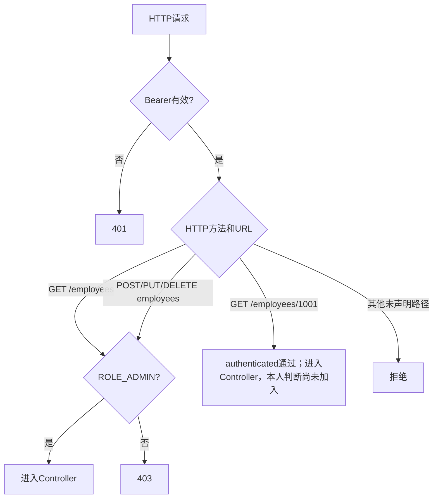
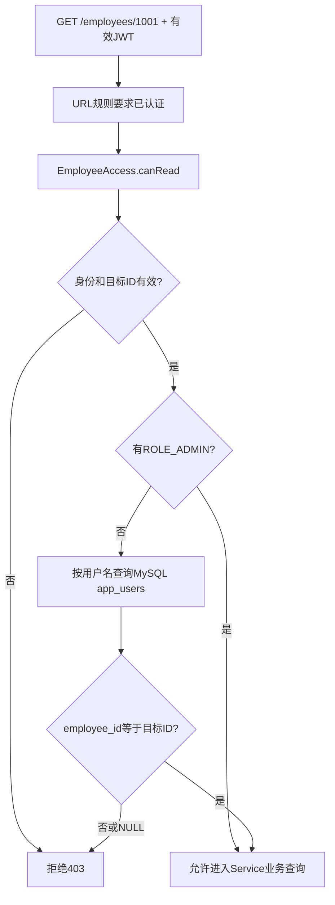

# 第16章 JWT角色授权与本人数据范围

继续使用第15章Employee Management工程：账号从MySQL读取，`POST /auth/login`返回15分钟JWT；本章不改注册、登录、签名和员工CRUD。学习成果是两类授权：**角色**决定能否执行某操作，**数据范围**决定能否读取某条员工记录。第13章事务、第14章分页仍保留；仅增加权限配置与本人判断。最终文件在[R16](../reference/R16_authorization_complete_source.md)，正文已给出完成本章所需代码。

## 16-01 已认证不等于有全部权限

第15章登录时，`AuthenticationManager`从MySQL验证账号，并把当时的角色写进签名JWT的`roles`。后续请求显式带`Authorization: Bearer <token>`：Spring Security先验签、检查`iss/aud/nbf/exp`，才把`sub`变成当前用户名、把`roles`变成权限。它不从Session恢复身份，也不会自动把`employee_id`写入Token。

```text
登录：MySQL账号 → 密码验证 → roles写入JWT
后续：Bearer → 验签及时间 → Authentication(用户名、角色)
授权：角色规则；必要时再查MySQL中的employee_id
```

`Authentication`表示当前请求已认证的身份，不等于任意员工记录；`ROLE_USER`只能表示角色，不能证明“这条员工是本人”。认证回答“是谁”，角色授权回答“能做什么”，数据范围回答“能访问哪条记录”。三个业务现象分别是：不带Token请求`GET /employees/1001`返回401；tanaka（USER）请求管理员才能执行的`GET /employees`返回403；tanaka请求sato的详情`GET /employees/1002`也返回403，但原因是数据归属不同。先用Postman登录tanaka，再在独立`GET /auth/me`请求中加Bearer，应200；无Token应401。

## 16-02 先确定本项目的权限规格

下面是Employee Management的**业务权限规格**，不是Spring Security自动提供的默认规则。正式项目应从需求、基本设计书或权限一览表确定，再把规则实现到后端；前端隐藏按钮只能改善显示，不能替代后端拒绝。

| 操作 | USER | ADMIN | 判断位置 |
| --- | --- | --- | --- |
| `GET /auth/me` | 允许 | 允许 | URL要求已认证 |
| `GET /employees`列表 | 拒绝 | 允许 | URL角色规则 |
| `GET /employees/{id}`本人 | 允许 | 允许 | URL先要求认证，Service再判本人 |
| `GET /employees/{id}`他人 | 拒绝 | 允许 | Service数据范围 |
| `POST /employees`新增 | 拒绝 | 允许 | URL角色规则 |
| `PUT /employees/{id}`修改 | 拒绝 | 允许 | URL角色规则 |
| `DELETE /employees/{id}`删除 | 拒绝 | 允许 | URL角色规则 |

练习数据保持连续：tanaka是USER并绑定员工1001；sato是USER并绑定1002；admin是ADMIN且不绑定员工。公开注册的普通账号默认没有`employee_id`，不能因拥有USER角色就读取任意员工详情。第15章登录时查询MySQL并把角色放进JWT；第16章先将JWT角色转换为权限，再用这张表决定URL访问和本人数据。

## 16-03 从JWT的roles建立ROLE_USER/ROLE_ADMIN

默认JWT资源服务器通常从scope生成`SCOPE_`权限；本项目Token使用`roles`声明，必须明确转换。`JwtGrantedAuthoritiesConverter.setAuthoritiesClaimName("roles")`指定读取哪个声明，`setAuthorityPrefix("ROLE_")`生成`ROLE_USER`等。`JwtAuthenticationConverter`将此转换应用到请求的`Authentication`。因此`hasRole("ADMIN")`检查的是`ROLE_ADMIN`。

下面是**将于16-04加入`SecurityConfig`的Bean方法片段**，此处先看角色数据怎样变形；不要在项目中复制出第二个`SecurityConfig`：

```java
// 功能：把已验签JWT中的roles声明转换为Spring Security权限对象。
@Bean
public JwtAuthenticationConverter jwtAuthenticationConverter() {
    JwtGrantedAuthoritiesConverter roles = new JwtGrantedAuthoritiesConverter();
    // 功能：从本项目自定义roles列表取值，而非默认scope声明。
    roles.setAuthoritiesClaimName("roles");
    // 功能：把ADMIN转换为ROLE_ADMIN，供hasRole("ADMIN")检查。
    roles.setAuthorityPrefix("ROLE_");
    JwtAuthenticationConverter converter = new JwtAuthenticationConverter();
    converter.setJwtGrantedAuthoritiesConverter(roles);
    return converter;
}
```

- `JwtGrantedAuthoritiesConverter`：从**已经验签**的JWT提取权限声明；`setAuthoritiesClaimName("roles")`指定读取本项目的`roles`列表，`setAuthorityPrefix("ROLE_")`为每个值加上角色前缀。
- `JwtAuthenticationConverter`：把已验证的JWT整体转换为当前请求的`Authentication`，其中包含由上一个转换器创建的`GrantedAuthority`权限对象。
- `hasRole("ADMIN")`、`hasAuthority("ROLE_ADMIN")`：在本配置下检查同一权限；`hasRole`会按角色约定寻找`ROLE_ADMIN`，`hasAuthority`则检查传入的完整字符串。不能在`hasRole`里再写`ROLE_ADMIN`。

```text
MySQL app_users.role=ADMIN【登录时查询】
  → UserDetails.roles("ADMIN")
  → 已认证Authentication含ROLE_ADMIN
  → JwtTokenService签发roles=["ADMIN"]
  → 后续请求：JwtDecoder先验签
  → JwtGrantedAuthoritiesConverter读取roles并加ROLE_前缀
  → 当前Authentication含GrantedAuthority("ROLE_ADMIN")
  → hasRole("ADMIN")通过
```

**先验签，后信任角色。** 客户端改JWT的`roles`会破坏签名，不能因此获得ADMIN；数据库改角色后，旧Token仍维持原声明至到期，这是15分钟JWT的快照边界。用tanaka和admin分别登录，观察两份JWT的`roles`（仅本地解码观察，不能把未验签Payload当成授权依据）与16-08中当前`Authentication.getAuthorities()`的`ROLE_USER`、`ROLE_ADMIN`；不要在截图中暴露完整Token。

## 16-04 URL层：角色决定能否操作

先定规则：公开接口仅`/health`、`/error`、注册、登录；`/auth/me`要身份；员工列表和写操作仅ADMIN；员工详情先允许已登录，再由Service判断本人。顺序重要：较具体的GET列表与GET详情规则必须正确匹配，`anyRequest().denyAll()`兜底拒绝未列出的接口。`HttpMethod`表示请求方法；`requestMatchers`同时按方法和路径匹配。匿名访问受保护资源401，已认证USER访问ADMIN接口403。

本阶段**只修改现有的一个**`src/main/java/com/example/employee/config/SecurityConfig.java`，不新建第二个同名类，也不整体替换文件。操作依次为：

公开的`/auth/register`和`/auth/login`不要求Bearer；受保护请求先由JWT组件验签并建立身份，再由URL规则检查角色。`authenticated()`只说明“已确认是谁”，并不说明“1002是本人”；详情的数据范围要在16-06由Service方法安全代理检查，`EmployeeAccess`不是HTTP Filter。

1. 加入`org.springframework.http.HttpMethod`、`org.springframework.security.oauth2.server.resource.authentication.JwtAuthenticationConverter`和`JwtGrantedAuthoritiesConverter`导入，把16-03的`jwtAuthenticationConverter()` Bean方法加入现有类中。
2. 将已有`securityFilterChain(...)`方法签名替换为下方两参数版本；`converter`由Spring注入，不是在每个请求中新建。
3. 用下方规则**整体替换**原`authorizeHttpRequests(...)`调用块；保留原密码编码器、认证管理器、无状态、CSRF、表单/Basic关闭和当前401处理。
4. 只替换原`oauth2ResourceServer(...)`中的`.jwt(Customizer.withDefaults())`为下方`.jwt(jwt -> ...)`，把角色转换器交给Resource Server；删掉已不使用的`Customizer`导入。

下方三段均为**同一文件的替换片段**，不是独立Java文件。修改完成后这份阶段配置可启动；此时员工详情仅要求“已认证”，本人限制要到16-06才生效。16-07会提供可核对的最终完整配置。

```java
// 功能：让过滤链取得启动时创建的角色转换器Bean。
public SecurityFilterChain securityFilterChain(
        HttpSecurity http, JwtAuthenticationConverter converter) throws Exception

// 功能：以下整块替换原authorizeHttpRequests(...)；HTTP方法与路径共同匹配。
.authorizeHttpRequests(a -> a
    .requestMatchers("/health", "/error",
            "/auth/register", "/auth/login").permitAll()
    .requestMatchers("/auth/me").authenticated()
    .requestMatchers(HttpMethod.GET, "/employees").hasRole("ADMIN")
    .requestMatchers(HttpMethod.GET, "/employees/*").authenticated()
    .requestMatchers(HttpMethod.POST, "/employees").hasRole("ADMIN")
    .requestMatchers(HttpMethod.PUT, "/employees/*").hasRole("ADMIN")
    .requestMatchers(HttpMethod.DELETE, "/employees/*").hasRole("ADMIN")
    .anyRequest().denyAll())

// 功能：在原oauth2ResourceServer(...)调用内部替换jwt配置。
.jwt(jwt -> jwt.jwtAuthenticationConverter(converter))
```

- `requestMatchers(HttpMethod.GET, "/employees")`：同时匹配GET方法和列表URL，交给`hasRole("ADMIN")`；前端隐藏列表按钮不能代替这一后端规则。
- `requestMatchers(HttpMethod.GET, "/employees/*")`：匹配单段员工详情URL，`authenticated()`只确认身份**不判断本人**。下一阶段会增加数据范围判断。
- POST/PUT/DELETE规则：对应权限矩阵中的新增、修改、删除，只有`ROLE_ADMIN`通过；`anyRequest().denyAll()`拒绝其余未声明的接口。
- `.jwt(jwt -> jwt.jwtAuthenticationConverter(converter))`：让已验签JWT使用本章的`roles→ROLE_`转换；否则默认scope映射不一定产生`ROLE_ADMIN`。



该图省略公开接口及JWT验签失败分支：匿名或错误Token先返回401，不会因为没有角色而被当作403。修改后用Eclipse启动，tanaka与admin分别登录取Token，再用Postman请求`GET http://localhost:8080/employees`（无查询参数/请求体）：前者403，后者200。此时`GET /employees/1002`对tanaka**仍可能200**，这是尚未加入本人判断的阶段状态，不能当作最终权限完成。

## 16-05 数据范围：这条员工资料是否属于本人

tanaka和sato都拥有`ROLE_USER`，但tanaka只绑定员工1001，sato只绑定1002。角色只表示用户类别，不能证明任意员工记录“属于本人”。账号表的`employee_id`只由受信任的服务端流程维护；公开注册账号默认NULL。不能用请求参数“我是1001”决定授权，也不把`employee_id`写入本项目JWT。数据库账号角色是登录时的JWT快照，员工关联则在每次详情授权时查询MySQL。

| 当前账号 | JWT角色 | MySQL中的`employee_id` | 请求目标 | 结果 |
| --- | --- | --- | --- | --- |
| tanaka | USER | 1001 | `/employees/1001` | 本人，允许 |
| tanaka | USER | 1001 | `/employees/1002` | 他人，403 |
| sato | USER | 1002 | `/employees/1002` | 本人，允许 |
| admin | ADMIN | NULL | `/employees/1001`或`1002` | 管理员，允许 |
| 新注册未绑定账号 | USER | NULL | `/employees/1001` | 无本人关系，403 |

### 新建EmployeeAccess.java

```java
package com.example.employee.security;

import com.example.employee.entity.AppUser;
import com.example.employee.mapper.AppUserMapper;
import org.springframework.security.core.Authentication;
import org.springframework.stereotype.Component;

// 功能：注册为名叫employeeAccess的Bean，供@PreAuthorize表达式引用。
@Component("employeeAccess")
public class EmployeeAccess {

    private final AppUserMapper appUserMapper;

    public EmployeeAccess(AppUserMapper appUserMapper) {
        this.appUserMapper = appUserMapper;
    }

    // 功能：先检查身份和目标ID，再允许ADMIN或查询普通用户的员工关联。
    public boolean canRead(
            Authentication authentication, Long employeeId) {
        // 功能：没有有效身份或目标ID时，默认拒绝。
        if (authentication == null
                || !authentication.isAuthenticated()
                || employeeId == null) {
            return false;
        }
        // 功能：管理员无需拥有employee_id，可直接读取详情。
        boolean isAdmin = authentication.getAuthorities().stream()
                .anyMatch(authority ->
                        "ROLE_ADMIN".equals(authority.getAuthority()));
        if (isAdmin) {
            return true;
        }
        // 功能：普通用户按JWT中的可信用户名查当前数据库关联，不能信任请求自报ID。
        AppUser currentUser =
                appUserMapper.findByUsername(authentication.getName());
        return currentUser != null
                && employeeId.equals(currentUser.getEmployeeId());
    }
}
```

- `@Component("employeeAccess")`：Spring创建这个授权检查Bean，表达式`@employeeAccess`按Bean名找到它；构造器注入`AppUserMapper`，不在每次请求新建Mapper。
- `canRead(Authentication authentication, Long employeeId)`：输入分别是本次Bearer验签后的身份和Service方法第一个参数（目标员工ID）；返回`true`允许继续，`false`拒绝。
- `authentication == null`、`isAuthenticated()`、`employeeId == null`：缺身份、未认证或目标ID无效均默认拒绝，避免空值放行。
- `getAuthorities()`：检查当前JWT转换出的权限；有`ROLE_ADMIN`直接允许，所以admin可以不绑定员工。
- `authentication.getName()`、`appUserMapper.findByUsername(...)`：对普通USER，取已验签JWT的`sub`用户名，再查询MySQL当前账号；这行会再次执行`app_users`的SELECT，但**不是重新比较密码**。
- `currentUser.getEmployeeId()`、`employeeId.equals(...)`：比较数据库当前绑定员工ID与请求目标ID；未绑定或账号查不到即返回`false`。返回值交给下节的`@PreAuthorize`决定是否调用真正业务方法。

本课程只有USER与ADMIN：ADMIN直接通过，其余已认证账号按`employee_id`比较。若将来加入GUEST、AUDITOR等角色，不能默认它们也有“本人读取”权限，必须先重新审查URL规则和`canRead()`的角色条件；本节不引入额外RBAC框架。



图中`EmployeeAccess`被调用需要下节先启用方法安全。16-04阶段只有URL规则，尚不会执行`canRead()`；加入16-06的注解后，tanaka请求1001预期200，请求1002预期403，admin请求二者预期按业务数据返回200，未绑定USER请求1001预期403。数据范围拒绝时不能把目标员工不存在误判为404：授权未通过前不会执行真正员工查询。

## 16-06 用方法级权限在Service入口执行本人判断

`@EnableMethodSecurity`启用方法级授权；`@PreAuthorize`在进入目标方法前计算表达式。`@employeeAccess`引用上节Spring Bean，`authentication`是当前Bearer请求建立的身份，`#p0`是方法第一个参数（目标员工ID）。返回false时业务查询不会执行，预期403；有权限但数据不存在，才进入原业务逻辑返回404。此处只增加接口注解，不重写第13章事务和第14章分页实现。

先在**16-04已经修改的同一个**`SecurityConfig`类声明上加`@EnableMethodSecurity`，并导入`org.springframework.security.config.annotation.method.configuration.EnableMethodSecurity`；没有这一步，下面的`@PreAuthorize`不会按预期拦截。此阶段仍能使用16-04的过滤链启动；16-07再统一401/403 JSON。

### 完整替换EmployeeService.java

```java
package com.example.employee.service;

import com.example.employee.dto.request.EmployeeCreateRequest;
import com.example.employee.dto.request.EmployeeSearchRequest;
import com.example.employee.dto.request.EmployeeUpdateRequest;
import com.example.employee.dto.response.EmployeeListItemResponse;
import com.example.employee.dto.response.EmployeeResponse;
import com.example.employee.dto.response.PageResponse;
import org.springframework.security.access.prepost.PreAuthorize;

// 功能：只对员工详情增加本人数据范围检查，其他接口保留原业务契约。
public interface EmployeeService {

    // 功能：在真正查询员工之前检查ADMIN或本人绑定关系。
    @PreAuthorize("@employeeAccess.canRead(authentication, #p0)")
    EmployeeResponse findById(Long id);

    PageResponse<EmployeeListItemResponse> search(
            EmployeeSearchRequest request);

    EmployeeResponse create(EmployeeCreateRequest request);

    EmployeeResponse update(Long id, EmployeeUpdateRequest request);

    void delete(Long id);
}
```

- `@EnableMethodSecurity`：让Spring为受保护的Service方法创建授权拦截，默认启用`@PreAuthorize`；它不是每次请求都新建一个安全配置。
- `@PreAuthorize("@employeeAccess.canRead(authentication, #p0)")`：在外部调用`findById(Long id)`进入方法体**之前**执行表达式。`@employeeAccess`指16-05的Bean，`authentication`来自本次JWT认证，`#p0`对应第一个参数`id`，返回`false`时抛拒绝异常，业务员工SELECT不执行。
- 代理边界：Spring通过Service Bean代理拦截外部调用；同一个对象内部用`this.findById(...)`自调用可能绕过方法级拦截，因此不能把单个注解当作全系统安全保证。
- 当前保护范围：本人检查只作用于`findById()`；`search/create/update/delete`依赖16-04的HTTP URL角色规则。若将来出现定时任务、消息消费者或其他非HTTP入口直接调用敏感Service，必须另做方法级权限或业务校验，不能只依赖URL规则。

只给`findById()`增加方法级数据范围检查，不重写第13章事务与第14章分页实现，也不要删除`EmployeeServiceImpl`中的查询、事务和履历代码。对有权限但数据库不存在的员工ID，`canRead()`对ADMIN返回`true`，随后原Service查询返回404；对无权限的USER先返回403。


## 16-07 统一401、403与业务404

`AuthenticationEntryPoint`处理缺失或无效Bearer造成的401；`AccessDeniedHandler`处理已认证但无权访问造成的403。JWT Bearer异常有时直接在资源服务器过滤器内发生，所以完整配置在`exceptionHandling`和`oauth2ResourceServer`两处连接401/403处理器。两者都不应该把内部异常堆栈或Token值返回给客户端。下列文件完整新建，`ApiResponse.failure`沿用第7章。

| 现象 | 发生位置 | 处理者与HTTP状态 |
| --- | --- | --- |
| 登录名不存在、密码错误或账号停用 | Controller调用的账号密码认证 | 第15章`AuthExceptionHandler`返回401 |
| 无Bearer、JWT过期、签名错误 | Controller之前的Security过滤链 | `RestAuthenticationEntryPoint`返回401及`WWW-Authenticate: Bearer` |
| USER访问ADMIN列表或写接口 | URL角色授权 | `RestAccessDeniedHandler`返回403 |
| USER读取他人详情 | Service方法级授权 | 当前工程的MVC处理器不捕获此拒绝异常；异常返回过滤链后由`RestAccessDeniedHandler`返回403 |
| ADMIN或本人有权查询，但员工行不存在 | 原`EmployeeServiceImpl.findById()`业务查询 | 第8章业务异常处理返回404 |

过滤链上的URL拒绝发生在Spring MVC之前，单靠`@RestControllerAdvice`接不住；登录Controller调用认证器失败则由MVC内部的`AuthExceptionHandler`处理。**方法级拒绝不同：**详情URL先通过，Controller调用Service代理时，`@PreAuthorize`调用`EmployeeAccess.canRead()`；若返回`false`，代理抛`AccessDeniedException`，`EmployeeServiceImpl.findById()`方法体不会执行。当前第8章`GlobalExceptionHandler`只处理指定业务/校验异常，`AuthExceptionHandler`只处理注册冲突和认证异常，都不匹配`AccessDeniedException`；因此异常可从MVC继续向外传播，由Security过滤链中的`ExceptionTranslationFilter`交给`RestAccessDeniedHandler`写403 JSON。若日后加入`@ExceptionHandler(Exception.class)`等兜底处理器，必须重新检查这条路径，不能仍假定所有方法级拒绝都会到达过滤链。统一响应结构是`{"success":false,"message":"...","data":null}`，但不同错误消息不得泄露账号存在情况或内部堆栈。

### 新建RestAuthenticationEntryPoint.java

```java
package com.example.employee.exception;

import com.example.employee.common.ApiResponse;
import tools.jackson.databind.ObjectMapper;
import jakarta.servlet.ServletException;
import jakarta.servlet.http.HttpServletRequest;
import jakarta.servlet.http.HttpServletResponse;
import org.springframework.http.MediaType;
import org.springframework.security.core.AuthenticationException;
import org.springframework.security.web.AuthenticationEntryPoint;
import org.springframework.stereotype.Component;

import java.io.IOException;

// 功能：把未认证或无效Bearer请求转换成统一401 JSON。
@Component
public class RestAuthenticationEntryPoint
        implements AuthenticationEntryPoint {

    private final ObjectMapper objectMapper;

    public RestAuthenticationEntryPoint(ObjectMapper objectMapper) {
        this.objectMapper = objectMapper;
    }

    // 功能：Security过滤链发现缺身份或认证失败时写入响应。
    @Override
    public void commence(
            HttpServletRequest request,
            HttpServletResponse response,
            AuthenticationException exception)
            throws IOException, ServletException {
        response.setStatus(HttpServletResponse.SC_UNAUTHORIZED);
        response.setHeader("WWW-Authenticate", "Bearer");
        response.setContentType(MediaType.APPLICATION_JSON_VALUE);
        response.setCharacterEncoding("UTF-8");
        objectMapper.writeValue(
                response.getOutputStream(),
                ApiResponse.failure("请先登录"));
    }
}
```

- `AuthenticationEntryPoint`、`commence(...)`：Spring Security对未认证请求的失败出口；三个参数分别是当前请求、响应和认证异常。这里不把异常消息或Token返回给客户端。
- `tools.jackson.databind.ObjectMapper`：Spring Boot 4.1.1工程使用的Jackson对象映射器，构造器由Spring注入；`writeValue(response.getOutputStream(), ApiResponse.failure(...))`直接写统一JSON响应。
- `SC_UNAUTHORIZED`、`WWW-Authenticate: Bearer`：分别是HTTP 401状态和Bearer认证提示头；响应Content-Type为`application/json`，编码为UTF-8。

### 新建RestAccessDeniedHandler.java

```java
package com.example.employee.exception;

import com.example.employee.common.ApiResponse;
import tools.jackson.databind.ObjectMapper;
import jakarta.servlet.ServletException;
import jakarta.servlet.http.HttpServletRequest;
import jakarta.servlet.http.HttpServletResponse;
import org.springframework.http.MediaType;
import org.springframework.security.access.AccessDeniedException;
import org.springframework.security.web.access.AccessDeniedHandler;
import org.springframework.stereotype.Component;

import java.io.IOException;

// 功能：把已有身份但无角色或本人权限的请求转换成统一403 JSON。
@Component
public class RestAccessDeniedHandler implements AccessDeniedHandler {

    private final ObjectMapper objectMapper;

    public RestAccessDeniedHandler(ObjectMapper objectMapper) {
        this.objectMapper = objectMapper;
    }

    // 功能：URL或方法级授权拒绝时写入响应，不进入正常业务结果。
    @Override
    public void handle(
            HttpServletRequest request,
            HttpServletResponse response,
            AccessDeniedException exception)
            throws IOException, ServletException {
        response.setStatus(HttpServletResponse.SC_FORBIDDEN);
        response.setContentType(MediaType.APPLICATION_JSON_VALUE);
        response.setCharacterEncoding("UTF-8");
        objectMapper.writeValue(
                response.getOutputStream(),
                ApiResponse.failure("没有该操作的权限"));
    }
}
```

- `AccessDeniedHandler`、`handle(...)`：Spring Security对已认证但授权失败请求的出口；`AccessDeniedException`在此只用于确定拒绝，不把内部细节返回客户端。
- `SC_FORBIDDEN`、`ApiResponse.failure(...)`：分别设置HTTP 403和本项目统一失败响应。与401不同，403不表示“需要重新登录”，而是当前身份没有该权限。


### 最终SecurityConfig完整核对

下列配置是本章完成状态；等两个JSON处理器创建后，**完整替换原`SecurityConfig.java`文件**，不要保留16-04的第二份阶段类。它保留第15章的密码编码、认证管理器、无状态策略及JWT验证，只新增角色转换、URL规则和JSON失败出口。

保留第15章`JwtConfig`、注册、数据库认证、JWT签发以及员工CRUD全部文件。只替换下方`SecurityConfig`。`roles`声明来自第15章登录时查出的数据库角色；资源服务器默认会把scope映射为`SCOPE_`，因此这里显式指定`roles`并加`ROLE_`前缀，让`hasRole("ADMIN")`匹配`ROLE_ADMIN`。

```java
package com.example.employee.config;

import com.example.employee.exception.RestAccessDeniedHandler;
import com.example.employee.exception.RestAuthenticationEntryPoint;
import com.example.employee.security.AppUserDetailsService;
import org.springframework.context.annotation.Bean;
import org.springframework.context.annotation.Configuration;
import org.springframework.http.HttpMethod;
import org.springframework.security.authentication.AuthenticationManager;
import org.springframework.security.authentication.ProviderManager;
import org.springframework.security.authentication.dao.DaoAuthenticationProvider;
import org.springframework.security.config.annotation.method.configuration.EnableMethodSecurity;
import org.springframework.security.config.annotation.web.builders.HttpSecurity;
import org.springframework.security.config.annotation.web.configurers.AbstractHttpConfigurer;
import org.springframework.security.config.http.SessionCreationPolicy;
import org.springframework.security.crypto.bcrypt.BCryptPasswordEncoder;
import org.springframework.security.crypto.password.PasswordEncoder;
import org.springframework.security.oauth2.server.resource.authentication.JwtAuthenticationConverter;
import org.springframework.security.oauth2.server.resource.authentication.JwtGrantedAuthoritiesConverter;
import org.springframework.security.web.SecurityFilterChain;

// 功能：启动时建立JWT角色转换、URL授权与方法级权限所需组件。
@Configuration
@EnableMethodSecurity
public class SecurityConfig {
    @Bean
    public PasswordEncoder passwordEncoder() {
        return new BCryptPasswordEncoder();
    }

    @Bean
    public AuthenticationManager authenticationManager(
            AppUserDetailsService users, PasswordEncoder encoder) {
        DaoAuthenticationProvider provider = new DaoAuthenticationProvider(users);
        provider.setPasswordEncoder(encoder);
        return new ProviderManager(provider);
    }

    // 功能：把已验签JWT的roles转换成ROLE_前缀权限。
    @Bean
    public JwtAuthenticationConverter jwtAuthenticationConverter() {
        JwtGrantedAuthoritiesConverter roles = new JwtGrantedAuthoritiesConverter();
        roles.setAuthoritiesClaimName("roles");
        roles.setAuthorityPrefix("ROLE_");
        JwtAuthenticationConverter converter = new JwtAuthenticationConverter();
        converter.setJwtGrantedAuthoritiesConverter(roles);
        return converter;
    }

    // 功能：统一连接认证、URL角色授权、Bearer验签和401/403出口。
    @Bean
    public SecurityFilterChain securityFilterChain(
            HttpSecurity http,
            JwtAuthenticationConverter converter,
            RestAuthenticationEntryPoint unauthorized,
            RestAccessDeniedHandler forbidden) throws Exception {
        http
            .csrf(AbstractHttpConfigurer::disable)
            .sessionManagement(s -> s.sessionCreationPolicy(SessionCreationPolicy.STATELESS))
            .formLogin(AbstractHttpConfigurer::disable)
            .httpBasic(AbstractHttpConfigurer::disable)
            .logout(AbstractHttpConfigurer::disable)
            // 功能：按业务权限矩阵从上到下匹配HTTP方法和URL。
            .authorizeHttpRequests(a -> a
                .requestMatchers("/health", "/error",
                        "/auth/register", "/auth/login").permitAll()
                .requestMatchers("/auth/me").authenticated()
                .requestMatchers(HttpMethod.GET, "/employees").hasRole("ADMIN")
                .requestMatchers(HttpMethod.GET, "/employees/*").authenticated()
                .requestMatchers(HttpMethod.POST, "/employees").hasRole("ADMIN")
                .requestMatchers(HttpMethod.PUT, "/employees/*").hasRole("ADMIN")
                .requestMatchers(HttpMethod.DELETE, "/employees/*").hasRole("ADMIN")
                .anyRequest().denyAll())
            // 功能：未认证返回401，有身份但无权限返回403。
            .exceptionHandling(e -> e
                .authenticationEntryPoint(unauthorized)
                .accessDeniedHandler(forbidden))
            // 功能：Bearer验签后用roles转换器建立当前Authentication。
            .oauth2ResourceServer(o -> o
                .authenticationEntryPoint(unauthorized)
                .accessDeniedHandler(forbidden)
                .jwt(j -> j.jwtAuthenticationConverter(converter)));
        return http.build();
    }
}
```

Bearer验证先由`JwtDecoder`检查签名、HS256、iss、aud、nbf、exp，再由Converter把`roles=["USER"]`转成`ROLE_USER`。JWT中的角色是签发时快照，数据库改角色或停用账号不会立即撤销旧Token；本课15分钟后到期，敏感系统还要设计撤销或短期令牌策略。

```mermaid
flowchart TD
    A[HTTP请求] --> P{公开注册或登录?}
    P -->|是| O[无需Bearer，进入对应Controller]
    P -->|否| B{有效Bearer?}
    B -->|否| C[Security过滤链的EntryPoint：401 JSON]
    B -->|是| D{URL角色规则通过?}
    D -->|否| E[Security的AccessDeniedHandler：403 JSON]
    D -->|是| F[Controller]
    F --> H{员工详情?}
    H -->|否| G[原业务Service]
    H -->|是| M[Service方法安全代理执行@PreAuthorize]
    M --> N{EmployeeAccess.canRead?}
    N -->|否| X[AccessDeniedException向外传播]
    X --> E
    N -->|是| I[EmployeeServiceImpl.findById]
    I -->|员工不存在| J[MVC业务异常处理：404 JSON]
    I -->|员工存在| K[200 JSON]
```

这张图省略方法安全代理内部细节；登录密码错误是第15章MVC异常处理的401，而不是Bearer过滤器的401。`RestAuthenticationEntryPoint`、`RestAccessDeniedHandler`在启动时创建为Bean，请求失败时才分别调用`commence()`或`handle()`。图中的方法级403路径依赖上文已经核查的异常处理配置；Eclipse断点还应核对`EmployeeServiceImpl.findById()`未进入，不能仅凭403状态码证明本人规则生效。

### 本地验证数据

在个人练习库准备员工1001/Tanaka、1002/Sato及账号tanaka(USER→1001)、sato(USER→1002)、admin(ADMIN→NULL)、disabled-user(停用)。账号密码哈希通过第15章`PasswordEncoder.encode`生成，不能存明文。不要对已有练习库执行`DROP TABLE`。如果需要完整的专用测试库初始化脚本，应另建隔离数据库，先核对库名再执行；第16章主线不要求JUnit/MockMvc。

## 16-08 Postman与数据库综合验收

每个账号都用`POST http://localhost:8080/auth/login`取得自己的Token（JSON为`{"username":"tanaka","password":"TrainingPass123!"}`，切换sato/admin时只改用户名）；切换账号时替换Bearer头。无Token与非法Token是401，已认证但不满足角色或本人规则是403，已获授权但员工不存在才是404。写请求无须CSRF Header，但必须带ADMIN Bearer；不能通过关闭过滤链来让测试通过。

### Postman权限矩阵

分别用tanaka、sato、admin登录取得各自Bearer Token；切换身份时替换`Authorization`头，不能只换JSON用户名。下表相对URL均以`http://localhost:8080`为前缀；每次受保护请求都写`Authorization: Bearer <对应Token>`，无请求体的GET也不例外。没有标明的查询参数均不提交。

| 身份 | 方法、URL | 请求参数与请求体 | 预期状态/响应 |
| --- | --- | --- | --- |
| 无Token | GET `/employees/1001` | 无 | 401 JSON |
| 无Token | POST `/employees` | 下方新增JSON | 401 JSON，数据库无新增 |
| tanaka | GET `/employees/1001` | 无 | 200，data.id=1001 |
| tanaka | GET `/employees/1002` | 无 | 403 JSON |
| sato | GET `/employees/1002` | 无 | 200，data.id=1002 |
| 注册后未绑定员工USER | GET `/employees/1001` | 无 | 403 JSON |
| admin | GET `/employees?page=1&pageSize=20&sortBy=id&sortDirection=asc` | 四个查询参数；无请求体 | 200，`data.items`、`page=1`、`pageSize=20`、`total`、`totalPages` |
| admin | GET `/employees/1001` | 无 | 200，data.id=1001 |
| tanaka | GET `/employees` | 无 | 403 JSON |
| tanaka | POST `/employees` | JSON员工资料 | 403 JSON，数据库无新增 |
| tanaka | PUT `/employees/1002` | JSON员工资料 | 403 JSON，数据库原值不变 |
| tanaka | DELETE `/employees/1002` | 无 | 403 JSON，数据库原值不变 |
| admin | POST `/employees` | JSON员工资料 | 201，新员工入库 |
| admin | PUT `/employees/1002` | 下方完整修改JSON | 200，`data.id=1002`及修改后的姓名/部门/邮箱；数据库原值更新，测试后恢复练习数据 |
| admin | GET `/employees/999999` | 无 | 404 JSON |
| admin | DELETE `/employees/1002` | 无；最后执行 | 204，数据库1002已删除 |
| 修改过的Token | GET `/auth/me` | 无 | 401 JSON |
| 过期Token | GET `/employees` | 无 | 401 JSON |

写请求Body具体使用：无Token或USER被拒绝的POST为`{"name":"Blocked","department":"Sales","email":"blocked@example.com"}`；ADMIN成功POST为`{"name":"Allowed","department":"Sales","email":"allowed@example.com"}`；越权PUT为`{"name":"Sato Edited","department":"Development","email":"sato@example.com"}`；ADMIN成功PUT也可使用这三个字段，建议先记录1002原值，验证后恢复。`EmployeeCreateRequest`与`EmployeeUpdateRequest`都要求`name`、`department`、`email`三个JSON字段；`department`须为Sales、Development或Support。POST/PUT均设置`Content-Type: application/json`，DELETE无请求体。与第10章原CRUD契约一致：详情200；新增201并带`Location: /employees/{id}`及保存后的`data`；修改200并返回更新后的`data`；删除204且无响应体；获授权但目标不存在由业务异常返回404。分页查询参数`name`、`department`、`status`可选；`page`默认1、`pageSize`默认20、`sortBy`默认id、`sortDirection`默认asc，成功响应的`data`是分页对象，不是直接的员工数组。

POST/PUT/DELETE均无CSRF Header，本工程认证只取Bearer请求头；缺Token写请求预期401。任何被拒绝的写请求应查询数据库验证无变化。先做详情再删除测试数据，避免后续404被误认为权限错误。旧Token在客户端“退出”后仍有效至到期，不声称服务端已吊销。

操作顺序：先在个人练习库核对1001、1002和三名账号的关联；分别`POST /auth/login`取得tanaka、sato、admin三份Token，Postman环境变量可以命名为`tanakaToken`、`satoToken`、`adminToken`，切换身份时确认Bearer字段确实换成对应值。再按表从GET到写请求执行，每次记录HTTP状态、脱敏响应及前后数据库值。下列查询只读，用来核对越权请求没有产生副作用：

```sql
-- 功能：确认账号角色和员工绑定；不查询或展示密码哈希。
SELECT username, role, employee_id, enabled
FROM app_users
WHERE username IN ('tanaka', 'sato', 'admin');

-- 功能：对照被拒绝的新增、修改、删除是否改变了员工数据。
SELECT id, name, department, email FROM employees WHERE id IN (1001, 1002);
SELECT COUNT(*) AS blocked_count FROM employees WHERE email = 'blocked@example.com';
```

在Eclipse Debug中逐点观察一次成功和一次拒绝，提交证据时不要暴露完整Token或密码：

| 断点或观察位置 | 请求及预期观察 |
| --- | --- |
| `AuthController.me()`首行 | 正确Bearer命中；无Token、错误Token不进入任何Controller |
| `SecurityConfig.jwtAuthenticationConverter()`创建处 | 只在启动时建Bean，不是每个请求都执行；运行时如需查看转换内部，下载Spring Security源码后在`JwtGrantedAuthoritiesConverter`处断点 |
| `EmployeeAccess.canRead()` | tanaka读取详情时进入；`employeeId`为路径ID，`authentication.getName()`为tanaka；列表403不会进入此方法 |
| `appUserMapper.findByUsername(authentication.getName())` | 普通USER详情会查当前绑定；ADMIN直接通过，不走此查询 |
| `EmployeeServiceImpl.findById()`首行 | 本人/ADMIN通过授权才进入；他人详情403不会进入真正业务查询 |
| `RestAuthenticationEntryPoint.commence()` | 缺Token或无效JWT对应401；不命中Controller |
| `RestAccessDeniedHandler.handle()` | USER列表/写接口或他人详情对应403；不应产生数据库写入 |

框架源码断点需要Eclipse有对应Maven Sources，不要求新人逐行调试第三方实现。注意URL拒绝发生在Controller之前；详情URL通过后可能进入Controller，但会在Service方法代理处被拒绝；只有权限均通过，才执行员工业务SELECT。根据权限矩阵填写实际状态、数据库前后值和断点命中情况；不只照抄预期结果。
